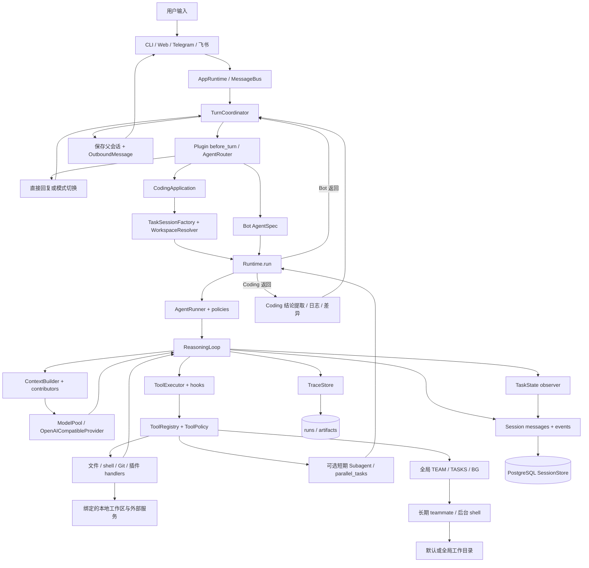
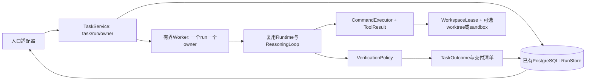

# TaleClaw 整体架构审查与架构决策

审查日期：2026-09-27。本文只涉及代码审查、公开资料调研与设计，不代表已实施改造。

## 1. 结论先行

**本项目已经是一个具备真实工具反馈循环的 Agent runtime，并在其上实现了 Coding 应用、多入口和可选扩展。它适合继续收敛为个人或小团队维护的、以单个主 Agent 为核心的工具型系统。当前最有价值的工作是统一执行边界与结果契约，而不是增加 Agent 数量或换用工作流框架。**

主要判断如下，证据编号见第 3 节，问题详情见第 7 节。

1. **已有能力是实质性的。** `Runtime.run → AgentRunner.run → ReasoningLoop.run` 会反复组装输入、调用模型、执行工具、把结果加入会话，并按预算、取消、错误或最终回复停止；并非只有一次 LLM 请求。[C03–C05]
2. **应用与内核分层值得保留。** Coding 自己创建任务会话、绑定 workspace、保存任务日志和结论；内核通过 contributor/observer 接收应用扩展。此次 AST 检查没有发现 `runtime/` 直接导入 `applications/web/gateway`。但这不意味着全部依赖均已解耦：工具 handler 和全局编排对象仍连接应用层。[C02、C06、C13]
3. **“隔离”“完成”“检查点”必须限定含义。** Coding 隔离的是会话历史；文件仍直接在绑定的工作区修改。无工具调用的最终回复可以结束 run，却不证明测试通过。保存会话、上下文快照和工作区差异，不等于拥有可恢复副作用的事务或文件回滚。[C05–C09]
4. **首要缺陷是跨模块语义不一致。** shell 返回值丢失退出码；后台命令走另一条执行路径并使用全局 cwd；长期 teammate、短期 subagent 和主 Agent 的身份、取消、工作区传播方式不同。已有权限和状态结构应继续使用，但不能将提示词、工具名称或字符串里的“成功”视为系统保障。[C09–C13]
5. **不建议推倒重写。** 先完成结构化执行结果、任务归属、单写者与可验证交付这四项；只有真实出现跨进程恢复、多个可写任务并发或环境隔离需求，再引入 worker、worktree 或容器。向量库、微调、多 Agent 不解决上述契约缺口。

本文不作成功率、性能或线上故障率判断。本轮没有进行真实模型任务对比，也没有启动项目服务。

## 2. 审查基线、范围和证据规则

### 2.1 版本与工作区

| 项目 | 本次记录 |
|---|---|
| 仓库根目录 | `/home/tale/kaggle/mytry` |
| HEAD | `5bc28e8d883a6ab4daf7e8d734ca3a1bcfbe24a2` |
| 提交时间、说明 | `2026-08-18T09:25:54+08:00`；`harden runtime handler and embedding sharing` |
| 开始审查时 tracked 修改 | `git diff --stat` 与 `git diff --cached --stat` 均为空 |
| 开始审查时 untracked | `docs/system-design (2)/`、`os`；未改动，也未作为运行实现的证据 |
| 目标文件原始状态 | `docs/agent-design-review/01-architecture.md` 不存在，本次新建 |
| 结束复核时并行产物 | 同目录另出现 `02-context.md`、`03-memory.md`、`04-reliability.md`、`05-finetuning.md`、`06-evaluation.md`；仅观察文件名，未写入、未纳入本报告的代码事实依据 |
| AGENTS.md | 检查根目录及父目录、`git ls-files '*AGENTS.md'`、相关目录含隐藏文件的文件名扫描，未发现适用文件；没有把未扫描的数据库/模型数据目录视为已审查 |
| 实际审查对象 | 上述 HEAD 的 tracked 源码与当前工作区文件；未读取真实 `.env`、用户聊天记录或私有数据库内容 |

先读了 `README.md`、`pyproject.toml`、目录结构及 `docs/overview/PROJECT_STRUCTURE.md`、`docs/architecture/SYSTEM_ARCHITECTURE.md`，随后用实现核实。旧 `PROJECT_STRUCTURE.md` 仍列出 `runtime/agent_loop.py` 等已不存在路径；当前入口实际在 `applications/turn_coordinator.py`。因此本文没有沿用旧文档的模块名称来证明能力。

外部资料访问日期统一为 **2026-09-27**。开源案例固定到当日读取的 commit，未将浮动 `main`、release 标签和商业产品文档混为同一版本。临时外部源码缓存只放 `/tmp`，项目内只写本报告。

### 2.2 事实标签与检查边界

- **事实／A 级证据**：实际代码分支、接口调用、数据字段或无副作用检查直接支持。
- **推断／B 级证据**：有明确调用链和触发条件的静态推演；没有真实端到端复现。
- **建议**：本文提出的方案；不是当前实现。
- **待验证／C 级证据**：配置、负载、产品语义或运行环境尚未确认。
- **已复现**只用于明确说明方法的内存桩检查，不扩展为真实 shell、越界写入或线上故障已复现。

执行了 Git 状态、文本搜索、源码读取和不导入业务模块的 AST 检查；没有安装依赖、运行训练、发起付费模型实验、连接数据库、启动服务、提交或推送。没有运行完整 pytest：现有测试包含数据库和应用装配路径，本轮以读测试代码识别覆盖范围；“有测试”不等于“本轮测试通过”。

AST 检查统计：`applications` 20 个 Python 文件、5,835 行；`runtime` 81 个、17,835 行；`tools` 8 个、6,559 行；`agents` 13 个、2,048 行；`models` 顶层及包内 Python 4 个、1,778 行；`tests` 127 个、20,619 行。统计包含空行、注释，只用于说明规模，不作为风险评级依据。

## 3. 本地代码证据索引

下列路径均相对仓库根目录，行号对应本次 HEAD。每个条目给出关键符号和能支持的结论；链接用于跳到文件，行号用于精确定位。

| 编号 | 路径、符号、行号 | 支持的事实 |
|---|---|---|
| C01 | [cli.py](../../cli.py) `main_async` L12–45；[applications/app_runtime.py](../../applications/app_runtime.py) `submit_user_message/run_once/run_message` L65–103 | CLI 经消息总线入站；Web 可直接提交单条消息；AppRuntime 是入口门面 |
| C02 | [applications/bootstrap.py](../../applications/bootstrap.py) `build_runtime` L111–133、204–240、282–400 | composition root 装配 session、模型、工具、插件、Runtime、CodingApplication、subagent；RAG 初始化有可降级分支 |
| C03 | [applications/turn_coordinator.py](../../applications/turn_coordinator.py) `run_inbound` L55–93、`_execute` L266–322、`_deliver` L328–346 | 接收、预处理、路由、记消息、执行、后处理、保存、出站；Coding 和普通 run 分流 |
| C04 | [runtime/runtime.py](../../runtime/runtime.py) `Runtime.run/_execute` L87–138；[runtime/execution/agent_runner.py](../../runtime/execution/agent_runner.py) `run` L72–102 | 单一公开执行入口，每个 run 新建 loop 和 policies；通过 RunContext 传取消、checkpoint、扩展 |
| C05 | [runtime/execution/reasoning_loop.py](../../runtime/execution/reasoning_loop.py) `run` L183–190、310–459，`_reasoning_step` L576 起 | 每步追加 run_checkpoint 事件并调用保存回调；空响应重试；无工具调用最终回复触发 COMPLETED；有工具调用则执行并继续 |
| C06 | [applications/coding/runner.py](../../applications/coding/runner.py) `run_coding_task` L127–164、187–233、235–307；[applications/coding/session.py](../../applications/coding/session.py) `TaskSessionFactory.create` L30–67 | 每次 Coding 请求创建新 UUID task session；绑定原 workspace；保存会话；生成结论与差异 |
| C07 | [runtime/sessions/session.py](../../runtime/sessions/session.py) `Session` L20–49、`add_message/append_event` L81–116、`SessionManager` L249–332；[runtime/sessions/session_store.py](../../runtime/sessions/session_store.py) L19–30、343–430、675–693 | messages 和 event_log 并存；PostgreSQL 持久化；本地锁、增量尾部写入；无 DB 版本比较条件 |
| C08 | [runtime/execution/state.py](../../runtime/execution/state.py) `RunExecutionState` L12–62；[runtime/task_state/service.py](../../runtime/task_state/service.py) `TaskStateRunObserver.after_run` L33–79、`load_task_state_core` L82 起 | 每 run 控制态与 durable TaskState 分开；最终回复、无 pending/blocker 时可投影任务完成 |
| C09 | [tools/handlers.py](../../tools/handlers.py) `run_bash` L2402–2415；[tools/executor.py](../../tools/executor.py) `execute` L144–165；[applications/coding/state_updates.py](../../applications/coding/state_updates.py) `_looks_like_test_result` L744–751 | bash 丢弃 returncode；handler 正常返回被包为 success；测试迹象识别不是通过验证 |
| C10 | [tools/hooks.py](../../tools/hooks.py) `ShellSafetyHook/ShellWorkspaceScopeHook/FileWriteScopeHook` L72–153；[runtime/workspace.py](../../runtime/workspace.py) `WorkspaceResolver` L46–93、`safe_workspace_path` L104–117 | 显式路径检查存在；shell 黑名单与绝对 cd 检查不是 OS 权限隔离 |
| C11 | [tools/handlers.py](../../tools/handlers.py) `BACKGROUND_HANDLERS` L2655–2657；[applications/coding/orchestration/background_task.py](../../applications/coding/orchestration/background_task.py) L10–70；[applications/coding/context_contributor.py](../../applications/coding/context_contributor.py) L13–25 | 后台工具未传 session，固定全局 cwd；结果和通知队列全局共享 |
| C12 | [agents/subagent/runner.py](../../agents/subagent/runner.py) L126–135、137–198、320–380；[agents/subagent/parallel.py](../../agents/subagent/parallel.py) L62–89；[agents/subagent/tools.py](../../agents/subagent/tools.py) L1–20、48–64 | 短期子任务有 whitelist、身份/workspace 继承、结构化返回；超时返回不证明线程停止；研究工具仍有 bash |
| C13 | [applications/coding/orchestration/teammate.py](../../applications/coding/orchestration/teammate.py) L235–247、358；[tools/tool_registry.py](../../tools/tool_registry.py) L29–43、151–157、181–186；[applications/bootstrap.py](../../applications/bootstrap.py) L339–345 | 长期 TEAM 全局实例，teammate 的 session 构造没有父 workspace/user 继承；主装配确实传入带 hook 的 executor |
| C14 | [tools/tool_registry.py](../../tools/tool_registry.py) `schemas_for_turn/execute/_tool_search` L303–419、498–529；[tools/policy.py](../../tools/policy.py) | 工具可见性与执行准入分开检查；确定性搜索解锁 deferred tools；异常也可能变成 Error 字符串 |
| C15 | [models/provider.py](../../models/provider.py) `OpenAICompatibleProvider` L34–118、222–253；[models/model_pool.py](../../models/model_pool.py) L145–181、410–481；[models/model_task_runner.py](../../models/model_task_runner.py) L47–83 | Chat Completions/Responses 适配；purpose 路由与 fallback；一次性模型调用使用 tools=[] |
| C16 | [web/server.py](../../web/server.py) `AgentService` L139–154、253–263、340–361、402–456、557–564 | 后台 event loop、Web 会话锁和直接取消入口；run_message 仍同步执行模型/工具段 |
| C17 | [runtime/routing/execution_plan.py](../../runtime/routing/execution_plan.py) L31–40、74–89、109–127；[user_scope.py](../../user_scope.py) L24–65、78–93 | 常规 coding 路由限 admin；user session/storage 的应用级命名空间；未给身份的兼容路径默认 local/admin |
| C18 | [runtime/trace/trace_store.py](../../runtime/trace/trace_store.py) L25–47、57–117；[applications/coding/artifacts.py](../../applications/coding/artifacts.py) `write` L22–65；[runtime/tooling/result_store.py](../../runtime/tooling/result_store.py) L52–119 | run JSON/trace、TASK_LOG、CONCLUSIONS、工具结果 artifact 均有真实写入实现 |
| C19 | [runtime/ports.py](../../runtime/ports.py) L13–90；[runtime/extensions.py](../../runtime/extensions.py) L18–36；[plugins/plugin_manager.py](../../plugins/plugin_manager.py) L33–82 | Context/Model/Tool/Executor ports、contributor/observer、插件 hook 扩展点已存在并被装配 |
| C20 | [runtime/db.py](../../runtime/db.py) L21–62；[pyproject.toml](../../pyproject.toml) L11–31；[requirements-deploy.txt](../../requirements-deploy.txt)；[requirements-rag.txt](../../requirements-rag.txt) | 会话强依赖 PostgreSQL；部署依赖已拆分，pip 项目默认依赖仍包含 RAG 大依赖 |

## 4. 还原实际架构

### 4.1 架构类型与能力边界

项目属于 **应用装配的单主 Agent、工具反馈循环架构，附带可选层级委派与多入口服务**。核心循环类似常见的 observation–action 迭代，但不能据此宣称实现了某篇 ReAct 论文的全部协议。它不是自动 DAG 工作流引擎，也不是以多 Agent 协商为必要条件的系统。

| 能力 | 实现程度 | 实际含义与限制 |
|---|---|---|
| CLI / Web / Telegram / 飞书入口 | 已经实现 | CLI C01；Web C16；`gateway/telegram/adapter.py:65–92,191–211`；`gateway/feishu/adapter.py:93–141`。本轮未连外部渠道验证 |
| 模型—工具—结果反馈循环 | 已经实现 | C04–C05；模型有工具调用继续，无工具调用最终回复退出 |
| Coding 任务会话、用户身份与 workspace 绑定 | 已经实现 | C06、C17；允许根目录检查存在，任务文件仍在绑定仓库执行 |
| 文件读写、搜索、shell、Git 工具 | 已经实现 | C09–C10、`tools/handlers.py` 与 registry；工具被调用才产生效果，不保证模型一定选择正确命令 |
| 任务进度结构与合法状态转换 | 已经实现 | TaskStateCore、patch、observer；`tests/test_shared_runtime_task_state.py:99–175` 有相应断言，未运行 |
| 测试验证和最终通过门禁 | 部分实现 | 可执行测试、有测试迹象和证据结构；缺少退出码、最终文件版本和交付结论的强绑定，见 A01 |
| 多 Agent | 部分实现 | 有真实短期 subagent、并行 executor 和长期 teammate；身份、归属、取消和环境接口不统一，见 A03/A05 |
| checkpoint 与恢复 | 部分实现 | 会话/事件/TaskState 可持久化；当前 Coding 入口总创建新 task，未发现公开的 resume(task_id) 端到端契约，见 A06 |
| 完整文件环境隔离、事务回滚 | 未发现实现 | 存在 sandbox 命名工具/目录及 workspace 检查，但主 bash 直接 `subprocess.run(shell=True)`；不能等同进程/网络隔离 |
| 插件和工具发现 | 已经实现 | 插件 setup、tools、hooks；确定性 deferred tool 搜索，不是插件在 OS 中隔离执行 |
| 原生任意供应商协议 | 部分实现 | 多 provider 配置确实存在，但内置适配落在 OpenAI-compatible Chat/Responses；其他原生协议需新 adapter，见 C15 |
| “研究员只读”、模型自检保证正确 | 只有指令或部分约束 | 研究角色 whitelist 仍有通用 bash；模型反思/最终回答不能提供写权限隔离或正确性证明，见 C12 |
| 自动交付经过独立验证的提交/PR | 未发现默认自动流水线 | 有 Git 工具、差异、日志和回复；并非每项任务都进入强制 commit/PR/test pipeline |

普通 LLM 调用和普通流程编排应单独识别：`HybridModeClassifier.should_use_coding`（`runtime/routing/hybrid_classifier.py:11–47`）是一轮 JSON 分类；`ModelTaskRunner.run_result`（C15）是一轮无工具调用；`TaskConclusionExtractor.extract`（`applications/coding/conclusions.py:37–75`）是一轮事后提取。它们可以辅助 Agent，但本身没有执行—观察闭环。`TurnCoordinator` 的固定接收/路由/交付步骤是应用编排，不是另一个自主 Agent。

### 4.2 模块与数据流



图中的 `G → GW → WW` 是应重点收敛的旁路，不表示所有子 Agent 都遗漏 workspace：短期 `TaskSubagentRunner` 已继承相关身份和 workspace（C12），长期 teammate 和 BG 才是主要不一致来源（C11–C13）。Bot 路径也不需要先经过 Coding 结论提取。

### 4.3 一次 Coding 任务的实际时序

以管理员先设置 `/workspace /allowed/demo`、再切换 coding 并输入“修复解析器并运行相关测试”为例。下图是代码执行顺序，非本轮真实运行记录。

```mermaid
sequenceDiagram
    actor User as 用户
    participant Entry as CLI或Web
    participant Turn as TurnCoordinator
    participant App as CodingApplication
    participant Sess as Session/SessionStore
    participant Loop as Runtime/ReasoningLoop
    participant Model as ModelProvider
    participant Tool as Executor/Registry/Handler
    participant Files as Workspace
    User->>Entry: 输入任务与workspace
    Entry->>Turn: InboundMessage或run_message
    Turn->>Sess: 读取父session，绑定身份
    Turn->>Turn: 插件预处理 + route
    Turn->>Sess: 记录用户消息
    Turn->>App: run_coding_task
    App->>App: 校验workspace，生成handoff
    App->>Sess: 创建新的task:UUID；按需初始化TaskState
    App->>Files: 有trace和run_state时采集before快照
    App->>Loop: Runtime.run(AgentSpec, RunContext)
    loop 预算内且未取消
        Loop->>Sess: 追加run_checkpoint事件；Coding回调保存Session
        Loop->>Loop: 构建上下文，计算可见工具
        Loop->>Model: chat或stream_chat
        Model-->>Loop: 文本及tool_calls
        alt 有tool_calls
            Loop->>Tool: hooks + 执行准入 + handler
            Tool->>Files: 读写文件或运行命令
            Files-->>Tool: 输出（当前bash丢失退出码）
            Tool-->>Loop: ToolExecutionResult
            Loop->>Sess: assistant/tool消息、事件、工具结果引用
        else 最终文本且无tool_calls
            Loop->>Loop: StopDecision=COMPLETED
            Loop->>Sess: observer投影TaskState，保存checkpoint
        end
    end
    Loop-->>App: RunResult及stop_reason
    App->>Model: 一轮无工具的结论提取
    App->>App: 可选memory promotion；写TASK_LOG/CONCLUSIONS
    App->>Sess: 保存task session
    App->>Files: 有trace时采集after快照、生成差异
    App-->>Turn: 回复与task summary
    Turn->>Sess: 保存父session
    Turn-->>Entry: OutboundMessage
    Entry-->>User: 展示结果
```

**验证不是上述时序中的强制独立阶段。** 模型若调用测试命令，观察结果后可以修改、重试；若直接输出最终文本，循环可以结束。预算终止、错误和取消还有单独 stop reason，不能把所有退出都称为成功。`TaskStateRunObserver` 有 pending/blocker 检查，因而 run 已结束而 TaskState 未完成也可能是合法状态，而非必然数据损坏。[C05、C08–C09]

### 4.4 状态归属、持久化和事实来源

| 状态/事实 | 当前 owner 与保存位置 | 架构评价 |
|---|---|---|
| 父会话与 task 会话 | SessionManager 缓存；PostgreSQL `sessions/messages/context_events` 等表，C07 | 身份清楚；两种会话用途不同，不应合并成一个历史 |
| 本次调用预算、工具计数、stop decision | RunExecutionState，C08；相关结果进入 trace/checkpoint | 合理的短生命周期；不是可独立恢复进程的状态机 |
| 任务目标、计划、pending/blocker、状态 | TaskStateCore ＋ coding TaskState 扩展（计划等），在 session metadata/checkpoint 中保存；C08、`applications/coding/task_state.py:251–257` | 主事实来源比散落字符串更好；版本校验只在此对象并不自动保护数据库并发写 |
| messages / event_log / prompt_messages | Session 的三类表示，C07 | 多个表示本身合理；当前既保存 messages 又保存 events，必须明确投影与迁移规则，不能宣称纯事件溯源 |
| Coding 展示状态 | task session metadata.status、父 task summary、run_state.metadata.coding_application，C06 | 应是 Task/Run 的派生展示；当前“completed/stopped”映射比 TaskState 状态更粗 |
| 上下文快照 | Session 的 context_snapshots/archive boundary；ContextBuilder 消费 | 用于上下文恢复/压缩；不是文件系统 checkpoint。本报告不重复专项算法 |
| 工作区文件与差异 | 真实 workspace；trace 开启时写 `.runs/<run>/` 的工作区差异，C06、C18 | 文件才是代码事实；差异记录不是写锁、工作区克隆或事务回滚 |
| task 日志与结论 | `.coding_applications/<task_id>/TASK_LOG.md`、`CONCLUSIONS.json`，C18 | 有审计价值；事后派生结果，不应成为新的任务执行权威 |
| 工具输出、长内容 | 新结果由 ArtifactToolResultStore → ArtifactStore；默认 `.coding_applications/artifacts`；旧 `.tool_results` 后端代码仍存在，C18 | 不因旧目录仍在就断言新写入仍走旧存储 |
| run trace / report | `.runs` 默认根及可选 trace index，C18 | 可观察性已实现；文件写入与 DB 会话保存不是一个原子事务 |
| 多 Agent 状态 | 短期 child result；另有全局 TEAM/TASKS/BG、`.team`、`.tasks`，C11–C13 | 最明显的 ownership 缺口；与 TaskState 的计划/owner/status 职责部分重叠 |
| 长期记忆与检索 | bootstrap 条件装配 repository/command/retrieval/index，C02 L135–203 | 属于可选服务；关闭长期记忆仍需要 PostgreSQL 会话库，二者不能混淆 |

扩展接口已有实际消费者（C19），不应再叠加一套泛型 pipeline。新增能力优先遵循：行为用 `AgentSpec`，上下文材料用 contributor，run 结果投影用 observer，执行能力用 `ToolSpec/ToolPolicy/ToolExecutor`，入口业务用 application，协议差异用 provider adapter。

外部依赖分三层：基础运行依赖 Python 3.12+、OpenAI SDK/HTTP、PostgreSQL；可选检索依赖 Qdrant、embedding/reranker 及相应库；渠道和插件依赖 Telegram/飞书/搜索等外部 API。运行时的可选性和安装包的可选性尚未一致：`requirements-deploy.txt` 已精简，但 `pyproject.toml` 仍将 RAG 库列入默认 dependencies。[C20]

## 5. 外部系统对照：借鉴边界，不复制规模

### 5.1 选型与开源状态核验

选择 mini-SWE-agent、Aider、Codex CLI 三个代码可检查案例，分别代表极简执行闭环、编辑与验证反馈、完整 coding harness；选择 Claude Code 和 Cursor 作为公开产品行为参照。没有为凑数量继续展开 OpenHands、SWE-agent、Cline。这里不把商业产品文档、开源 Agent 实现和通用 Agent 框架视为同一类证据，也不作榜单排名。

| 系统 | 核实版本和许可 | 定位及比较边界 |
|---|---|---|
| mini-SWE-agent | SHA `04d809ceab9df28f9adaed044884180159172930`，提交 2026-09-03；MIT；官方仓库公开、未归档。[M0] | 可运行的极简 coding agent/研究基线，不是多租户平台。源码版本标识 2.4.6；不把 HEAD 等同于同名 release |
| Aider | SHA `5dc9490bb35f9729ef2c95d00a19ccd30c26339c`，提交 2026-05-22；Apache-2.0；官方仓库公开、未归档。[A0] | 交互式 coding assistant，强调编辑格式、Git 与反思；不是任意任务工作流引擎 |
| Codex CLI | SHA `b334d5b3f2d9441b95286a8c2af8c2152737d977`，提交 2026-09-26；Apache-2.0；官方仓库公开、未归档。[O0] | 开源 coding harness；CLI/app-server 的公开代码不等于所有云端产品服务、模型权重均开源 |
| Claude Code | 商业产品；官方 GitHub `LICENSE.md` 为保留权利并指向 Commercial Terms，不能据公开仓库认定核心开源。[H0] | 下文仅依据官方公开说明，未检查私有实现、泄露或反编译代码 |
| Cursor Agent | 商业产品；未找到可检查 Agent 核心的官方开源实现；服务条款保留服务所有权并限制源码获取/派生。[U0] | 仅比较已披露行为；不推断其内部数据库、恢复协议或精确调度算法 |

开源状态由仓库 API、固定提交源码和许可证交叉确认；商业产品没有在本轮核实到可固定的客户端构建号，全部产品结论限定于访问日的官方资料。

### 5.2 三个开源案例的架构比较

| 比较维度 | mini-SWE-agent | Aider | Codex CLI | 对 TaleClaw 的启示 |
|---|---|---|---|---|
| 执行循环/任务分解 | `DefaultAgent.run/step` 单循环，query→actions→observations，异常也进入轨迹；非强制任务 DAG。[M1] | `Coder.run_one` 由 reflected_message 驱动有限纠错，默认最多 3 次反思；架构模式可先给方案再由 editor 执行。[A1][A2] | `run_turn` 在模型 follow-up 或 pending input 存在时继续，最终分支运行 stop hooks；没有后续工作才收尾。[O1] | 当前主循环已足够承担基础任务。优先明确收尾契约，无需增加 planner/executor 框架层 |
| 单/多 Agent | 所审核心是单 Agent，环境抽象独立。[M1][M2] | architect/editor 是有边界的串行两阶段，不是通用并行协作。[A2] | ToolRouter 显式识别子 Agent 管理工具；主循环支持待处理输入/消息。[O1][O2] | 分解应解决独立子问题；个人项目先短期只读委派，避免同时维护两套团队生命周期 |
| 工具/环境接口 | Model、Environment、Agent Protocol；bash 是主要动作接口，Local/Docker 可替换。[M2][M3][M4] | 编辑格式由 Coder 子类处理；文件集合、命令确认、lint/test 有专用接口，不强求一切都是同一 Tool。[A1] | ToolRouter 分发到 runtime，ToolOrchestrator 处理批准、环境权限与 sandbox 尝试。[O2][O3] | 当前 ToolRegistry 可保留；应补所有 shell 共用的 ExecutionScope/命令执行端口，而非把所有领域工具压成 bash |
| 状态/checkpoint/恢复 | 每步 finally 保存轨迹和配置；不是文件/进程快照；所审 run 会重置 messages。[M1] | 聊天历史、编辑集合由 Coder 持有；Git undo 保护代码，聊天恢复与代码恢复分开。[A1][A3] | rollout recorder 有 resume、record、persist、flush；app-server 暴露 thread/turn 的 start/resume/fork 等接口。[O4][O6] | 先提供明确的恢复入口和恢复范围；不能仅有 JSON 日志便称 durable execution |
| 文件编辑/验证/交付 | shell 承载编辑测试；结束标记与退出 0 表示提交终止，不证明已测试。[M3] | 编辑后可 auto_commit，再 lint、建议 shell、可选 auto_test；默认 auto_test=False。[A1] | 内核将模型、工具和 turn diff 连接；所审 final 分支不是统一“测试全通过”判定器。[O1] | 完成、提交、验证是三种事实。把验证证据绑定最终 diff，比增加一个“审核 Agent”更直接 |
| 供应商耦合 | Model adapter 处理调用和 action 解析；当前 LiteLLM 版本会传 `BASH_TOOL`。[M5] | LiteLLM 汇合调用，但仍有供应商参数/消息差异处理。[A4] | 所审 `WireApi` 仅 Responses，旧 `chat` 值被拒绝；可配置 base_url、auth 等。[O5] | 本项目的 Chat/Responses 双协议有实际价值；多 provider 配置不等于任意原生协议无成本接入 |
| 权限/不可信输入 | CLI 的 InteractiveAgent 默认确认；LocalEnvironment 直接执行主机 shell，确认不等于 OS 隔离。[M3][M6] | 新文件/扩展编辑集合/shell 建议有确认，undo 有脏文件和提交归属保护；所审路径不证明系统级 sandbox。[A1][A3] | 批准和 sandbox 分层，有明确 Forbidden/NeedsApproval 分支与平台 sandbox manager。[O3][O7] | tool_search 解锁只是能力发现；执行层才应强制权限，命名“read-only”或“sandbox”没有保障效力 |
| 终止/失败 | submitted、limits、time、格式错误等区分；预算检查并非绝不超额的账单保证。[M1] | 反思上限到达后返回，不等价于任务成功。[A1] | follow-up/pending/stop hook/取消共同影响 turn；恢复接口有版本和能力限制。[O1][O6] | 维持清楚的 stop reason；不要把正常 return 统一显示为任务成功 |

三个容易被旧印象误导的细节：

- mini README 的简化表述不能替代源码：本次固定版本 `models/litellm_model.py:64–71` 实际提供 tool calling schema；另有 text-based adapter。准确结论是动作接口极简，不是所有适配器都“不使用 tool calling”。[M5]
- Aider 的自动 commit 出现在 lint/test 前，且 `auto_test=False` 是默认值；“生成了 commit”不是“检查通过”。[A1]
- Codex 的模块已演进：本次循环在 `codex-rs/core/src/session/turn.rs`，rollout 在独立 `codex-rs/rollout`，不能拿旧 `core/src/codex.rs` 路径冒充当日源码检查。[O1][O4]

### 5.3 两个商业产品：只比较公开事实

| 维度 | Claude Code 公开内容 | Cursor 公开内容 | 本项目适用性及推断边界 |
|---|---|---|---|
| 循环/分解/多 Agent | 描述收集上下文、行动、验证的循环及 subagent 扩展。[H1] | 披露 instructions/tools/model 组合、按模型调适及 Project 委派能力。[U1] | 可借鉴用户介入点；不能从产品支持多 Agent 推导多 Agent 必然提升本项目完成率 |
| 工具/环境 | 文件、搜索、shell 等；权限控制与 Bash sandbox 相互补充。[H1][H4] | 披露文件、搜索、shell、浏览器工具及批准规则。[U1][U2] | 工具覆盖广不等于统一可信结果；本项目宜先统一现有执行面 |
| 状态/恢复 | 本地会话日志支持 resume/fork；文件 checkpoint 有边界。[H1][H2] | checkpoint 与 Git 分开，文件恢复不等同删除或回滚对话。[U1] | 借鉴“明确恢复什么”；未公开部分不推测为完整分布式事务 |
| 编辑/验证/交付 | checkpoint 不覆盖 Bash 改文件、大多数 subagent 改动及外部副作用。[H1][H2] | checkpoints 针对 Agent 变更，Git 仍承担持久版本管理。[U1] | 成熟产品同样不承诺万能回滚；本项目不应为追平想象中的能力造复杂快照系统 |
| 模型供应商 | Claude 模型可由不同云渠道承载；这不等于任意模型兼容。[H5] | 公开多模型选择和 harness 调适；内部 adapter 未披露。[U1] | 保持现有 provider adapter；新协议只在真实需求出现后扩展 |
| 权限/不可信输入 | 权限规则由程序执行，提示词不改变授权；sandbox 限制进程访问。[H3][H4] | 官方明确 Run Modes/Auto-review 是尽力保护，并非硬安全边界。[U2] | 不将模型审核、README 指令或风险标签当作确定性权限隔离 |
| 终止/继续 | 可中断、继续；未据公开资料确认统一业务成功状态机。[H1] | 支持排队消息与工具边界介入；未据公开资料确认所有故障恢复语义。[U1] | 可以借鉴交互，不将闭源实现推断包装为代码事实 |

**反方评价：**mini 的少量抽象便于维护，但 shell-only 会把权限、编辑冲突和结果结构的工作推给执行环境；Aider 的 Git/验证反馈值得借鉴，但自动提交策略未必适合有用户未提交改动的共享仓库；Codex 的 sandbox、批准与恢复模块更完整，但跨平台和长期兼容成本远高于个人项目可随意复制的规模。商业产品的体验可以定义目标，不能直接证明某种内部设计适合当前仓库。

## 6. 三种立场的审查

| 立场 | 当前设计的实际优点 | 最重要的质疑 | 对应决策 |
|---|---|---|---|
| 维护者 | 单公开 Runtime 入口；应用装配；ports、ToolSpec、observer/contributor；有边界测试和 trace | 新增工具后是否同时修改 handler、policy、错误文本识别、trace、subagent 分类？同一 shell 能力为何有多个 cwd/取消语义？[C09–C15] | 先统一结果/执行范围；按真实职责拆 handler，不因文件长就重写框架 |
| 真实使用者 | 多入口、独立 Coding task、流式反馈、任务日志和差异记录 | “已完成”是否经过验证？停止后是否仍有子任务或事后模型调用？“继续”是旧任务恢复还是新任务摘要承接？[C06、C08–C12] | 明确验证与停止状态；增加可解释恢复；减少隐式后处理 |
| 反方审查者 | 文件路径检查、角色路由、工具执行准入能阻止一部分误操作 | 切换 workspace 后转 background；两个任务用同名 teammate；子任务超时后迟到写入；两个进程保存同一 session；测试词出现在普通文本中 | 用确定性的范围、单写者、版本和结果证据验收；不靠更长 prompt 弥补 |

过度抽象的判断应看成本和事实来源，而不是类的数量。现有 `Runtime → AgentRunner → ReasoningLoop` 分别承担契约、配置解析、循环，分层有理由；`TaskStateCore` 的业务状态与 `RunExecutionState` 的单次执行状态也有理由。更值得质疑的是全局 TaskManager、长期 TEAM、BG 与会话级 TaskState 同时拥有任务状态，却缺少共同 owner、task/run 关联和生命周期。[C08、C11–C13]

同样，不把所有字段都算已实现：`RunExecutionState.tool_calls/active_tool_calls/cancellation_requested` 在所审代码中主要是声明/reset，实际循环还用局部计数；`ModelPolicy.model` 虽有字段，provider resolver 主要消费 purpose/profile（`runtime/agent_spec.py:7–18`、`agent_runner.py:112–145`）。这些应澄清或简化，属于低风险契约问题，不能据此断言线上失控。

## 7. 对抗性问题清单与改进设计

评级按实际触发条件：P1＝在支持的执行场景下可能导致错误文件作用域、错误交付或持续副作用；P2＝可用性、恢复或维护成本显著；P3＝契约/文档/默认配置清晰度。没有因代码风格评为 P1，也没有声称存在已证实的线上 P0 事故。工作量为熟悉仓库的 1 位工程师的估算人日，含必要回归；不是本轮执行承诺，且不同问题工作量有重叠。

### A01. 工具返回、命令结果、验证通过与任务完成缺少统一契约

**现状证据（A）：**`run_bash` 只拼接 stdout/stderr；ToolExecutor 对正常返回设 `success`；registry 内的异常可能转成 `Error:` 字符串；测试迹象识别依赖名称/文本；无工具调用即可结束 run，TaskState 的自动完成也不检查测试退出码。[C05、C08–C09、C14]

**触发 → 场景 → 影响（B，推演）：**测试命令非零退出且无输出，模型收到 `(no output)`；或者读取包含 `pytest` 的文档被当作测试迹象；随后模型输出最终回答。界面、trace 与用户可能把“handler 返回了”理解成“命令通过、任务达标”。仅“非零空输出返回 `(no output)`”已用实际函数加内存桩复现，未执行真实测试或完整任务，见第 9 节。

**现有优点：**模型仍能看到错误文本；loop 对不可用工具、重复调用等另有控制；TaskState 有版本、终态和证据引用校验。不能写成完全没有错误处理。具体补充证据：`reasoning_loop.py:533–552,1080–1129`；`applications/coding/state_updates.py:349–416`。

**最小改进（建议）：**handler 返回统一 `ToolResult`，命令结果至少包含 `exit_code/timed_out/stdout_ref/stderr_ref/cwd`；policy denial 保持 `denied`，执行错误保持 `error`，模型 observation 可继续渲染成文本。Coding 交付另记录 `verification=passed|failed|not_run|not_applicable`、检查命令、任务约定和最终工作树 fingerprint。保留自然 final，但不自动升级为 verified。

**成本/风险：**2–4 人日建立结果协议，另 2–4 人日接交付验证。`rg` 无匹配返回非零等情况要按工具语义判断，不能将所有非零都变成不可重试故障。验证本身也可能有副作用，须走相同权限边界。

**不值得改造的条件：**只做问答时无须强制测试服务；仍值得保留退出码和明确 not_run，因为这是低成本事实。

**验收：**空输出非零、异常、拒绝、超时、成功五种结果在 observation、trace、TaskResult 中一致；普通文档里的测试词不能构成测试通过；文件再次修改后旧验证失效；测试未运行可以正常结束但必须显示 not_run。

### A02. workspace 路由和操作护栏尚不是统一的执行权限边界

**现状证据（A）：**文件工具用 resolve/is_relative_to 防止路径逃逸；bash 为本机 `shell=True`；ShellSafetyHook 是有限模式，ShellWorkspaceScopeHook 仅查绝对 cd；两者只匹配 bash。BG 不传 session 且使用 WORKDIR。[C09–C11]

**触发 → 场景 → 影响（B，推演）：**管理员在仓库 A 发起任务，后台命令相对路径却落到全局工作目录；或者读取不可信仓库说明后，模型构造不含 `cd` 的绝对路径命令。目录路由无法约束子进程可读写的主机范围，可能操作不属于任务的文件。这里未执行越界操作；常规 coding 路由要求 admin，**不是已证实普通用户可提权**。[C17]

**现有优点：**允许根目录、相对路径校验、工具准入和危险命令检查都有实际作用；主 bootstrap 也确实给 TEAM 传入包含 shell hook 的 executor，不能说 teammate 完全没有 hook。[C10、C13]

**最小改进（建议）：**显式传 `ExecutionScope(user_id, session_id, task_id, run_id, workspace, permissions, deadline, cancellation)`；主 shell、后台、子任务共用 CommandExecutor。未满足范围契约的后台/长期 teammate 默认不开放写能力。若研究角色声明只读，移除通用 bash 或换受约束只读执行接口。

**增强与代价：**真正需要执行不可信仓库代码时，再用一个受支持平台的 OS/container sandbox 限制文件、网络与凭据；3–5 人日贯通 scope，隔离环境另估。新增沙箱会带来构建缓存、网络白名单、凭据、挂载和跨平台成本。继续增加黑名单不能替代这一层。

**不值得引入强隔离的条件：**明确只给可信管理员在个人机器全权限运行，且愿意接受本机执行语义；此时仍需修正 cwd，并准确称为操作护栏而非安全沙箱。

**验收：**两个允许工作区各有同名标记文件，主/子/后台路径一致；文件工具、shell、背景执行都不能越过所选权限策略；只读角色无法写标记；普通 user 仍不能从常规路由获得 coding。

### A03. 全局团队/后台状态与会话级任务隔离不一致

**现状证据（A）：**BG.tasks/通知队列为全局；`CodingRuntimeContributor.contribute` 对所有 coding_application 消费同一 BG 队列和 lead inbox；TEAM 按 name 存成员；TASKS 是单独文件任务板。`runtime/messaging/team_bus.py:30–38` 读取 inbox 后清空；`applications/coding/orchestration/task.py:26–64,82–99,117` 只有 claim 有实例锁，create/update 没有统一事务。[C11–C13]

**触发 → 场景 → 影响（B，推演）：**A 启动后台作业，B 下一次构建上下文先 drain，A 的结果进入 B；两个任务都启动同名 reviewer；队友从无任务归属的任务板领取工作。即使前台暂时串行，后台线程完成时间与后续会话顺序也能触发归属混淆，不必假设 Web 前台已经真正并发。

**现有优点：**文件任务板直观、容易手工检查，单实例认领有基本锁；短期 subagent 的身份/workspace 继承已经比长期 TEAM 完整。

**最小改进（建议）：**默认保留主 Agent 与短期只读 subagent；持久团队入口先显式标实验或关闭。需要团队时，以 task_id 分区成员、任务、通知，所有 drain 必须带 owner；小团队采用单写者与原子文件替换，不必建分布式工作流。

**成本/风险：**3–6 人日；旧 `.team/.tasks` 需迁移或只读归档，避免将旧孤儿任务误接入新会话。

**不改条件：**产品严格限制全局最多一个活跃 Coding task，并在所有入口和后台生命周期共同强制该约束；只靠使用者自觉不能构成限制。

**验收：**A/B 任意顺序创建同名成员、发通知、领取任务，不得跨任务消费或覆盖；每个后台结果能追溯 user/task/run/workspace；旧记录无法在缺 owner 时自动执行。

### A04. 异步入口包含同步长执行，容易让会话互相等待

**现状证据（A）：**Web 将请求提交到一个 event loop，持有每会话 asyncio.Lock 后 await `run_message`；TurnCoordinator 在 async `run_inbound` 内直接调用同步 `_execute`，后者运行同步 provider 和工具。[C03、C15–C16]

**触发 → 场景 → 影响（B，推演）：**A 的模型等待或 shell 执行占据服务 loop，B 虽然是不同 session，也不能按预期及时运行；出站 dispatcher、会话标题任务或其他 async 工作延迟。`reply_timeout` 的 wait_for 在 run_message 返回之后才开始，因此它不是包围整个模型任务的 deadline（`web/server.py:439–449`）。

**现有优点：**单 loop 和会话锁使顺序清楚，降低当前同进程写竞争；`request_cancel` 是直接调用 registry（L253–263），不能错误断言取消请求一定被同一 loop 阻塞。但取消是否能中止正在进行的同步模型/子进程调用，是另一件事。

**最小改进（建议）：**先定义最多活跃任务数和 session/workspace 单写者；再将同步执行放入有界 worker，并保持状态变更单 owner，或逐层改为真正 async I/O。不要直接给 `_execute` 套无限 `to_thread`，那会暴露此前被串行掩盖的共享状态问题。

**成本/风险：**3–6 人日，依赖 A03/A05 的边界；并行后 ModelPool 缓存、SessionManager、hooks、全局 manager 都要审视线程归属。

**不值得改造的条件：**始终单用户短任务，允许排队且 UI 明示；无需追求高吞吐架构。

**验收：**用假 provider 阻塞任务 A，任务 B 的接收/排队/状态查询和取消入口仍在约定时间内响应；明确整个任务 deadline；限制 worker 数；同一 session 仍保持有序。

### A05. 子任务超时返回不代表已停止，共享文件编辑缺冲突检测

**现状证据（A）：**parallel timeout 后 future.cancel、shutdown(wait=False)；child RunContext 未继承取消回调；子任务共享父工作区，code 角色有写能力。编辑工具读原文件、替换首个匹配再写回，没有 base hash（`tools/handlers.py:705–725`）。[C12]

**触发 → 场景 → 影响（B，推演）：**可写子任务超时，父收到失败后重试或自行修复；原线程稍后仍写文件，使刚测试的版本变化。两个作者都读取旧文件再写回，也可能丢失其中一份修改。不能将 `future.cancel()` 的返回当作写者已停止。

**现有优点：**并行结果保序、有数量上限、timeout 结果和失败协议；主 Agent 不会无限等待。`tests/test_parallel_tasks.py:34–80` 包含快速超时返回断言，但未证明运行线程已终止。

**最小改进（建议）：**默认并行只读、写任务串行；传递 cancellation/deadline，未知停止状态的写任务禁止自动重试；交付前确认所有写者已结束；编辑请求携带 base hash，冲突显式返回。

**增强与代价：**真正证明并行写有收益后才采用每任务 worktree、patch 合并和冲突裁决。1–2 人日限制写入，3–5 人日完成协作取消与结束屏障；强制停止进程组/独立 worker 另计。worktree 不隔离网络和主机凭据，也不能撤销外部副作用。

**不值得引入 worktree 的条件：**小改动、文件高度重叠、并行协调比串行更慢；此时单写者最合适。

**验收：**超时/取消被确认完成后无新增写入或工具调用；未停止写者使交付标为 blocked/unknown；两个基于同一旧 hash 的编辑只有一个成功；最终验证 fingerprint 等于交付 fingerprint。

### A06. 已保存会话，但没有完整任务重启恢复契约

**现状证据（A）：**Coding 每次创建新 UUID，checkpoint callback 保存会话；后续 handoff 读父摘要。BG/协议请求在内存，teammate 的 Session 不经相同持久化回调。workspace snapshot 保存 hash/size/mtime 而非可恢复内容（`runtime/trace/workspace.py:114–173`）。[C06–C08、C11–C13]

**触发 → 场景 → 影响（B，推演）：**文件写入后、工具结果持久化前进程退出；用户输入“继续”，得到新 task 与摘要，无法确定上次副作用完成到了哪里。旧 team task 可能仍 in_progress，而 worker 已不存在。

**现有优点：**事件、TaskState、日志能帮助检查与重建上下文，所以不能说完全不能恢复；当前按新 task 承接还减少了盲目续跑旧状态的风险。

**最小改进（建议）：**定义 explicit resume(task_id)：加载旧 task session，创建新 run_id，比较 workspace 基线，列出在飞操作并标 unknown，先观察事实再继续。区分“从历史继续”和“重放副作用”，默认不重放不确定的提交、发布或命令。

**成本/风险：**4–8 人日；依赖 A01/A02，副作用重复比丢一条对话更危险。不要承诺任意 shell 的 exactly-once；先支持可解释的 at-most-once/unknown 恢复策略。

**不改条件：**任务很短，使用者接受新任务重新观察和人工恢复；界面需明示继续方式。

**验收：**在模型前、工具返回后、会话保存前后做故障注入；恢复关联旧 task/新 run，不重复非幂等动作；工作树已变化时重新检查；明确 BG/外部副作用不可恢复项。

### A07. 数据库事务不等于会话多写者一致性

**现状证据（A）：**SessionManager 缓存可变对象；SessionStore 的 lock 是实例内 threading.Lock；保存时覆盖 metadata、从首个变化 seq 重写 messages 尾部，context_events 同 seq 冲突直接 DO NOTHING。[C07]

**触发 → 场景 → 影响（B/C，推演）：**两个进程或绕过 Web session lock 的消费者加载同一个 session 旧版本，先后保存。后写者可覆盖先写者 metadata/messages，同时事件冲突被忽略，形成表间不同观察。当前 Web 单进程有锁，网关还有自己的串行约束，所以这是多实例/同 key 多写者条件风险，不是普通请求必然丢消息。

**现有优点：**单进程保存有锁、事务和增量写入；比无事务整文件覆盖可靠。TaskState 的 base_version 校验也有价值，但不能代替 DB compare-and-swap。

**最小改进（建议）：**正式声明并强制 session 单 writer；需要多进程接管时增加 session revision/CAS 或 DB advisory lock，并对同 seq 不同 checksum 报错。无需将所有状态迁成事件溯源框架。

**成本/风险：**2–4 人日，涉及 schema 和冲突路径；重试不得重放外部副作用。

**不值得加分布式锁的条件：**唯一服务实例且所有写入都归同一个 owner；仍应在文档和接口约束该条件。

**验收：**两份旧版本保存时一个成功、另一个明确冲突；不静默覆盖；重启接管不会同时产生两个 session owner；messages/events 校验一致。

### A08. “可选”结论提取仍处在主任务交付路径上

**现状证据（A）：**Coding 在读取 stop_reason 后，仍调用 `conclusion_extractor.extract`，再 promotion、产物保存；提取直接 provider.chat，没有任务取消回调。提取异常被捕获并记录。[C06；`applications/coding/conclusions.py:49–75`]

**触发 → 场景 → 影响（B，推演）：**用户取消主循环或任务失败后，仍发生额外模型调用和延迟；长期记忆写入关闭不等于结论提取也关闭。模型 usage、预算和“已停止”的用户预期可能不一致，具体账单影响未测。

**现有优点：**结论提取失败不必使任务回复丢失，任务日志能记录错误；将 reusable conclusions 与原始对话分开是合理的。

**最小改进（建议）：**取消/失败默认跳过；成功且需要结论时再执行，并计入同一任务模型调用预算；结果交付与可选 enrichment 分开，有明确 timeout。小项目可先加开关和条件，无需后台队列。

**成本/风险：**1–2 人日；异步化会增加数据迟到、状态展示和关机清理，未必要做。

**不改条件：**使用者明确要求每次结论摘要并接受额外等待；也应显示阶段而非让其看起来仍在执行原任务。

**验收：**cancel 后模型调用计数不再增长；关闭该功能能直接交付；后处理失败不改变已有执行/验证事实。

### A09. 扩展接口与配置路径的承诺大于实际贯通程度

**现状证据（A）：**Web 接收 `model_profile/thinking_enabled`（C16）；TurnCoordinator 普通路径传入 RunExecutionState，而 Coding task_kwargs 未传这些字段（C03 L271–284 对比 L313–320）。ModelPort/AgentSpec 可扩展，但内置 provider 是 OpenAI-compatible，且部分配置字段没有执行消费者。[C15、C19]

**触发 → 场景 → 影响（B，推演）：**调用者在 Web 请求中指定 profile，Coding 路由仍按 AgentSpec purpose 使用默认配置；配置显示和实际供应商不一致，使定位成本上升。尚未验证当前前端对每种模式是否展示此选择，因此不将其说成已发生用户投诉。

**现有优点：**purpose 路由、故障 fallback、实际 selected_profile/provider/model 元数据已存在；流式已发文本后不盲目切换 provider（`model_pool.py:451–464`），这是有价值的输出一致性保护。

**最小改进（建议）：**只保留可消费的设置；为 Coding 明确“接受请求 override”或“固定应用配置并拒绝 override”。添加 adapter contract fixtures，覆盖 tools、流式、usage、错误与能力差异，不先接更多供应商。

**成本/风险：**1–3 人日；为任意模型抹平全部协议会扩大维护范围，宜按真实使用模型逐个支持。

**不改条件：**Coding 产品明确不支持用户选模型；此时需要拒绝/提示而不是悄悄忽略。

**验收：**同一 profile 请求在 bot/coding 的实际 selected_profile 与约定一致；不支持参数明确返回；文档不存在仅有字段而无行为的承诺。

### A10. 可选扩展、安装路径与故障可见性需收敛

**现状证据（A）：**会话数据库必须 PostgreSQL；bootstrap 在 RAG 初始化异常时将服务置 None；项目默认依赖包含 RAG 库，而 deploy requirements 已分开；旧 overview 文档仍列不存在的模块。[C02、C20；第 2 节]

**触发 → 场景 → 影响（B，推演）：**只想用本地 coding 的维护者安装全部大依赖；RAG 故障被降级后，用户仍按启用配置期待检索。不是所有降级都错误，但缺少明确健康状态会难以解释答案差异。

**现有优点：**扩展失败可降级，memory/RAG 不是核心执行循环的硬依赖；PostgreSQL 提供统一持久化，已有运维时没有必要改回 SQLite。

**最小改进（建议）：**整理最小安装 extra 与有效配置报告；区分 enabled/configured/ready/degraded；维护一份从真实入口生成或核对的架构索引。这里仅提出设计，不修改依赖或其他文档。

**成本/风险：**1–3 人日；依赖切分需验证 extras 与容器构建矩阵，盲目换库会制造更多安装路径。

**不值得引入第二数据库后端的条件：**现有部署已经稳定依赖 PostgreSQL；为“更轻”再维护双存储没有确定收益。

**验收：**最小安装路径无需 RAG 库即可装配预期功能；必需 DB 不可用时明确报错；检索禁用和初始化失败可区分；README 的每个核心路径都能定位到源码。

### 7.1 排序汇总

| ID | 严重度与条件 | 证据可信度 | 影响范围 | 修复收益 | 估计工作量 | 前置依赖 |
|---|---|---|---|---|---|---|
| A01 | P1：执行/编辑任务；纯问答较低 | A：源码与内存桩；B：错误交付推演 | shell、trace、验证、子任务、UI | 高：统一事实、减少误报完成 | 4–8 人日 | 先定义结果/验证语义 |
| A02 | P1：自定义工作区或不可信命令 | A/B | 全部命令执行及主机文件权限 | 高：避免作用域错位 | scope 3–5；沙箱另估 | ExecutionScope；权限专项 |
| A03 | P1：多个任务/后台/长期队友；单任务 P2 | A/B | team、通知、归属、不同仓库 | 高：消除跨任务混用 | 3–6 | task/run ID；旧数据策略 |
| A04 | P2：多会话或长 I/O | A/B | Web、异步网关、响应时延 | 中高：排队可解释、取消可响应 | 3–6 | 先处理 A03/A05 共享状态 |
| A05 | P1：并行可写子任务 | A/B | 文件、验证时效、重复调用成本 | 高：交付后不再迟到修改 | 限制 1–2；取消 3–5 | scope、单写者、结构化结果 |
| A06 | P2；有外部副作用重放需求时升级 | A/B，部署 C | 重启、长任务、用户继续体验 | 中高，视任务时长 | 4–8 | A01/A02、恢复范围约定 |
| A07 | P1：同 session 多进程写；单实例 P2 | A：保存代码；B/C：场景 | sessions/messages/events | 条件性高 | 2–4 | writer ownership、DB migration |
| A08 | P2：取消/成本敏感任务 | A/B | 后处理、延迟、模型调用归属 | 中，改动小 | 1–2 | 终止和预算契约 |
| A09 | P2：暴露模型选择；其余 P3 | A/B，前端暴露 C | 配置、provider、定位体验 | 中 | 1–3 | API 设置语义 |
| A10 | P3；依赖阻塞部署时 P2 | A/B | 安装、运维、架构文档 | 中 | 1–3 | 明确支持的部署矩阵 |

## 8. 架构决策与两条实施路线

### 8.1 保留、简化、重构、补充

| 决策 | 对象 | 理由与边界 |
|---|---|---|
| 应保留 | `Runtime.run`、AgentSpec、每 run 独立 loop/policies | 单入口、行为定义与执行分开；已有代码和边界测试，不值得换框架重新实现 |
| 应保留 | CodingApplication 与父/task Session、handoff | 产品生命周期由应用拥有；避免长工具轨迹污染普通父对话。保留会话隔离，补充准确命名 |
| 应保留 | ToolRegistry/ToolPolicy/ToolExecutor、确定性工具发现 | 可见性和执行准入都检查；能够集中放权限与结果协议，不新增平行注册体系 |
| 应保留 | TaskStateCore、版本/证据引用校验、trace | 提供可解释状态和审查依据；将展示副本明确为投影，不把所有 status 强行合成一个字段 |
| 应简化 | persistent teammate、全局任务板、背景编排的默认暴露 | 当前归属成本超过个人项目默认收益；先保留短期只读 subagent，团队功能按需启用 |
| 应简化 | 无消费者字段、重复错误字符串分类、隐式事后模型调用 | 让接口承诺与执行行为一致；取消后少做无必要工作 |
| 应重构 | 所有命令执行路径与 scope 传播 | 修复 cwd、身份、取消与权限不一致；不因文件过长单独发起大重构 |
| 应重构 | handler→executor→loop→trace 的结果契约 | 同一个失败只解释一次；文本作为展示，结构数据作为程序事实 |
| 应补充 | 明确 verification 与交付物版本、单写者、编辑冲突 | 提供用户可判断的成果状态；比增加模型自检角色更可验证 |
| 条件性补充 | explicit resume、session CAS、独立 worker、worktree/沙箱 | 由长任务、多进程、并行写或不可信代码的真实需求触发 |

### 8.2 最小可行改进：先让事实可依赖

建议首批只包含以下闭环，不同时重写 UI、数据库和上下文算法：

1. **结果协议贯通。** bash/后台保留退出码，denied/error/success 不再由字符串猜测；trace 与模型 observation 消费同一结果。
2. **作用域贯通。** 从应用入口生成 ExecutionScope，所有执行路径显式接受；暂未接通的后台/持久队友写路径关闭。默认每工作区一个写者。
3. **完成语义清楚。** 保留 run stop reason，另显示验证状态和跳过原因；交付包含修改清单、检查命令和对应文件 fingerprint。
4. **停止后不再新增可选工作。** 取消后的结论提取跳过；未知停止的子任务不自动重试、不宣称完成交付。

建议结构示例，**这是拟议契约，不是仓库当前 API**：

```json
{
  "task_id": "task-demo",
  "run_id": "run-2",
  "scope": {"user_id": "owner", "workspace_id": "repo-A"},
  "execution": {"stop_reason": "assistant_final_message"},
  "verification": {
    "status": "failed",
    "command_id": "cmd-4",
    "command": "python -m pytest tests/test_parser.py -q",
    "exit_code": 1,
    "workspace_fingerprint": "sha256:example",
    "output_ref": "artifact:example"
  },
  "delivery": {"status": "needs_work", "changed_files": ["parser.py"]}
}
```

这个例子允许模型结束回答，同时诚实显示测试失败。对于“解释某函数”的只读任务，可以是 `verification.status=not_applicable`；对于用户明确不让测试的编辑任务，可以是 `not_run` 并保存原因。不要把所有任务都强制套入“先规划、再实现、再跑全套测试”的流程。

反方也应审查这个建议：命令 exit 0 不一定测试了正确目标；模型可以选过弱检查；fingerprint 可能遗漏未跟踪文件、生成物或环境差异。最小方案应定义检查范围，由用户请求/项目约定确定必要验证，保存未验证项；不将绿色状态扩展为“代码绝对正确”。只有需求明确时才建设配置化验证清单，而不是再让模型自报分数。

### 8.3 路线一：保守增量改造（推荐）

适用于个人使用、少量管理员、单部署实例、绝大部分任务串行、已有 PostgreSQL 运维的情况。保持目录分层和现有模型协议，不迁移到新 Agent 框架。

| 阶段 | 具体产出 | 迁移方式/成本 | 风险控制与停止条件 |
|---|---|---|---|
| I0：约定语义 | 列出支持的任务、权限、验证/恢复范围；收集低成本离线回归样例 | 1–2 人日；复用现有 ScriptedModel/fixtures | 不把当前未测生产表现写成基线；先定义目标 |
| I1：执行事实 | ToolResult/CommandResult + trace 渲染兼容 + verification 明确展示 | 约 4–8 人日；旧字符串 handler 经单一 adapter 渐进迁移 | 旧记录显示 unknown，不补造 exit code；关键结果矩阵通过后再扩展 |
| I2：执行范围 | scope 传递；默认限制并行写/全局团队；取消后的后处理退出 | 约 4–7 人日，与 I1 可共享工作 | A/B 工作区隔离与超时无迟到写验收；不顺带做跨平台容器平台 |
| I3：按需求补恢复或响应性 | explicit resume，或有界 worker/会话 owner；根据真实使用痛点选一个 | 每项约 4–8 人日；保留旧数据只读兼容 | 如果任务短且用户满意，停在 I2；不要为了路线完整而做全部增强 |

**停止条件：**真实任务中没有被证明的并行写收益、长任务重启恢复需求或吞吐瓶颈时，不实施 worktree 分配器、持久 worker 调度器和多数据库后端。I1–I2 已能纠正最重要的语义和范围问题。总量不是简单累加问题表：首批范围约 2–4 周一人工作量，取决于旧测试和接口兼容成本；需实际拆分后重新估算。

### 8.4 路线二：较大幅度重构（条件触发）

仅在至少一项需求被明确证实时选择：多个可写 Coding task 必须并发；任务持续数小时且要跨进程恢复；需要对不可信仓库执行提供硬权限边界；多个入口/实例必须共享任务调度。不要仅因商业产品具备这些能力而选择此路线。

目标仍保留现有 Agent 循环，将其放入更清楚的执行边界，而非重写推理逻辑：



`RunStore/WorkspaceLease/VerificationPolicy` 均是拟议职责，不是当前新增实现。初期可在单进程和同一 PostgreSQL 内完成，不要求消息中间件、微服务或分布式工作流。

迁移顺序：

1. 从现有 session metadata/trace 生成只读新投影，明确 task/run/tool_call 的 ID、schema version 和 owner，暂不接管写入。
2. 让单条新任务路径写结构化记录；旧工具通过 adapter 接入。禁止两套 manager 同时修改同一任务，迁移期间不用“任意双写”掩盖权威来源。
3. 在一个受支持环境实现 workspace lease、命令 deadline、进程退出/unknown 记录；以只读恢复演练证明没有重复副作用。
4. 逐个迁移后台/短期子任务；长期 teammate 若没有真实需求则退役，旧数据可读。必要时才启用 worktree 和补丁合并。
5. 新路径在代表性任务和故障注入上达标后切换入口，保留可回退的旧只读记录与导出，不对历史记录补造验证成功。

**成本与新增风险：**约 4–8 周单人工作量是量级估算，外部环境/跨平台支持可能显著增加。风险包括 schema 迁移、双事实来源、旧用户文件误接管、worker 孤儿、任务重放、测试环境与交付环境不一致。worktree 只隔离 Git 文件树；容器也需要明确网络和凭据边界；任何方案都不自动撤销外部 API 副作用。

**停止/回退条件：**如果新系统仍不能证明 owner 唯一、命令结果完整、恢复不重复副作用，就不迁移真实可写任务；如果并行方案未降低端到端时间或人工修复成本，停用并行写，保留简单单 worker；如果部署维护成本超过可观察收益，退回路线一，不能以“重构已投入很多”继续扩大范围。

### 8.5 有收益再做与当前不建议做

| 有明确收益后再做 | 收益证据 | 当前不建议引入 |
|---|---|---|
| worktree 并行写/patch 合并 | 有可独立文件任务，净耗时下降且冲突人工成本可控 | 多 Agent 默认分工、互相评审投票、全局团队常驻作为所有任务必经路径 |
| 独立 worker/进程恢复 | 长任务中断产生可量化重做成本 | 全仓事件溯源、通用分布式 DAG、消息中间件和复杂 saga |
| 原生新 provider adapter | 确有常用模型需要非兼容协议，合同测试可维护 | 为假想供应商建立高度泛化抽象，或为框架统一性丢掉现有双协议支持 |
| 更严格沙箱 | 明确执行不可信代码或有真实多租户边界 | 将正则黑名单、模型自检或风险标签宣传成沙箱 |
| 记忆/RAG/微调增强 | 对具体任务的收益经过独立专项验证 | 用向量数据库、长期记忆或微调修复退出码丢失、owner 缺失等系统问题 |

收益衡量建议使用同一组实际代表任务的完成率、检查结果可解释性、总耗时、模型调用数、人工修复时间。先做假模型/本地 fixture 的确定性验证；未来若需要付费比较实验，单独设预算和授权。本轮没有进行这些实验。

## 9. 已执行检查与后续验证计划

### 9.1 本轮实际检查结果

| 检查 | 结果 | 可以/不可以推导什么 |
|---|---|---|
| Git HEAD、tracked diff、初始 untracked 清单 | 已记录第 2 节 | 可固定代码版本；不代表已审私有配置/运行数据 |
| runtime AST import 扫描 | 81 个 Python 文件，直接导入 applications/web/gateway 为 0 | 支持直接依赖边界；不证明传递依赖或全局对象完全解耦 |
| 非零退出码内存桩 | 实际 `run_bash` 函数对 returncode=1、空输出返回 `(no output)` | 已复现函数返回行为；未执行真实 shell、测试或端到端用户任务 |
| shell hook 内存检查 | 对无 cd 的绝对路径重定向字符串返回无拒绝 | 仅证明所审 hook 放行该字符串；没有执行越界写入，A02 仍按推演描述 |
| 现有测试代码阅读 | 涵盖 lifecycle、task state、tool safety、parallel、workspace、provider | 用于识别已有约束和遗漏；没有声称本轮 pytest 通过 |
| 固定外部源码与官方页面 | 三个固定 SHA、许可证及产品文档已读取 | 支持实现/披露对照；不构成性能或安全认证 |
| 文档交付校验 | 45 个本地文件链接存在；29 个外部引用定义齐全；代码围栏闭合；3 个 Mermaid 图已人工检查结构 | 未安装 Markdown/Mermaid 渲染依赖，未声称完成浏览器渲染测试；最终 HEAD 不变、tracked diff 与 staged diff 为空 |

最小可复核的返回行为脚本如下。该脚本只 AST 提取实际函数，`subprocess` 完全用内存桩替换；不会导入项目 bootstrap、连接数据库或调用模型：

```python
import ast
from pathlib import Path
from types import SimpleNamespace

path = Path("tools/handlers.py")
tree = ast.parse(path.read_text(), filename=str(path))
tree.body = [node for node in tree.body
             if isinstance(node, ast.FunctionDef) and node.name == "run_bash"]

class FakeSubprocess:
    class TimeoutExpired(Exception):
        pass

    @staticmethod
    def run(*args, **kwargs):
        return SimpleNamespace(stdout="", stderr="", returncode=1)

namespace = {
    "subprocess": FakeSubprocess,
    "workspace_root_for_session": lambda _: Path("/workspace"),
    "_format_tool_error": str,
}
exec(compile(tree, str(path), "exec"), namespace)
print(namespace["run_bash"]("false"))  # 实测输出：(no output)
```

### 9.2 已有测试的准确价值

| 测试位置 | 已有覆盖（仅阅读） | 仍需增加的验收 |
|---|---|---|
| `tests/test_runtime_architecture_closure.py:15–49` | 单入口、直接 import 约束、旧模块移除 | 所有执行路径的统一 scope，而非只检查 import |
| `tests/test_runtime_phase0_closure_baseline.py:85–173` | 假模型 lifecycle、日志与 trace 顺序 | 命令结果与最终验证版本的绑定 |
| `tests/test_shared_runtime_task_state.py:99–175` | version/terminal/run 投影、snapshot 不取代 TaskState | 多进程 DB CAS 和 run 完成但 verification 未通过的展示 |
| `tests/test_workspace_resolver.py:10–48`、`tests/test_tool_safety.py:12–118` | 相对路径/symlink 和已列危险命令 | background/teammate 继承；shell 实际权限层（未来隔离环境中验证） |
| `tests/test_parallel_tasks.py:34–80` | 保序、上限、异常、快速超时返回 | 超时写者停止、无自动重复副作用、交付前结束屏障 |
| `tests/test_recovery_controller.py:39–100` | 有副作用工具不交给 judge、有限纠偏 | explicit resume 的中断点矩阵 |

可靠性专项可复用这些 fixture，优先做“不请求模型”的确定性检查。每个新增检查应证明用户可见契约，避免仅把实现细节原样写成测试。

## 10. 关键资料及其支持的具体结论

以下资料均实际访问于 **2026-09-27**。固定源码的日期取 commit 日期；未标发布日期的官方网页只记录访问日，不补造发布日期。表中编号也是正文引用链接。

| 编号 | 资料、版本/日期 | 支持的具体结论 |
|---|---|---|
| M0 | [mini 固定提交](https://github.com/SWE-agent/mini-swe-agent/commit/04d809ceab9df28f9adaed044884180159172930)、[许可证][M0]、[官方仓库元数据](https://api.github.com/repos/SWE-agent/mini-swe-agent)，2026-09-03 | MIT、公开且未归档；固定审查对象 |
| M1 | [DefaultAgent 源码][M1] L88–190，同 M0 | 单循环、终止/预算、每步保存轨迹 |
| M2–M4 | [Protocol][M2] L43–80、[LocalEnvironment][M3] L24–92、[DockerEnvironment][M4] L101 起 | 模型/环境边界、shell 环境替换、结束 sentinel 不等于测试通过 |
| M5–M6 | [LiteLLM adapter][M5] L64–151、[InteractiveAgent][M6] L124–181 | 当前 tool calling；交互式执行确认，不把 DefaultAgent 误当 CLI 全行为 |
| A0 | [Aider 固定提交](https://github.com/Aider-AI/aider/commit/5dc9490bb35f9729ef2c95d00a19ccd30c26339c)、[许可证][A0]、[仓库元数据](https://api.github.com/repos/Aider-AI/aider)，2026-05-22 | Apache-2.0、公开且未归档；HEAD 不等于 release |
| A1 | [Coder 源码][A1] L101–106、924–944、1585–1623、2191–2240、2450–2475 | 有限反思；commit/lint/test 顺序；auto_test 默认关闭；文件和命令确认 |
| A2–A4 | [ArchitectCoder][A2] L11–48、[commands][A3] L553–644、[models][A4] L985–1037 | 串行设计/编辑、Git undo 保护、供应商适配仍有差异 |
| O0 | [Codex 固定提交](https://github.com/openai/codex/commit/b334d5b3f2d9441b95286a8c2af8c2152737d977)、[许可证][O0]、[仓库元数据](https://api.github.com/repos/openai/codex)，2026-09-26 | Apache-2.0、公开且未归档；公开 harness 与闭源服务需区分 |
| O1–O2 | [run_turn][O1] L163、424–695、1592 起；[ToolRouter][O2] L44–60、73 起 | 模型/工具循环、pending input、stop hook、子管理工具分发边界 |
| O3、O7 | [ToolOrchestrator][O3] L122–223；[sandbox manager][O7] L49 起、L294 起 | 批准/禁止/沙箱选择是执行机制，不只是 prompt |
| O4–O5 | [rollout recorder][O4] L365、875、1035–1091；[ModelProviderInfo][O5] L99–175 | 恢复与显式 flush；当前 WireApi Responses-only 的限制 |
| O6 | [官方 App Server 文档][O6]，网页访问日 | thread/turn start/resume/fork 与审批协议；文档含实验能力限制，不照搬全部为生产承诺 |
| H0 | [Claude Code 官方许可证][H0]，访问日 | 公开仓库并不授权将核心称开源 |
| H1–H2 | [How Claude Code works][H1]、[Checkpointing][H2]，访问日 | 公开执行模型、会话恢复与 Bash/subagent 等文件恢复限制 |
| H3–H5 | [Permissions][H3]、[Sandboxing][H4]、[Model configuration][H5]，访问日 | 执行层授权与 sandbox 分层、Claude 多云承载不等于任意模型适配 |
| U0–U2 | [Cursor 服务条款][U0] §1.5/§5.1、[Agent overview][U1]、[Agent security][U2]，访问日 | 商业产品边界；公开交互/工具/checkpoint；模式和自动审查不是硬安全边界 |

这些资料支持设计比较，**不支持**“某项目更有名所以更适合”“多 Agent 一定更好”“商业产品已经解决所有恢复/验证问题”等推断。本地事实的权威证据是第 3 节固定版本源码，不是外部资料或本仓 README。

[M0]: https://github.com/SWE-agent/mini-swe-agent/blob/04d809ceab9df28f9adaed044884180159172930/LICENSE.md
[M1]: https://github.com/SWE-agent/mini-swe-agent/blob/04d809ceab9df28f9adaed044884180159172930/src/minisweagent/agents/default.py#L88
[M2]: https://github.com/SWE-agent/mini-swe-agent/blob/04d809ceab9df28f9adaed044884180159172930/src/minisweagent/__init__.py#L43
[M3]: https://github.com/SWE-agent/mini-swe-agent/blob/04d809ceab9df28f9adaed044884180159172930/src/minisweagent/environments/local.py#L24
[M4]: https://github.com/SWE-agent/mini-swe-agent/blob/04d809ceab9df28f9adaed044884180159172930/src/minisweagent/environments/docker.py#L101
[M5]: https://github.com/SWE-agent/mini-swe-agent/blob/04d809ceab9df28f9adaed044884180159172930/src/minisweagent/models/litellm_model.py#L64
[M6]: https://github.com/SWE-agent/mini-swe-agent/blob/04d809ceab9df28f9adaed044884180159172930/src/minisweagent/agents/interactive.py#L124
[A0]: https://github.com/Aider-AI/aider/blob/5dc9490bb35f9729ef2c95d00a19ccd30c26339c/LICENSE.txt
[A1]: https://github.com/Aider-AI/aider/blob/5dc9490bb35f9729ef2c95d00a19ccd30c26339c/aider/coders/base_coder.py#L924
[A2]: https://github.com/Aider-AI/aider/blob/5dc9490bb35f9729ef2c95d00a19ccd30c26339c/aider/coders/architect_coder.py#L11
[A3]: https://github.com/Aider-AI/aider/blob/5dc9490bb35f9729ef2c95d00a19ccd30c26339c/aider/commands.py#L553
[A4]: https://github.com/Aider-AI/aider/blob/5dc9490bb35f9729ef2c95d00a19ccd30c26339c/aider/models.py#L985
[O0]: https://github.com/openai/codex/blob/b334d5b3f2d9441b95286a8c2af8c2152737d977/LICENSE
[O1]: https://github.com/openai/codex/blob/b334d5b3f2d9441b95286a8c2af8c2152737d977/codex-rs/core/src/session/turn.rs#L163
[O2]: https://github.com/openai/codex/blob/b334d5b3f2d9441b95286a8c2af8c2152737d977/codex-rs/core/src/tools/router.rs#L73
[O3]: https://github.com/openai/codex/blob/b334d5b3f2d9441b95286a8c2af8c2152737d977/codex-rs/core/src/tools/orchestrator.rs#L122
[O4]: https://github.com/openai/codex/blob/b334d5b3f2d9441b95286a8c2af8c2152737d977/codex-rs/rollout/src/recorder.rs#L875
[O5]: https://github.com/openai/codex/blob/b334d5b3f2d9441b95286a8c2af8c2152737d977/codex-rs/model-provider-info/src/lib.rs#L99
[O6]: https://learn.chatgpt.com/docs/app-server
[O7]: https://github.com/openai/codex/blob/b334d5b3f2d9441b95286a8c2af8c2152737d977/codex-rs/sandboxing/src/manager.rs#L49
[H0]: https://github.com/anthropics/claude-code/blob/main/LICENSE.md
[H1]: https://code.claude.com/docs/en/how-claude-code-works
[H2]: https://code.claude.com/docs/en/checkpointing
[H3]: https://code.claude.com/docs/en/permissions
[H4]: https://code.claude.com/docs/en/sandboxing
[H5]: https://code.claude.com/docs/en/model-config
[U0]: https://cursor.com/terms-of-service
[U1]: https://cursor.com/docs/agent/overview
[U2]: https://cursor.com/docs/agent/security

## 11. 尚未确认的问题

1. 实际部署是否单 Web 实例、是否共享同一 session key、是否有多管理员同时执行 Coding；这决定 A03/A04/A07 的实际优先级。未读取真实 `.env` 或线上日志作推断。
2. 当前长期 TEAM、background_run、parallel code 子任务的真实使用频率与收益；未因存在代码就认定它们经常使用。
3. 任务用户所说“完成”的产品合同：仅提供建议、已修改文件、指定测试通过，还是已可提交/发布？需在验证门禁前确认。
4. 用户对“继续”的期望：新任务接续历史，还是同 task 的跨进程恢复？对外部副作用的 unknown 状态是否接受人工确认？
5. 当前 UI 是否在 Coding 模式展示模型选择，以及用户是否依赖此覆盖参数；A09 的代码参数遗漏已确认，具体用户影响待验证。
6. 生产模型协议、延迟、成本与 fallback 频率；本轮没有模型质量/性能对比，不据此选择供应商或微调。
7. 本文列出的对抗场景除第 9 节内存桩外，尚无真实服务/文件系统/并发端到端复现；需要在隔离 fixture 中验证。
8. Claude Code/Cursor 未公开的内部状态机、持久一致性、统一验证门禁；公开文档不足以确认，不以推测填空。

## 12. 与其他任务的接口或依赖

| 专项/汇总接口 | 本文给出的边界 | 需要专项补充的内容 |
|---|---|---|
| 上下文专项 | Session/event/checkpoint/TaskState/派生摘要各自归属；C07/C08/A06 | 压缩后事实一致性、恢复上下文质量、提示注入的来源标记；不在此重复算法 |
| 记忆专项 | 结论抽取属于应用事后处理；关闭 memory 不等于没有结论调用；A08 | 事实晋升标准、持久权威与索引一致性；是否确需每次提取 |
| 可靠性专项 | ToolResult、verification、deadline、取消、unknown 副作用、单写者；A01/A04–A07 | 故障注入矩阵、预算核算、进程终止和恢复证明 |
| 工具/安全专项（若设立） | ExecutionScope、所有执行分支同权限语义；A02/A03/A05 | 具体 OS/network/credential 威胁模型、插件/仓库内容信任边界 |
| 评测或产品专项 | 不默认多 Agent/向量库/微调收益；定义代表任务与人工成本 | 经过单独授权的真实任务评测；不能直接拿本报告推演作成功率数据 |
| 汇总任务 | 保守路线优先；重构由明确部署/任务需求触发 | 统一严重度、实施次序和维护预算，避免多专项重复重构同一接口 |

建议共享的最小合同只有 `ExecutionScope`、`ToolResult`、`TaskOutcome/verification`、`task_id/run_id/tool_call_id` 与恢复状态枚举；这些是设计接口建议，不要求其他任务现在修改文件。迁移既有记录时允许 unknown，不能让上下文、记忆或报告层补造执行成功事实。

## 13. 建议交给汇总任务裁决的争议

1. **产品定位：**保留多入口通用助手＋Coding 应用，还是收敛为主要面向本地代码任务的产品？本文支持先保留分层，不支持因定位未定而扩大平台。
2. **权限模型：**是否明确仅可信管理员本机执行，还是承诺不可信仓库/多租户隔离？前者先统一 scope，后者必须建设执行环境边界，不能仅修改 prompt。
3. **团队功能：**长期 TEAM/全局任务板/BG 是必须保留的核心能力，还是可实验关闭？默认建议简化为单主 Agent＋短期只读委派。
4. **完成定义：**最终回复能否标 completed，还是统一改为 turn_finished 并独立显示 task/verification？建议保留多层状态、明确投影，而非所有层共用一个布尔值。
5. **恢复投入：**优先解决结果可解释与执行范围，还是立即建设 resume/worker？没有长任务或多实例需求时，建议停在保守路线 I2。
6. **持久化与安装：**已使用 PostgreSQL 的前提下，是否值得为个人本地模式再维护另一后端？本文不建议当前扩成双后端，优先整理 RAG extras 与有效配置可见性。
7. **多 Agent 的收益门槛：**应以端到端时间、实际完成率和人工修复成本裁决；没有基线时不默认增加 Agent 是改进。任何付费实验需另设范围与预算。
