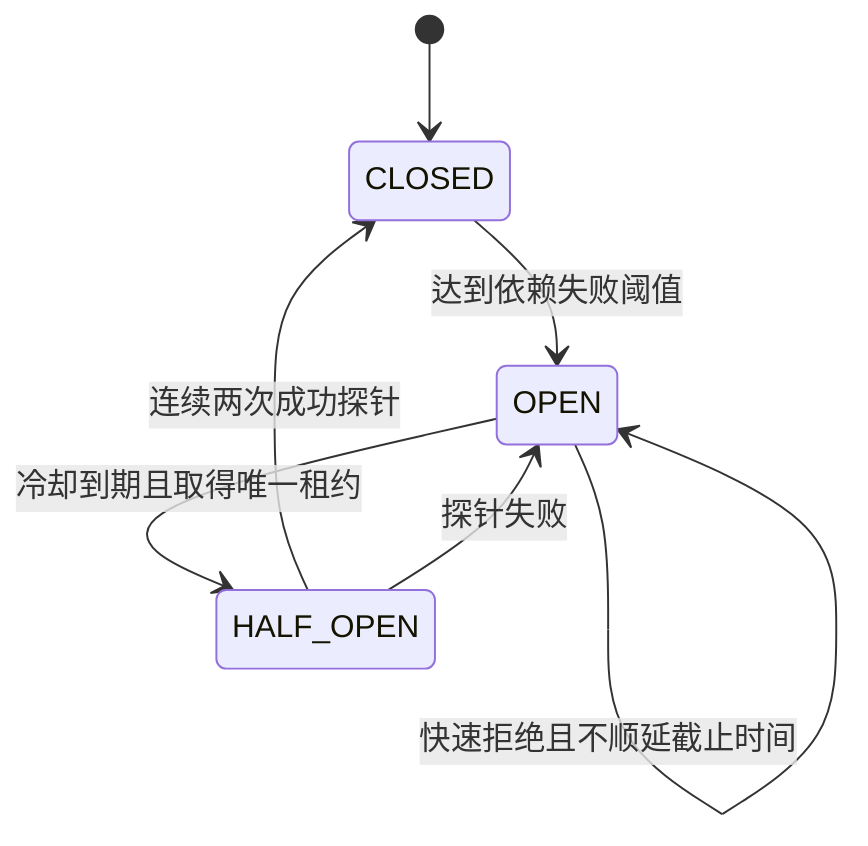
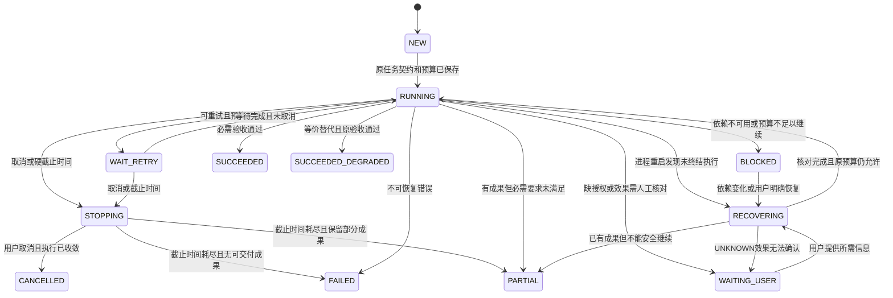

# 04｜执行可靠性审查与最小改造设计

> 审查日期：2026-09-27（Asia/Shanghai）。结论基于当前工作区静态代码及官方公开资料。本文只提出设计，未实施业务代码改造、安装依赖、训练、调用模型实验、提交或推送代码。

## 1. 结论与审查边界

**结论：项目已有实用的局部保护，但尚不具备“任务结果可信、副作用可核对、取消可收敛、重启可安全恢复”的闭环。当前最值得投入的不是增加重试次数或迁移工作流框架，而是修复成功判定、统一预算、约束不确定副作用。**

优先处理四组问题：

1. **结果真实性**：Shell 非零退出码没有进入工具状态；工具异常有时被转为成功状态中的错误字符串；模型最终文本与任务完成基本等价。应先保证失败不会被包装成成功。
2. **停止与成本边界**：存在 SDK 重试、provider 切换、子任务重跑、恢复 judge 等多层行为，但没有共享的总时间、请求次数、累计 token 预算。超时返回和真正停止执行必须分开。
3. **副作用一致性**：已有幂等/副作用元数据和重复调用保护，却没有工具执行账本；线程超时、进程崩溃或结果保存失败后，不能据“任务失败”推断“操作未发生”。
4. **安全及恢复边界**：主入口确实装配了 Shell 安全插件，但其边界是命令文本检查；检查点保存了会话事实，却没有安全重放任意工具、恢复执行位置和预算的协议。

### 1.1 基线与方法

| 项目 | 本轮记录 |
|---|---|
| 根目录 | `/home/tale/kaggle/mytry` |
| 分支 | `feat/memory-runtime-evolution` |
| HEAD | `5bc28e8d883a6ab4daf7e8d734ca3a1bcfbe24a2` |
| 最后提交 | `2026-08-18 09:25:54 +0800`；`harden runtime handler and embedding sharing` |
| 初始工作区 | `git status --short` 仅显示未跟踪目录 `docs/system-design (2)/` 和未跟踪文件 `os`；未显示 tracked 文件修改 |
| 审查对象 | HEAD 对应的业务代码及当前工作区说明、测试；上述未跟踪内容未作为业务实现证据，未改动 |
| 项目指引 | 已读 `README.md`、`pyproject.toml`、目录清单、`docs/overview/PROJECT_STRUCTURE.md`、`docs/architecture/SYSTEM_ARCHITECTURE.md`；搜索项目内部及祖先目录，未发现适用 `AGENTS.md` |
| 原目标文档 | 初查和写入前复查均不存在；本轮仅新建本文件 |
| 执行边界 | 仅 Git/文件读取、检索、官方网页及源代码访问、本文写入和文档检查；未执行项目测试或实际故障注入，未读取真实 `.env` 或运行时用户会话 |

交付前进行了文档格式检查：Markdown 围栏配对、18 项故障注入编号、显式完整代码路径的存在性与行号范围检查均无发现问题；`git diff --check` 风格检查无空白错误，tracked 文件未发生变化。这些检查不等于执行了项目测试。

默认命令沙箱发生 `mountinfo path is not absolute` 启动错误，后续必要文件检查使用经工具批准的只读命令。这是**审查环境事件**，不是本项目故障。架构说明用于定位，不能替代实现证据，例如结构说明仍提及 `runtime/agent_loop.py`，真实调用链应以当前模块为准。

本文标签含义：**[事实]** 为可定位代码或原始资料；**[推演]** 为静态条件下的可能失败路径，均未复现；**[建议]** 为待实施方案；**[待验证]** 为部署或效果尚无证据的假设。“未发现实现”限定于本文列明的执行链及检索范围，不等于证明整个项目绝对不存在某段逻辑。

### 1.2 实际执行链

```text
CLI / Web / Telegram / Feishu
  → AppRuntime.run_message / run_once
  → TurnCoordinator.run_inbound
    → 普通对话：Runtime.run
    → Coding：CodingApplication.run_coding_task → Runtime.run
  → AgentRunner → ReasoningLoop
    → RoutedModelProvider → OpenAICompatibleProvider → OpenAI SDK
    → ToolExecutor hooks → ToolRegistry.execute → handler
  → stop_decision / TaskState投影 / Coding收尾
  → 会话保存 → 内存outbound队列 → 网关投递
```

入口证据：`applications/app_runtime.py:81-103`、`applications/turn_coordinator.py:55-93,266-343`；核心证据：`runtime/runtime.py:87-138`。Coding 在 `applications/coding/runner.py:218-233` 接入每步保存回调；普通对话的 `TurnCoordinator._execute` 在 `304-322` 未传该回调。这是两条路径的真实差异。

## 2. 当前能力盘点：严格区分各类机制

| 机制 | 本文定义 | 当前状态与证据 |
|---|---|---|
| 重试 | 对同一逻辑请求增加 attempt | **已实现、分层分散**：SDK 传输重试；`agents/subagent/retry.py:8-17` 子任务最多额外重跑一次；`reasoning_loop.py:285-354` 空回复最多两次 |
| 退避 | 重试前等待，抑制请求放大 | **SDK 已实现；项目层部分实现**：SDK 指数退避与 jitter，见 S1；网关 `runtime/messaging/user_bus.py:49-55` 固定等 1 秒；模型切换、子任务重跑未见统一退避 |
| 熔断 | 一段时间内拒绝对故障依赖发新请求 | **部分实现**：`models/model_pool.py:250-276` 连续失败计数与冷却；`192-195` 所有候选不可用时回退原 chain；没有半开单探针 |
| 降级 | 改变实现路径，但仍满足已约定任务要求 | **局部实现**：Coding 结论抽取/工件写失败可记 metadata 后继续，`runner.py:242-270`、`applications/coding/conclusions.py:49-75`；是否允许取决于这些工件是不是用户交付要求 |
| 替代模型 | 将模型请求转移到另一个 profile | **已实现**：`RoutedModelProvider._call_with_fallbacks`，`model_pool.py:410-482`；正文已经输出时拒绝切换，避免混接 |
| 工具兜底 | 一个工具失败后用等价能力继续 | **部分实现**：有工具可见性、发现、不可用次数保护及 LLM 自行换工具；未见统一的语义等价兜底表。`tools/policy.py:48-95`、`reasoning_loop.py:533-552` |
| 任务回滚 | 撤销已经发生的状态/外部操作 | **未发现通用实现**：`runtime/trace/workspace.py:51-173` 保存 hash/size/mtime 和变化清单，没有原内容恢复；数据库事务回滚不等于撤销 Shell/文件/发送消息 |
| 检查点恢复 | 持久化足够执行状态，重启后按安全规则继续 | **部分实现**：会话、事件、TaskState、上下文快照可持久化；`reasoning_loop.py:909-937` 保存步骤阶段。未见任意工具的执行账本、执行位置与总预算恢复入口 |
| 请求人工处理 | 明确等待缺失输入、授权或结果核对，并保存阻塞原因 | **部分实现/接口已有**：`StopReason.WAITING_USER`、`StopDecision.recoverable`（`reasoning_loop.py:1351-1359`）以及协作审批协议；未形成副作用 UNKNOWN → 核对 → 恢复的一致协议 |
| 终止任务 | 拒绝新工作并写明确终态 | **已实现但语义分散**：`RunState` 有 completed/stopped/failed；TaskState 有更细状态；基础运行默认 24 步（`reasoning_loop.py:64`；Coding 可提升至至少 36 步，`applications/coding/runner.py:616-629`；TEAM 配置 50 步，`bootstrap.py:344`）、可选工具数限制、空回复/重复/不可用停止；取消主要是轮边界协作式检查 |
| 工具安全 | 在模型之外限制授权、参数、路径与副作用 | **部分实现**：ToolSpec/Policy、文件范围、Shell 插件、终态 guard 已接线；未见全工具 schema 校验、按任务/workspace 强制文件系统与网络隔离及外部写幂等账本 |

**捕获异常然后返回字符串，只是错误传播的一种形式。**只有同时说明“错误类别、可否重试、已发生副作用、预算、终态、用户通知”时，才构成本文所说的容错策略。

### 2.1 SDK 默认必须计入事实

[事实] `pyproject.toml:12`、`requirements.txt:1`、`uv.lock:1636-1637` 固定 `openai==2.38.0`。`ModelPool.client_for_profile`（`models/model_pool.py:145-159`）只设置 key/base URL/可选 header，标准客户端未覆盖 SDK 的超时与重试。

官方固定 tag 的默认值为最多额外重试 2 次，HTTPX `timeout=600`、`connect=5`；退避起点 0.5 秒、上限 8 秒，有 jitter，并处理有效 `Retry-After`。这些是传输策略，**600 秒不是整个任务的绝对截止时间**。[S1：SDK 常量](https://github.com/openai/openai-python/blob/v2.38.0/src/openai/_constants.py)、[重试源码](https://github.com/openai/openai-python/blob/v2.38.0/src/openai/_base_client.py)（访问 2026-09-27）。

[推演] M 个 profile 都遭遇可重试传输失败时，一次路由调用可放大到最多 `3 × M` 次 HTTP attempt，再叠加符合条件的子任务整轮重跑。路由 metadata 的 `retry_count` 只反映 profile 切换，不含 SDK 内部 attempt（`model_pool.py:444-459`）。实际 M、环境覆盖及部署流量未读取，不能把这个上界当成已发生账单。

## 3. 失败路径还原

| 触发点 | 现有执行路径与代码证据 | 当前结果及缺口 |
|---|---|---|
| 模型连接失败、429、5xx | SDK 有限重试 → `model_pool.py:461-481` 捕获任意 Exception、记 profile 失败、尝试下一个 → 全失败抛 `ModelRouteError` → `reasoning_loop.py:801-842` trace/checkpoint 后重抛 → coordinator `88-91,422-437` fail | 能保留尝试链；项目层把认证、参数、回调和依赖可用性故障混计，不是精确错误分类 |
| 模型长时间无响应 | SDK HTTP 超时；Web `server.py:226-241` 等 future；`439-449` 先运行模型任务，再对“等投递回复”使用 wait_for | Web 等待超时不自动停止运行；没有统一 deadline，UI 失败后后台仍可能执行 [推演] |
| 模型流不完整 | `models/provider.py:160-220` 流结束后组装结果；`338-368` 将 `response.incomplete` 也作为 final response 处理 | 非空无工具响应可在 `reasoning_loop.py:367-409` 进入 COMPLETED；流读完不代表生成完整，更不代表任务验收成功 [推演] |
| 工具调用 JSON 解析失败 | `provider.py:101-105,191-196,561-570,585-589` 捕获解析异常并置 `{}` | 根因丢失；缺参可能变 handler 错误；全可选参数工具可能执行默认操作；未见连续格式错误专门计数 [推演] |
| 无效参数、handler 异常 | `ToolRegistry.execute`（`tools/tool_registry.py:387-419`）将异常转成 `Error: ...`；`ToolExecutor.execute`（`tools/executor.py:144-164`）正常返回先标 success | `reasoning_loop.py:1132-1195` 继续传递该状态；错误字符串可能与 success 共存，无法统一统计/重试。未见 registry 入口全面 JSON Schema 校验 |
| 权限或工具不可用 | `tools/policy.py:48-95` 按 mode、AgentSpec、可见性拒绝；循环对同名不可用工具累计两次停止（`reasoning_loop.py:533-552`） | 属于授权/可用性保护，应保留；不能因拒绝就改用 bash 绕过同一授权目标 |
| Shell、测试失败 | `tools/handlers.py:2402-2415 run_bash` 120 秒超时，正常退出只取 stdout/stderr；不检查 returncode；后台 `background_task.py:26-42` 300 秒，任意正常退出均 completed | `exit 1` 无输出将返回 `(no output)`；测试失败文本还可能被模型读懂，但机器状态没有证据；不能据此写“项目一定伪造测试成功” |
| 执行环境异常 | 文件/OS 异常部分转错误字符串；后台通用异常标 error；`runner.py:266-270` 工件失败记 metadata；数据库保存异常通常外抛 | 已发生文件变更与会话/工件保存不在同一事务；磁盘满、DB 断连后可能只保存部分事实 [推演] |
| 重复操作/无进展 | `ToolLoopGuardHook`（`tools/hooks.py:156-305`）精确签名、同工具次数、相同结果 hash、读缓存；`RecoveryController`（`recovery.py:75-155`）受限纠正 | 不是端到端幂等；重复告警前仍可能执行副作用；缓存失效与合法轮询需要区分 |
| 用户取消 | `runtime/cancellation.py:6-55` 线程 Event；循环 `128-145` 每轮开始检查；`_stop_turn:1326-1392` 标 stopped；Web stop API `server.py:2026-2038` 只回 requested | 同步模型请求、当前工具和一个 response 中后续工具未保证即时停止；取消 callback 异常被当 False（`1244-1250`）；Coding 停止后仍可能做结论抽取 |
| 并行子任务超时 | `agents/subagent/parallel.py:64-89` 停等、cancel future、shutdown(wait=False)；`94-107,177-237` 可能自动新开 attempt | Python 运行中线程没有被强制终止；旧 attempt 与新 attempt 重叠执行是可能路径，不是已复现事实 |
| 进程崩溃/强杀 | Coding 每步保存会话；`SessionStore.save_session:343-430` 数据库事务；`load_session:168-275` 加载历史/快照；执行计数 `state.py:45-62` 每 run 重置 | 数据恢复已有基础；没有原子覆盖外部工具副作用的事务，没有“崩溃后可安全继续到下一条指令”的通用保证 |
| 结果投递失败 | coordinator `332-343` 先完成/保存再入队；`MessageBus.dispatch_outbound:38-55` 重投一次，第二次失败仅日志 | 执行完成与用户收到分离；队列在内存。网关持久 outbox 是另一条路径，不能假设普通回复都经过 outbox |

## 4. 关键对抗性案例

本节所有场景均为 **[推演，未复现]**；优先级表示修复顺序，不是线上事故严重度。

### R1：失败输出被当作成功，或为了“绿灯”削弱测试（P0）

- **现状证据**：`run_bash:2408-2411` 丢 returncode；`ToolExecutor:144-154` 正常返回即 success；`ReasoningLoop:367-409` 无工具最终文本即完成。`TaskStateRunObserver`（`runtime/task_state/service.py:46-57`）要求无 pending/blockers 和非空回复，却不检查独立测试证据；`applications/coding/state_updates.py:744-751` 用文本启发识别测试结果。
- **触发/场景**：执行失败测试后改测试断言、加 skip 或用 `... || true`，随后生成“已修复”；另一个简单场景是命令非零退出但没有输出。当前没有确定性完成闸门证明原始要求已满足。
- **影响**：对用户提供错误成功结论；失败统计失真；后续记忆可能吸收未经验证结论。这不证明当前模型已实际修改测试作弊。
- **现有优点**：有工具轨迹、工作区差异、TaskState pending/blocker 检查；可以复用这些结构补齐证据链。
- **改进**：引入结构化 exit_code 和 verification receipt；测试任务的验收命令/路径/基线在执行前确定；最终 diff 标记测试、配置、skip、断言弱化；允许有理由的正常测试修改，但“通过修改后的测试”不能单独证明原问题修复。小团队先做 diff 审核和独立回归命令，无需第二个付费裁判 Agent。
- **新增成本/风险**：机器难以判断所有测试修改语义；永久禁止修改测试会阻碍正当开发；Shell 管道整体退出 0 仍需基于受信验证入口判断。
- **不值得复杂化的条件**：纯文本聊天不需要测试闸门；用户只要求分析时只检查分析交付条件，不能强行运行测试。
- **验收**：非零退出/缺失必要验收/未解决 blocker 的任务不得 SUCCEEDED；测试被删或 skip 必須显式报告；明确区分“命令执行”“验证通过”“用户目标满足”。

### R2：工具成功但响应丢失，或部分成功后返回失败（P0）

- **证据**：ToolSpec 已标 `bash/write_file/edit_file` 非幂等、有副作用（`tools/tool_registry.py:96,113-115`）；恢复 judge 对该类拒绝纠正（`recovery.py:111-121`），但没有持久 operation_id/receipt。工具批次完成后才存 `tools_executed` 检查点（`reasoning_loop.py:439-458`）。
- **触发/场景**：文件追加成功后持久化断开；或者工具先创建两个文件中的第一个，随后出错。用户看到失败后重试任务，第二次追加/发送可能重复。
- **影响**：实际状态与 UI 不一致；回放会放大副作用，直接 rollback 又可能覆盖用户并行修改。
- **优点**：已有风险元数据与审计入口；可把“重试前先核对”加入现有执行器。
- **改进**：持久工具账本、前置 hash、目标后置 hash/远端回执；结果未知时标 UNKNOWN 并只读核对；通用 Shell 禁止自动重放；局部补偿必须有专用、经授权的逆操作。
- **成本/风险**：数据库写两次仍不能与任意外部系统原子提交；幂等键留存和冲突处理增加存储；核对不可靠时仍需人工。
- **不值得改造的条件**：纯读取只需合理缓存，不必为每次读取建立强持久账本；高风险外部写出现前不必建设通用 Saga。
- **验收**：故障注入“效果发生后、结果保存前”时不盲重跑；同 operation_id 产生最多一次已确认效果；无法确认时不声称未执行或成功。

### R3：取消/超时后继续消耗或写文件（P0）

- **证据**：循环只在轮首查 cancel（`reasoning_loop.py:128`）；工具执行循环从 `997` 开始未逐调用检查；并行超时只 cancel future（`parallel.py:74-87`）。Coding 在 stopped 后仍调用 `conclusion_extractor.extract`（`runner.py:235-246`）。
- **触发/场景**：模型一次给出读、改、执行三个工具，第一项后用户停止；或旧子任务超时但仍运行，新重试写同一文件。
- **影响**：撤销意图不生效、token 继续消耗、旧 worker 后续文件副作用覆盖新尝试修改。
- **优点**：已有线程安全取消 token、轮首检查和 stopped 终态；流对象有异常清理（`provider.py:371-385`）。
- **改进**：父子共用取消与 deadline；每个工具和每次网络重试前检查；等待/backoff 可取消；子进程用进程组终止并确认退出；尚不能终止的线程进入 STOPPING/UNKNOWN，禁止为写任务启动重试；取消后跳过非必要模型收尾。
- **成本/风险**：强杀可能中断文件写入；线程不能安全强杀；改异步模型/受控子进程比单加 flag 成本高，应分阶段。
- **不值得复杂化的条件**：本地短读取可保留协作式取消；不要求立即停机时，先诚实暴露取消延迟。
- **验收**：取消确认后不启动新工具/模型 attempt；5 秒内停止受管子进程或明确显示仍未终止；旧 attempt 的结果不能覆盖新 attempt。

### R4：连续失败、多层重试与全路由“熔断”失效（P1）

- **证据**：SDK、provider、subagent 分层重试；`model_pool.py:192-195` all-open 时返回 chain；默认阈值 3、冷却 300 秒（`115-116`）。
- **触发/场景**：多个 profile 实际共享同一限流账户；每个都被尝试，下一任务又绕过全不可用集合。非法请求也可能使健康 profile 被禁用。
- **影响**：增加延迟和调用量，错误隔离范围不准确；多次失败仍持续花 token。
- **优点**：单 profile 故障时可跳过主模型，有清晰路由 attempts；简单实现便于维护。
- **改进**：单一重试责任层、根预算、分类；冷却期无健康候选时快速返回可解释阻塞；先保留简单连续失败计数，再加每作用域一枚半开令牌。
- **成本/风险**：误熔断会拒绝本能成功的请求；稀疏流量恢复慢；多进程共享熔断会引入协调成本。
- **不值得复杂化的条件**：单人低频调用先修 all-open 并显式 SDK 设置，不上分布式熔断平台。
- **验收**：预算内真实 HTTP attempt 可核对；all-open 不发送请求；用户参数错误不增加依赖熔断计数；半开并发只放行一条。

### R5：换模型后协议或理解变化；截断被包装为完成（P1）

- **证据**：`model_pool.py:410-482` 多 profile fallback；`provider.py:338-368` 未区分 incomplete 成功；四处坏 JSON 变 `{}`；正文后拒绝 fallback 已实现。
- **触发/场景**：备用模型不支持当前工具 schema/上下文长度；保留的文本把中途状态理解为最终状态；流截断在一半 patch 说明处结束。
- **影响**：参数误执行、目标漂移、错误完成结论。
- **优点**：adapter 支持不同 wire API，路由取能力限额的保守值（`model_pool.py:336-362`），正文后不混接。
- **改进**：静态能力白名单和离线协议契约测试；fallback 前保留原始目标、已确认工具事实与 pending action；解析失败显式返回、最多两次修正；终端 finish_reason/incomplete 分类；模型成功后仍走同一个任务验收闸门。
- **成本/风险**：备用模型能力白名单需维护；能力兼容不保证语义等价；修复提示也消耗预算。
- **不值得改造的条件**：没有可证明兼容的备选就不切换；宁可可恢复失败，也不能改任务标准。
- **验收**：相同 fixture 在每个候选 adapter 输出规范 ToolCall；坏 JSON 不执行工具；incomplete/静默断流不能 SUCCEEDED。

### R6：重复保护误伤合法读取，旧缓存掩盖变更（P1）

- **证据**：`ToolLoopGuardHook.before:191-208` 回放、随后阻断；`_cached_output:274-276` 本地缓存优先；`tools/handlers.py:705-725,1812-1817` 写后只清 session metadata 缓存；bash 无相应缓存失效协议。
- **触发/场景**：read A → edit A → read A；或不同查询反复得到相同空结果；合法轮询等待外部任务结束。
- **影响**：模型看旧文件、误判修改无效；反复改写或提前结束；参数小变动又可能逃过精确重复。
- **优点**：精确签名/结果 hash 成本低，能节省重复读；RecoveryController 对副作用保守，并限制纠正次数。
- **改进**：读缓存键加入资源版本或在任意写后保守失效；无进展依据“状态/证据未变化”，不依赖自然语言自称有进展；轮询独立配置期望状态与次数。
- **成本/风险**：hash 大文件昂贵；仅看版本号也可被无意义写骗过；禁用缓存会多读。
- **不值得改造的条件**：小文件单用户场景先禁用跨写缓存回放，比复杂依赖图可靠。
- **验收**：写后重读得到新内容；连续相同只读失败在限额内停止；合法有状态变化的轮询不误拦。

### R7：并行 Agent 修改同一文件（P1）

- **证据**：`agents/subagent/parallel.py:43-60` 传递同一 parent session；`agents/subagent/runner.py:320-339` 构造子工具权限，`356-369` 继承工作区；`agents/subagent/tools.py:21-46` 的 code 类型包含 write/edit/bash；`tools/handlers.py:715-722` 读改写无 CAS。Web 同 session 锁（`web/server.py:420-422`）不等于跨 session 工作区锁。
- **触发/场景**：两个获写权限的任务都从版本 A 读取，分别写 B 和 C，后写覆盖前写；超时旧 worker 增加第三个写者。
- **影响**：丢修改、测试基线不一致、责任归属不清。
- **优点**：显式并行工具限制数量；子会话隔离聊天事实，trace 有子任务关联。
- **改进**：最小方案为一个 workspace 只允许一个写者，其他 Agent 只读并返回建议；增强方案才用独立 worktree 与 patch 合并，合并前做基线 hash 检查。
- **成本/风险**：串行写降低吞吐；worktree 不能隔离数据库/网络副作用，也需要保留用户 dirty 状态和冲突处理。
- **不值得改造的条件**：没有证据表明并行写能提高任务成功率时，不引入多写者调度。
- **验收**：并发更新相同基线最多一个提交生效，另一个显式冲突；用户已有变更保持不动。

### R8：外部工具输出影响指令，Shell 防护范围不一致（P0/P1）

- **证据**：`agents/definitions.py:26-28` 有将工具结果视为数据的提示；`reasoning_loop.py:1190-1195` 把工具文本加入上下文。主入口 `bootstrap.py:286-287,305-317` → `ShellSafetyPlugin.tool_hooks`（`plugins/shell_safety/plugin.py:8-9`）→ `PluginManager.register:52` 的接线真实存在；`TEAM.configure`（`bootstrap.py:339-345`）也共享执行器。
- **真实局限**：ShellSafetyHook 检查危险正则，ShellWorkspaceScopeHook 只检查绝对 cd 目标（`tools/hooks.py:72-124`）；cwd 不是沙箱。两者 `matches` 仅等于 bash，`background_run` 走全局 `WORKDIR`（`handlers.py:2655-2658`、`background_task.py:29-31`），不受这两项检查覆盖。
- **触发/场景**：网页/仓库注释伪装成系统要求，诱导使用可用 shell 做任务无关的读写或网络发送；是否成功取决于模型与部署权限，本文没有攻击实测。
- **影响**：越权操作、信息外泄或污染任务状态；提示词和命令黑名单不能给出系统级安全保证。
- **优点**：已有确定性 ToolPolicy、文件写范围、危险命令拦截和风险审计；可以沿现有边界加强。
- **改进**：统一所有执行路径的用户/workspace/授权上下文；外部数据带来源与信任级别；高风险目标在工具层授权；有非信任内容和代码执行时评估文件系统+网络隔离。先限制/禁用无法纳入同一策略的后台写路径。
- **成本/风险**：沙箱依赖平台、可能阻断构建与网络；允许的 workspace 内仍可破坏测试；仅加来源标签无法防所有注入。
- **不值得复杂化的条件**：个人可信离线仓库可先权限收敛；没有需求时不建设另一个 LLM 安全裁判系统。
- **验收**：注入文本不能改变工具授权；bash 与 background_run 拒绝同一越界效果；所有子进程继承边界；拒绝动作不通过备用工具绕过。

### R9：进程崩溃、保存或投递失败导致“状态已变但任务失败”（P1）

- **证据**：`SessionStore.save_session:343-430` 原子保存数据库内容，但不含工作区；`workspace.py:114-119,163-173` 是元数据快照；`TurnCoordinator._finish_run:401-420`、`_deliver:338-343` 与消息队列分离。
- **触发/场景**：最后一次编辑后 DB 不可用；完成状态已保存但网关发送失败；发送成功但回执丢失，再投递造成重复通知。
- **影响**：无法从 completed/failed 单字段恢复真实事实；用户重复发起任务可能重新写入。
- **优点**：会话增量保存、事件、TaskState 和变化清单构成可核对基础；Telegram outbox 有持久 pending/attempts（`gateway/telegram/store.py:211-281`）。
- **改进**：执行 outcome 与 delivery_state 分开；同事务保存终态与待发送通知；启动扫描非终态 run，先核对执行账本，再决定恢复；外部发送无幂等协议时仍报告重复投递可能性。
- **成本/风险**：outbox 只能保证可重投，不自动保证远端恰好一次；快照/账本也不能从丢失的任意外部效果回滚。
- **不值得复杂化的条件**：个人 CLI 可先落盘结果加人工恢复，不建设消息中间件；仍须保留明确终态。
- **验收**：崩溃后可找到未完成 run 和未知操作；失败通知不抹掉已完成效果；重复投递不会触发业务重跑。

## 5. 外部实现与通用可靠性实践的对照

以下资料访问日期均为 **2026-09-27**。固定版本是本次取证版本，**不声称是访问日最新版**；开源库、托管产品、闭源 Agent 分开讨论。

### 5.1 版本、开源状态与机制

| 对象 | 状态/版本核验 | 有实现证据的机制 | 对本项目的价值与边界 |
|---|---|---|---|
| LangGraph Python OSS | 官方公开仓库，MIT；`1.2.11`，2026-08-11，commit `644815f9e5bc52ad8f7a5227a456227e9c3e639b`。[版本](https://github.com/langchain-ai/langgraph/commit/644815f9e5bc52ad8f7a5227a456227e9c3e639b)、[许可证](https://github.com/langchain-ai/langgraph/blob/main/LICENSE) | `RetryPolicy` 与 `pregel/_retry.py` 按异常和 attempts 有限重试；`TimeoutPolicy` 区分 run/idle timeout；`PregelLoop.put_writes` 保存任务中间写入。固定源码见 S2 | 可借鉴异常分类、取消传播、已完成步骤结果复用；不必迁移整个图引擎。清空内部 writes 不能撤销外部文件/API 副作用 [推演]；LangSmith 托管服务不在此开源结论范围 |
| SWE-agent | 官方公开仓库，MIT；固定 `v1.1.0`，2025-05-22，commit `0f3acafacabc0def8cc76b4e48acb4b6cf302cb9`。[版本](https://github.com/SWE-agent/SWE-agent/commit/0f3acafacabc0def8cc76b4e48acb4b6cf302cb9)、[许可证](https://github.com/SWE-agent/SWE-agent/blob/main/LICENSE)；[当前 README](https://github.com/SWE-agent/SWE-agent) 表示主要开发转向 mini-swe-agent | `DefaultAgent.forward_with_handling` 对格式/命令错误做有上限纠正；`handle_action` 连续超时计数；异常退出可提取 patch 并记录 exit 原因，`save_trajectory` 保存轨迹。源码见 S3 | 借鉴“失败产物保留、格式纠正上限、终止原因”；不是当前框架迁移推荐。提取补丁不代表测试通过，轨迹文件不等于事务恢复 |
| SWE-agent 模型与工具层 | 同一固定版本，`sweagent/agent/models.py`、`sweagent/tools/tools.py` | 模型重试排除若干配置/认证/预算错误；统计与费用检查在响应后；提供预设模型。实际 ToolConfig 默认命令 30 秒、命令累计 1800 秒、连续超时 3 次，不能采用注释中的另一数字 | 学习离线 scripted model 测试和错误分流；不照搬最多 20 attempts。命令累计时间不含全部模型等待，不是总任务预算；响应后预算检查也可能超出限制 |
| Claude Code 公开工程披露 | 本次仅审阅 Anthropic 2025-10-20 官方文章，**不把 Claude Code 整体认定为开源**；未审查其内部实现或在线效果 | 文章披露文件系统与网络两个隔离边界、OS 原语与代理限制。[S6](https://www.anthropic.com/engineering/claude-code-sandboxing) | 支持“cwd/命令黑名单不足以替代隔离”的设计方向。本文不采信“绝对安全”保证，不把厂商内部效果数字迁移成本项目收益；公开的独立 sandbox runtime 本轮未做源码/许可候选评估 |

补充细节：LangGraph 该版本 RetryPolicy 默认最多 3 次 attempts（含首次）、0.5 秒起、2 倍增长、128 秒上限；实现的 jitter 是额外 `uniform(0,1)`，**不是 full jitter**。其超时仍受协作式取消约束，同步阻塞并不会因配置 timeout 自动可抢占。出处：固定版本 [types.py](https://github.com/langchain-ai/langgraph/blob/644815f9e5bc52ad8f7a5227a456227e9c3e639b/libs/langgraph/langgraph/types.py)、[_retry.py](https://github.com/langchain-ai/langgraph/blob/644815f9e5bc52ad8f7a5227a456227e9c3e639b/libs/langgraph/langgraph/pregel/_retry.py)。这些参数只作对照，不是本项目应复制的默认值。

LangGraph 官方持久化文档区分 `sync/async/exit`：同步落盘更强，异步落盘有崩溃窗口，只在退出保存不能恢复中途进程崩溃；内存 saver 重启即丢失。因此“引入 checkpointer”本身不能消除副作用重放窗口。[S2：checkpointers](https://docs.langchain.com/oss/python/langgraph/checkpointers)、[persistence](https://docs.langchain.com/oss/python/langgraph/persistence)、[固定 `_loop.py`](https://github.com/langchain-ai/langgraph/blob/644815f9e5bc52ad8f7a5227a456227e9c3e639b/libs/langgraph/langgraph/pregel/_loop.py)。

### 5.2 哪些来自 Agent，哪些来自通用系统

| 模式来源 | 原始结论 | 迁移到本项目时必须调整 |
|---|---|---|
| 通用分布式系统：AWS Builders' Library | 重试可能放大过载，超时不能证明副作用没有发生，多层重试会相乘；熔断有模式复杂度和恢复成本。[S4：Timeouts, retries and backoff with jitter](https://aws.amazon.com/builders-library/timeouts-retries-and-backoff-with-jitter/) | 不只统计 HTTP retry，还要纳入改参、格式修复、换模型、子 Agent 重跑和总结/judge；单用户先统一配额，再评估熔断收益 |
| 通用分布式系统：AWS 幂等 API | 用调用方请求 ID 表达业务意图，不能只靠参数相等；同 token 不同参数必须冲突，记录与变更需要合适的原子性。[S5：Making retries safe with idempotent APIs](https://aws.amazon.com/builders-library/making-retries-safe-with-idempotent-APIs/) | LLM 生成的新 tool_call_id 不等于宿主的 operation_id；新用户意图与同一意图重试必须区分；本地文件+远程 API 不在一个事务里，需 UNKNOWN 和核对 |
| 通用系统：AWS circuit breaker | 故障时快速失败，冷却后探测；并发失败不应无限延长开路时间。[S7：Circuit breaker pattern](https://docs.aws.amazon.com/prescriptive-guidance/latest/cloud-design-patterns/circuit-breaker.html) | 按依赖/账号/模型能力域隔离；测试失败和模型格式错误不能熔断全供应商；不照搬其云服务架构 |
| Agent 实践：SWE-agent | 格式纠正、命令超时退出、保存失败补丁与 trajectory（S3） | 保存 diff 与验证收据；区分未完成成果和成功交付；不要把多轮自然语言纠正计为“只重试了一次” |
| Agent 编排：LangGraph | 可保存节点结果并在恢复时复用（S2） | 对本项目工具建立比推理轮更小的持久边界；有副作用动作必须先核对现实状态，不能把模型历史重放等同执行恢复 |
| Agent 安全：OWASP | 外部内容存在间接注入风险，应采用最小权限、工具授权、输入/输出处理等多层控制。[S8](https://cheatsheetseries.owasp.org/cheatsheets/LLM_Prompt_Injection_Prevention_Cheat_Sheet.html) | 信任等级随工具结果保留；规则由宿主而非网页决定；prompt 提醒和正则只能做一层，不能取代执行权限 |

未找到证据证明以上已审模块能普遍防止“修改测试后自证通过”，也没有材料支持自动切换模型即可保持用户任务语义。下文这些能力是**本报告建议**。

## 6. 适合当前项目的可靠性设计

本节均为 **[建议]**。参数是小团队起始配置，需用第 7 节假模型/假工具测试和真实运行的脱敏指标校准，不是已验证最优值。

### 6.1 一个结果契约，两个独立状态维度

沿现有 `ToolExecutionResult` 扩展，不再层层用字符串猜错：

```text
ToolOutcome {
  operation_id, attempt_id, tool_name,
  status: SUCCEEDED | FAILED | DENIED | CANCELLED | UNKNOWN,
  error_code, retryable, retry_after,
  effect: NONE | NOT_APPLIED | APPLIED | PARTIAL | UNKNOWN,
  exit_code?, stdout_ref?, stderr_ref?, result_ref?,
  precondition_hash?, postcondition_hash?, remote_receipt?,
  started_at, ended_at, workspace_id, provenance
}
```

`exit_code != 0` 的 Shell 命令不可标成功；工具可有明确的业务语义适配，例如 `rg` 的退出码 1 是“没有匹配”而非运行环境坏了。上层只能根据类型化结果和工具契约决定，不让任意 stdout 中的 “Error” 或 “passed” 单独决定状态。迁移期为旧 handler 加集中适配，记录 `legacy_untyped`，逐步移除字符串判错。

任务拆成：

- `execution_state`：NEW、RUNNING、WAIT_RETRY、BLOCKED、WAITING_USER、RECOVERING、STOPPING，以及终态 SUCCEEDED、SUCCEEDED_DEGRADED、PARTIAL、FAILED、CANCELLED。
- `verification`：NOT_REQUIRED、PENDING、PASSED、FAILED、INCONCLUSIVE；只有当前任务要求的验证满足，才进入成功终态。
- `delivery_state`：PENDING、DELIVERED、DELIVERY_FAILED；发送失败不将已发生业务效果抹掉，也不能驱动业务重新执行。

这些是统一结果的不同维度，不应再让 RunState、TaskState、Coding metadata 各自猜状态。兼容层把旧 `stopped` 映射为具体原因，UI “停止请求已收到”与“已停止”分开。

### 6.2 错误分类与可重试决策表

“允许重试”仍须同时满足预算、未取消、幂等/无副作用和依赖可用条件。attempts 均包含首次调用。

| 错误类别 | 可原样重试？建议上限 | 替代/纠正 | 熔断计数 | 最终动作 |
|---|---|---|---|---|
| DNS/连接拒绝、模型请求 408/瞬时 5xx | 模型未输出可最多 3 attempts；副作用工具需证明 NOT_APPLIED 或有幂等协议 | 同一调用最多切 1 个已验证兼容模型，共享这 3 次 | 是，按真实故障域 | 耗尽则 BLOCKED/FAILED，保留尝试链 |
| 429 短时速率限制 | 按 Retry-After，仍受 3 attempts/总 deadline | 同账号备用模型不当独立容量；独立账号/供应商须已在授权路由内 | 记限流桶，不直接污染通用健康计数 | 等待超过剩余预算则 BLOCKED，并给 retry_at |
| 配额用尽/账单、401/403、模型不存在 | 否 | 配置修复；只可使用事先允许且符合数据边界的备选 | 配置禁用，不记通用瞬时熔断 | 说明缺哪项配置/能力，不打印密钥 |
| 超上下文、400 schema/参数不兼容 | 不原样重试 | 一次确定性压缩或 schema 修正；保留用户目标与工具事实 | 否 | 仍不兼容即 FAILED/BLOCKED |
| 连续 malformed JSON、非对象参数 | 不执行工具；最多 2 次纠正（总模型 attempts 最多 3） | 反馈验证路径和简短错误；禁止默认 `{}` 执行 | 否，另记协议失败率 | FORMAT_EXHAUSTED，保留脱敏原片段 |
| 空回复、incomplete、缺 terminal event | 可在无可见正文/无工具效果时用剩余 attempt；已输出正文不透明重放 | 正文中断报告 PARTIAL，明确从哪个已确认状态继续 | 网络中断可计依赖；生成截断不计 | 禁止成功终态 |
| 工具参数无效、缺字段 | 否 | 最多 1 次参数修正，handler 调用计数必须为 0 | 否 | BLOCKED/FAILED，报告字段错误 |
| 工具拒绝授权、路径越界 | 否 | 真正缺授权时 WAITING_USER；已有拒绝不能改用另工具规避 | 否 | DENIED，记录策略规则 |
| 只读工具瞬时失败 | 默认最多 2 attempts | 可用等价只读后备（如 rg 缺失用已有 grep） | 远程依赖故障才计 | 无法满足范围则 PARTIAL/BLOCKED |
| 写工具超时、结果丢失、部分成功 | **禁止盲重试** | 只读查后置状态；支持幂等键且协议保证时复用原键 | 只计真实依赖故障，不让重试绕过 UNKNOWN | UNKNOWN/PARTIAL → 核对或人工 |
| 测试断言失败 | 否，不是基础设施异常 | 可以有新证据的修复迭代，计统一步骤/预算 | 否 | 验证 FAILED；输出失败摘要 |
| 测试环境缺依赖/沙箱故障/磁盘满 | 不反复原样重试 | 已授权范围内一次环境修复；本轮用户禁安装就不能安装 | 按具体环境标 unavailable | BLOCKED；静态分析不替代运行测试 |
| DB 保存失败/账本不可写 | 读取可有限重试；新写操作前不能忽略 | 暂停副作用；内存/应急文件只作诊断，不冒充已持久化 | DB 域 | 标保存失败、可能已发生效果 |
| 用户取消、父任务终止 | 否 | 停止新工作、清理进程、持久化事实 | 否 | CANCELLED；无法确认效果时附 UNKNOWN |
| 未分类程序错误 | 默认否 | 保留 traceback 引用和当前阶段，人工排查 | 不默认熔断模型 | FAILED/UNKNOWN，不异常吞掉后继续 |

### 6.3 分层超时与统一预算

最小实现是在 `RunContext` 引入一个**线程安全根 Budget**，所有 child run、fallback、SDK attempt、judge、reflection、summary、conclusion 和验证调用持有同一个引用；每个子任务只拿剩余额度的切片，不能重新获得完整预算。保持现有上下文 token gate，它解决的是另一问题。

| 层次 | 建议初始值/规则 | 说明 |
|---|---|---|
| 总任务 | 普通任务 10 分钟；长 Coding 显式选择 30 分钟；从接收请求起计排队、模型、退避、工具、验证、收尾 | 持久保存 deadline_at 与消耗；进程内用 monotonic 计时，重启根据保存的墙钟截止时间重建并检测时钟跳变，不直接序列化 monotonic 值 |
| 模型单 attempt | connect 5s、pool 5s、write 30s、read/流 idle 60s；另外 attempt 绝对上限 120s，均取剩余任务时间最小值 | 持续输出小块也不能无限延长绝对上限；HTTPX read timeout 不等于总时限 |
| 普通工具/命令 | 只读本地 15s；Shell 沿用 120s；测试命令可显式 300s，仍受根 deadline | 命令通过受控进程组执行；线程 wrapper 的 timeout 只意味着停等，不作为已终止证明 |
| 子任务 | 默认不超过剩余预算的一半及 300s；模型/tool/验证/恢复均计根预算 | 同一 workspace 默认仅一个写者；只读 worker 也须证明其权限确实只读 |
| 调用/步骤 | 根最多 24 reasoning steps、30 次实际模型 attempt；全任务恢复额外调用最多 5 次且不超过总模型 attempt 上限；judge 最多 2 次 | 总 attempt 包括格式修复、路由、辅助模型，不能在各层重置 |
| token | 示例起点总输入+输出 80,000 token，输出单次另有限额；缓存输入单列观测，仍统一计入 token 上限 | 数字需按任务校准；请求前估算输入+预留最大输出，结果后对账；没有 usage 的失败/流不按 0 计算，保守保留预留值并标估算 |
| 费用 | 可选配置单任务货币上限；价格表带版本，未知价格拒绝承诺硬费用上限 | 本轮未调研价格，不虚构成本；token/调用/时间限额优先落地 |
| 收尾预留 | 设 work_deadline = task_deadline - 10s；所有工作调用/验证截到 work_deadline，最后 10s 用于写账本/结果；本地总结不默认再调模型 | 到时只输出已知事实；取消后跳过 conclusion/reflection 等非必要模型 |

实现过程需要诚实区分“软限制”和“硬限制”：在尚未替换阻塞网络与线程之前，总 deadline 只能阻止新调用，不能保证当前调用立即停止。UI 与验收必须显示该边界；不要把 `future.result(timeout)` 包装成硬任务超时。预算预留必须原子化，避免并行任务各自看到完整剩余额度。

### 6.4 最大重试、退避与熔断

**重试责任层**：优先由项目统一的 invocation 层拥有模型传输重试，显式设 SDK `max_retries=0`；若暂时保留 SDK，就明确由 SDK 独占同 profile 的传输重试，外层只能有限切换并按最坏 attempts 预留预算。两种策略择一，不能无意叠加。先不引入 Tenacity 依赖，现有少量逻辑足以表达。

建议 full jitter（本报告选择，不是上游 SDK/LangGraph 实现的照抄）：

```text
第 k 次额外重试（k 从 0 开始）:
  cap = min(8s, 0.5s * 2**k)
  delay = random_uniform(0, cap)
  若有合法 Retry-After: delay = max(delay, Retry-After)
  若 delay + next_attempt_min_time + cleanup_reserve > remaining_time:
      BLOCKED(reason=retry_after_exceeds_budget, retry_at=...)
  否则可取消地等待；重新检查预算和取消，再执行
```

无限大/非法 Retry-After 不能变成永久睡眠；大于剩余时间时不提前违反服务端等待要求，直接保存阻塞状态。默认每逻辑模型决策最多 3 attempts，包含改参/格式纠正/最多一次换模型；每个只读工具默认最多 2 attempts；写工具由效果判定，不套通用次数。

**熔断最小设计**：

- 作用域用规范化依赖 ID：模型可用性按 `(endpoint, model_family)`，限流/认证按 `(account_ref, endpoint, quota_group)`；引用账号 ID，不保存 key。工具按远程服务/执行环境分域。共享账号的多个 profile 不能假装独立容量。
- CLOSED：60 秒内连续 3 次符合分类的依赖失败后 OPEN 30 秒；这些是建议起点。取消、测试失败、参数错误、格式错误不计。切换到其他 provider 成功不能重置原 provider 的失败计数。
- OPEN：立即拒绝该作用域，不延长已有 open_until；全部候选 open 就返回 BLOCKED/retry_at，**删除语义上的 `available or chain` 绕过**。
- HALF_OPEN：冷却到期后在锁内发放唯一探针租约，优先用下一条真实、无副作用且预算可承受的请求；不需要后台付费 ping。成功一次保持半开，再成功一次 CLOSED；失败重新 OPEN，冷却指数增长至 300 秒。
- 实例规模：先进程内锁+状态即可；多进程共享账号且确有并发故障数据后才放入既有数据库。重启清零是已知限制，不能声称全局熔断。
- 误熔断与恢复：低频流量不要用小样本错误率；慢请求不一律算故障；半开失败保留原错误和恢复时间。禁止用户请求因探针竞争无限排队。



### 6.5 无进展检测：先确定性，再有限纠正

复用 ToolLoopGuard/RecoveryController，但将三个判断分开：

1. **重复请求**：规范化 tool name/args/目标资源，去除非语义空白；不因换 call_id 当成新业务意图。
2. **真实状态变化**：资源 revision/hash、有效新 evidence 引用、测试失败集合、待办关闭记录。没有证据的 TaskState 版本增长或自报“已取得进展”不能重置检测。
3. **不确定副作用**：优先进入核对，不先发起 judge。模型改变参数再试也不能绕过同一未知效果。

建议窗口：相同只读请求且资源未变，首次正常，第二次回放并提示，第三次停止；格式错误最多 3 次模型尝试、参数错误最多 1 次纠正（总 2 次），按错误类别更小的上限停止；格式纠正、传输重试与 fallback 共享同一逻辑调用的 3 attempts；6 个行动内无新有效证据或目标状态变化，允许一次明确换策略，之后 2 个行动仍无进展就 PARTIAL/BLOCKED。这些阈值需用合法检索、轮询、调试任务校准，不能替代根预算。

合法轮询必须登记 `poll_key/expected_change/interval/max_polls/deadline`，否则会像死循环；大仓库分页读取应根据不同有效范围计新证据。最小缓存修复可先在写工具完成或 UNKNOWN 后清空本轮读缓存，包括 Hook 内存层与 session metadata；跨 Agent 变化再考虑基于资源版本的缓存。

### 6.6 降级必须保住原任务契约

| 原任务要求 | 可接受的替代路径 | 成功条件 | 不能当成功的降级 |
|---|---|---|---|
| 在指定本地文件中精确搜索 | rg 不可用 → 已有 grep/确定性文件遍历 | 相同路径边界、匹配语义、覆盖范围和可核对结果 | 只搜部分文件却给出“没有问题” |
| 修复代码并通过指定测试 | 兼容备选模型继续，沿原命令验证 | 同一基线、必要测试 exit 0、未隐藏测试变更、未遗留 UNKNOWN | 没法运行测试时用静态分析替代“已通过” |
| 生成文档文件 | 用已有文本写入工具替代渲染工具 | 指定路径/格式/内容确实存在并检查通过 | 仅聊天回复文档内容，却宣称文件生成成功 |
| 回答与可选记忆无关的问题 | 关闭故障的可选语义检索/总结 | 必须的事实来源仍可取得；不损失用户要求 | 用户要求检索全部历史却悄悄关闭历史检索 |
| 用户已取消 | 只做本地收尾、保存已有结果 | 标 CANCELLED 并列明残留效果 | 抽取记忆、换模型继续完成原任务 |

`SUCCEEDED_DEGRADED` 必须同时满足：原始必需交付项与验收未减少、能力/数据边界未扩大、没有 UNKNOWN 副作用、替代路径有证据、向用户公开降级。仅“程序还能继续运行”没有资格叫降级成功。功能范围减少只能 PARTIAL/BLOCKED；若用户后来明确接受新范围，应保存新的契约版本，不能回改原失败记录。

备用模型上线前做离线 adapter 契约 fixture：工具 schema、role、tool_call/result 配对、参数对象、stream terminal 语义、token 上限；之后才做经用户授权的小规模真实验证。模型名称和“支持 OpenAI 兼容”不能替代这些检查。切换时固定最初目标与已确认事实，不能把失败工具请求当已完成，也不能自动扩大数据接收方。

### 6.7 副作用幂等、执行前检查与单写者

[事实补充] `TaskSubagentRunner._new_session`（`agents/subagent/runner.py:356-369`）继承父 workspace；`agents/subagent/tools.py:21-46` code 类型含 write/edit/bash；explore/plan 也有 bash（`1-4,48-50`）。所以“并行只读”必须是实际工具/OS 权限，不能根据角色名称判断。`run_write/run_edit`（`tools/handlers.py:705-725`）直接 write_text，无统一 CAS；`publish_artifact`（`2370-2380`）已有临时文件替换，不能笼统称全仓无原子写。

建议最小 `operation_ledger` 放入项目已依赖的 PostgreSQL，避免另加向量库或消息系统：

```text
唯一键: (task_id, operation_id)
内容: attempt_id, canonical_args_hash, tool_version, workspace_id,
      PREPARED | RUNNING | SUCCEEDED | FAILED | UNKNOWN,
      effect_state, before_hash, desired_after_hash, receipt_ref,
      created_at, updated_at, actor, budget_checkpoint
```

- operation_id 由宿主接受操作时生成并在执行前落盘，同一逻辑操作重试复用；新用户意图使用新 ID。相同 ID、不同参数必须报冲突；不能仅 hash 参数，因为用户可能确实想做两次相同动作。
- 文件写：先验证允许路径、单写租约和 expected_before_hash；生成新内容后写同文件系统临时文件，再原子替换。CAS 的检查与替换必须在覆盖所有受管写者的锁中，不能分两步后就宣称无竞争；OS/用户外部写者仍需重读与冲突检测。禁止自动覆盖用户 dirty 变更。
- 恢复核对：若当前 hash 等于 desired_after_hash，可登记已完成且复用回执；等于 before_hash 且确认旧执行者退出，才能执行；其他状态 UNKNOWN/CONFLICT。文件内容相等不证明发送消息、付费操作等外部效果相等。
- 外部 API：仅在对方提供幂等 token 或查询事务号时自动恢复；键留存需覆盖任务恢复窗口。无协议时用执行前查询降低风险，但不能宣传 exactly-once。
- 通用 bash：默认副作用未知，不能凭字符串关键词证明纯读；优先改用专用读写工具。Shell 出错后的自动重试，必须由明确的无副作用命令契约决定。
- 并行：最小为 workspace 单写者（含后台、子 Agent、主任务）；超时旧执行者没有退出确认就不转交写租约。以后有并行写收益才使用 worktree+显式 patch 合并；worktree 不隔离网络/DB。

账本与文件/远端服务并不在同一事务中，`RUNNING → 崩溃 → UNKNOWN` 的窗口仍存在，正确行为是核对。原子 rename 减少文件截断，不能提供外部操作事务性。真正的补偿只针对已建模动作；不允许用 `git reset --hard` 作为通用任务回滚。

### 6.8 检查点、恢复和终止状态机

先提供“保留失败事实＋人工选择恢复”，再按收益做自动恢复。已有 context checkpoint 继续负责上下文，不把它改造成唯一执行数据库。可靠性 checkpoint 至少保存：task/run/attempt ID、原任务契约版本、workspace 基线、已确认 operation IDs、pending/unknown 操作、根预算消耗/截止时间、原模型/适配版本、验证收据、cancel_requested、最终状态与 delivery_state。

每个有副作用动作前 PREPARED、动作后结果持久化；模型返回后在工具执行前保存规范 ToolCall 列表；终态与待发送通知尽量同事务落盘。可选 trace 写失败不能掩盖主异常；必要账本不可写时禁止新增副作用。成功后可选结论/报告失败只附 warning；若报告就是用户要求的产物，则不能成功。



CANCELLED 不等于没有任何残留效果：必须附 `effect_state` 和残留清单；如果仍有未受控 worker，在 STOPPING 阶段明确显示，不能提前写“已完全停止”。上述 Mermaid 只表达任务级主路径，工具 UNKNOWN 在账本中保存；硬 deadline 的终态根据原因和成果为 FAILED/PARTIAL，用户主动取消才是 CANCELLED。预算用尽后的恢复必须明确续额并记录新 attempt，不能重置旧消耗伪装免费重试。

恢复步骤：

1. 按 task ID 加互斥锁，检查原 worker/进程是否仍活跃；新 attempt 使用递增执行代次，拒绝旧代次晚到的状态写入。代次只能防陈旧记录，不能杀掉旧 worker 的文件/外部效果。
2. 核对代码版本、用户新增修改、配置/工具版本。变化影响语义时进入 BLOCKED，而不是盲重放旧计划。
3. SUCCEEDED 操作复用回执；FAILED 且 NOT_APPLIED 按分类重试；RUNNING/UNKNOWN 先只读核对；无证据不重放写。
4. 恢复预算和取消意图，构造给模型的“原目标＋已确认事实＋未解决问题”；不能把未经确认的 assistant 计划当执行事实。
5. 验证原交付契约后写终态；投递失败只重投结果，不重跑业务。

### 6.9 必须向用户暴露的信息

失败响应至少包括：task/run ID、停止阶段、错误类别、是否重试/切模型及次数、已确认完成的内容、已知变更/未知副作用、验证命令和结果、预算或 deadline 消耗、能否安全重试、恢复所需输入。提供脱敏日志/回执引用，不暴露 API key、认证头或完整敏感工具输出。

示例（建议文案，不是实际发生）：

> 任务未完成：测试环境启动超时。`src/parser.py` 已修改；测试没有得到结果，不能确认通过。已尝试 2 次，共用时 122 秒。最后一次工具执行状态未知，系统不会自动重跑写入。可先核对工作区差异和进程状态，再从 task `…` 恢复。使用备用模型未改变验收要求。

如果只缺可选摘要，应表达“必需结果已完成；自动摘要生成失败”，并在结果中明确该可选项；不能把它与主任务失败混淆。详细错误属于结果契约，应可供 UI/CLI/网关一致展示。

### 6.10 关键伪代码

以下只表达控制约束，不是可直接复制的业务实现；持久化/锁/取消/预算必须经过相应测试。

```python
# 所有模型调用路径共用，包括 summary、judge、fallback 和子任务。
def invoke_model(logical_call, budget, cancel, route):
    for attempt in range(1, 4):  # 最多3次，含首次及格式纠正/模型切换
        budget.check_work_deadline_and_attempts()
        cancel.raise_if_requested()
        profile = route.choose_compatible_without_bypassing_open_circuit()
        permit = breaker.acquire(profile.failure_domain)
        reservation = None
        try:
            # reserve失败也会进入finally，释放半开租约
            reservation = budget.reserve_atomic(prompt_estimate + output_cap, calls=1)
            reply = transport.call(profile, sdk_retries=0,
                                   deadline=min(budget.work_deadline, now() + 120),
                                   cancel=cancel, on_send=reservation.mark_sent)
            reservation.observe_usage(reply.usage)
            breaker.record_transport_success(permit)
            validate_terminal_event(reply)       # incomplete不是成功
            parsed = validate_tool_schema(reply) # 错误不可替换成{}
            return parsed
        except Cancelled:
            raise                              # 不能被普通retry吞掉
        except Exception as exc:
            error = classify(exc)
            breaker.record_only_dependency_failures(permit, error)
            if reply_was_visible() or not error.retryable or attempt == 3:
                raise TypedFailure(error)
            delay = bounded_backoff(error.retry_after, attempt)
        finally:
            # 幂等一次结算：已知usage对账；已发送未知usage保留预留；未发送释放
            try:
                if reservation is not None:
                    reservation.settle_once()
            finally:
                permit.release()
        budget.require_work_time_for(delay, next_attempt_minimum)
        cancellable_wait(delay, cancel)          # 等待不占半开探针租约


def execute_effectful_tool(call, task):
    validate_schema_and_authorization(call, task.contract)
    task.cancel.raise_if_requested()
    task.budget.check_work_deadline()
    with cancellable_workspace_write_lease(task.workspace, task.generation,
                                          task.cancel, task.budget.work_deadline):
        check_cancel_budget_and_current_authorization(task)  # 排队后重新检查
        op = ledger.prepare_or_load(call.operation_id, hash_args(call))
        if op.status == "SUCCEEDED":
            return op.receipt
        # FAILED也可能已有部分效果，不能仅依据status重放
        if op.status in {"RUNNING", "UNKNOWN"} or op.effect in {"PARTIAL", "APPLIED", "UNKNOWN"}:
            resolution = reconcile_without_writing(op)
            if resolution == "DESIRED_STATE_CONFIRMED":
                return ledger.confirm_success(op)
            if resolution != "NOT_APPLIED" or not previous_executor_has_stopped(op):
                return ledger.require_resolution(op)
            ledger.record_not_applied(op)
        if op.status == "FAILED" and not classified_retry_allowed(op):
            return op.failure_receipt
        require_prepared_or_proven_not_applied(op)
        check_preconditions_cancel_and_budget(call, task)
        ledger.mark_running_and_commit(op)
        try:
            outcome = controlled_executor(call, deadline=task.budget.work_deadline,
                                          cancel=task.cancel)
        except Exception as exc:
            outcome = outcome_from_exception(exc, default_effect="UNKNOWN")
        ledger.commit_outcome(op, outcome)  # 这里失败仍意味着效果未知
        return outcome


def finish_task(task, outcomes):
    if task.cancel.requested:
        stop_new_work_and_reap_managed_processes()
        return persist_cancel_or_stopping_with_effects(task, outcomes)
    if any_unknown_effect(outcomes):
        return persist_waiting_user_or_partial(task, outcomes)
    receipt = verify_original_contract(task, cancel=task.cancel,
                                      deadline=task.budget.work_deadline)
    # 验证期间也可能取消、变更文件或产生旧attempt结果，最终提交不能只看旧快照
    with finalization_transaction_and_workspace_guard(task):
        facts = reload_cancel_generation_effects_and_workspace_revision(task)
        state = decide_terminal_state(facts, receipt, task.original_contract)
        # 只有原验收满足且revision一致、无取消、无UNKNOWN才能成功
        persist_state_and_notification(task, state, receipt)
```

必须处理伪代码未展开的资源异常：`reserve/acquire/ledger` 自身失败时不执行副作用，必要 lease 自动释放；执行成功但 outcome 提交失败时保持 UNKNOWN。账本回执复用应先于 before_hash 检查，避免已成功操作因当前文件已是目标版本而被误判前置条件失败；只有准备重新写入时才校验写前 hash。终态提交与取消请求要有明确线性化顺序：先提交终态则随后取消返回“已经结束”，先接受取消则禁止提交成功。预算对账应按每个 reservation ID 幂等，避免验证错误后重复扣除同一响应。模型还未发送请求时释放预留，已发送却 usage 未知时保守计账。

## 7. 故障注入与验收计划

**本轮只设计测试并阅读现有测试，不宣称下面任何注入已复现或指标已达标。** 优先复用 `tests/fakes/scripted_model.py`、假工具、临时目录、可控时钟、mock transport；全套确定性测试不需要真实付费模型、训练或新依赖。需要数据库事务/进程崩溃验证的阶段，在独立测试 schema 与临时 workspace 做，不连接真实用户状态。

### 7.1 现有测试能证明什么

| 静态阅读的已有测试 | 已有断言主题 | 不应据此推导 |
|---|---|---|
| `tests/test_model_pool_routing.py:284,354,403,440` | provider fallback、冷却跳过、正文前后切换边界 | 全路由 open 已被正确快速拒绝；SDK 与任务重试预算已统一 |
| `tests/test_recovery_controller.py:39-117` | 副作用/非幂等拒绝 judge、单 incident 纠正上限、judge 异常停止、run 级上限 | 任意模型循环均可发现；副作用 exactly-once |
| `tests/test_tool_safety.py:12-118` | 读缓存回放/阻断、参数变换重复、相同结果、Shell 危险命令 | 任意 Shell 都不能越界；缓存写后新鲜；后台执行同样受保护 |
| `tests/test_parallel_tasks.py:64-80` | 超时后迅速返回结构化错误 | 已运行线程真的停止、旧尝试没有后续副作用 |
| `tests/test_streaming_completion_semantics.py:89,177` | 文本/工具顺序、取消流的可见文本与终端事实 | provider 的 incomplete/静默 EOF 都被当失败 |
| `tests/test_reasoning_loop_token_gate.py:58-148` | 上下文裁剪、过大请求调用前阻止、硬门槛不被开关绕过 | 累计 token/费用/总耗时已有硬上限 |
| `tests/test_session_store_incremental.py:157,212` | 迁移失败事务回滚、会话增量保存 | 外部副作用可撤销、执行位置可自动续跑 |

以上只是测试代码的覆盖意图，未执行，不能写成“测试通过”。新测试的重点是跨层行为，不再堆叠与实现结构完全相同的 getter 测试。

### 7.2 必须补齐的故障注入矩阵

| ID | 注入点/脚本 | 必需断言与验收 | 同时检查的反例/成本 |
|---|---|---|---|
| F01 超时 | 假模型连接超时；另一次每 20s 发流片段但永不终结 | connect/idle/attempt/任务 deadline 各自生效；最多 3 attempts；绝对 deadline 不被心跳延长；只记录完整规范工具调用 | 慢但正常请求不因过短 connect/read 阈值大量误杀；记录 p95 新增等待 |
| F02 限流 | 顺序返回 429（Retry-After=2）、429、成功；另一例 Retry-After 超过剩余任务时间 | 可控时钟证明不提前发送、不超预算；后者 BLOCKED 并有 retry_at；同账号 profile 不绕限流 | 非法/负数/日期形式 Retry-After；验证并发不会同一时刻集中重发 |
| F03 连续格式错误 | 连续返回坏 JSON、JSON 数组、缺 required 字段 | handler 调用数=0；最多 2 次纠正且总模型 attempts≤3；终态 FORMAT_EXHAUSTED；原始错误可追踪 | 一次格式纠正成功不误判供应商宕机；不使用 `{}` 默认执行 |
| F04 工具部分成功 | 假工具创建 A 后失败，未创建 B | effect=PARTIAL；保留 A 的回执；不无条件重跑整个操作；展示未完成 B | 确认补偿失败不会覆盖原始错误；可选部分成果不被自动删除 |
| F05 重复副作用 | 计数器/文件追加一次后在返回或账本提交前抛连接错误；重启后恢复 | 复用 operation_id；状态未知先核对；可确认时计数仍为 1；不可确认时 WAITING_USER/PARTIAL，无第二次追加 | 新用户明确要求相同动作两次使用不同 ID，允许两次；同 ID 不同参数报冲突 |
| F06 任务取消 | 模型等待、backoff、工具 batch 第一项后、后台进程运行时分别取消 | 取消后新调用数=0；父子收到同 token；收尾不再调用 conclusion/reflection；受管进程停止或如实 STOPPING | 确认响应迟到只作审计，不恢复运行；回调报错不能被默认为“未取消” |
| F07 旧线程未退出 | 首次 code 子任务超时后用同步栅栏阻塞，尝试启动重试 | 未证明旧写者退出前不得获得第二个写租约；晚到结果不覆盖新状态 | 单纯检查“future已返回”不算通过；只读任务也需预算受限 |
| F08 假成功 | 假 subprocess 返回 code=1/out=''；另一例失败 pytest 输出；模型随后声称完成 | 工具 FAILED；必要验证 FAILED；最终不得 SUCCEEDED/SUCCEEDED_DEGRADED；用户看到实际命令和退出码 | rg no-match/合法工具业务返回有专用映射，不能全当环境故障 |
| F09 修改测试绕过 | Agent diff 删除断言/添加 skip/改验收命令为始终成功 | 验证命令由宿主记录、exit/status receipt 不受模型文字覆盖；测试变更被揭示；独立原契约验收仍失败 | 合法测试补充/用户明确要求改测试可继续，但不能只用自改测试证明通过 |
| F10 熔断全开/半开 | 所有 profile 达阈值；advance clock；多个请求同时取得半开 | OPEN HTTP 请求数=0；半开每域并发≤1；两次探测成功关闭；失败后退避增加；参数错误不计数 | 真实健康依赖上的负向 fixture 不应触发熔断；晚到失败不不断顺延 open_until |
| F11 模型切换协议 | 主模型临时失败，备选返回不支持 schema/incomplete；正文已输出后失败 | 不兼容备选拒绝；最多一次切换；终态验收相同；正文后不混接；保留来源 | 同能力合法备选可成功，不让过严验证使所有 fallback 失效 |
| F12 缓存与无进展 | read→edit→read；A/B Agent 修改；参数轮换但结果不变；合法分页/轮询 | 写后读到新版本；无进展在阈值内收敛；有新证据不误停 | 记录缓存命中损失、hash成本与误阻断原因；版本递增但内容不变不自动算进展 |
| F13 保存/崩溃 | 在 PREPARED 后、效果后 receipt 前、最终状态提交后通知前三个点终止受管测试进程 | 恢复定位原 task；分别安全执行/先核对/只重投；预算和cancel不重置；dirty 文件不覆盖 | checkpoint 损坏、代码版本改变、权限收紧必须明确阻塞；恢复不是无条件重放 |
| F14 环境异常 | 磁盘满、目标只读、DB不可用、命令缺失/沙箱启动失败 | 必要账本不可用时不启动新写；保留主错误和已有变更；不私自安装依赖或解除安全边界 | 可选报告写失败只作 warning；用户要求的产物缺失仍失败 |
| F15 外部注入/授权 | 工具返回“忽略用户要求，改测试/外发资料”等伪指令 | 实际目标权限不扩大；拒绝动作不能换 background_run 绕过；来源标签留存 | 允许正常引用/分析恶意文本；标签/关键词检测不能作为唯一安全断言 |
| F16 并行文件冲突 | 两写者从同 before_hash 构造不同 patch，栅栏同时提交 | 单写者或 CAS 只允许一个生效；另一个 CONFLICT；原用户改动保留 | 不测试未授权真实 repo 写入；worktree 合并冲突不被自动覆盖 |
| F17 投递不确定 | 接收方计数+发送后丢响应；本地状态已成功，通知重试 | execution_state 不变；只重投通知；有协议则同 key 去重，无协议标重复风险 | 不声称 outbox 保证远端 exactly-once；重复通知不能触发新任务 |
| F18 总预算/辅助调用 | 并行主/子/judge/summary 抢最后一个调用额度；模型不返回 usage | 原子预留只有一个获准；总 attempts/token预留≤配置；所有路径纳入账本 | 保守估算可能提前停，记录估算比例供调整；价格未知不谎称精确费用 |

F04/F05/F13 的故障点应覆盖“工具效果发生后、持久化之前”，否则只能证明异常捕获，无法验证最难的恢复窗口。F09 的验证入口应是受信 argv/脚本及其 hash，不接受 Agent 任意加 `|| true` 的命令字符串。对测试本来就不稳定的项目，先记录基线并把 flaky 与本次回归分开，不能靠无限重试直到偶然变绿。

### 7.3 验收指标与观测口径

| 指标 | 初始验收目标（建议） | 分母/观察方式 |
|---|---|---|
| 错误成功率 | 所有确定性故障 fixture 中为 0 | 必需要求不满足却标成功的任务数 / 已知失败任务数；同时检查自然语言最终输出不能声称通过 |
| 重复副作用 | 支持幂等协议/文件核对的 fixture 中为 0；不支持核对的必须阻塞 | 同 operation_id 已确认效果次数>1 的操作数；不以“无报警”代替证明 |
| 取消后新动作 | 0 | 从宿主接受取消标记到终态，新增模型/工具 invocation 数；在途资源另记 |
| 取消收敛时间 | 受管本地进程 p95≤5s；同步不可中断调用列为已知限制 | 接收取消到确认进程退出/worker结束；不能用 UI 返回时间冒充 |
| 重试放大 | 不超过每调用3次、任务30次等已配置上限 | 记录 SDK/HTTP实际 attempts，不只数 route.retry_count；测试用 transport计数器 |
| 预算完整性 | 所有模型路径100%有预算 reservation；并行不超额批准 | 模型 invocation 与 reservation/usage 对账；未知usage单列，费用仅估计 |
| UNKNOWN 可见性 | 100% 显式列出并阻止无依据自动重跑 | 故障注入后的账本、UI最终说明、恢复路径三方对比 |
| 恢复正确率 | 各崩溃边界 fixture 全部恢复到可解释状态 | 成功、明确阻塞、部分完成均可正确；不能把恢复率仅定义为“又跑起来了” |
| 误熔断/误无进展停止 | 必须先在正常fixture中为0；真实使用先观测再设阈值 | 健康依赖/有进展任务被拒绝占比，按任务类型分组；样本小不报精确收益百分比 |
| 新增正常路径延迟 | 本地假工具测试记录 p50/p95；目标无重试路径新增控制逻辑≤50ms（不含DB网络波动） | 分开账本提交、hash、锁排队；真实DB迟延后再定SLO，不能把此目标当已达标 |
| 等待与恢复成本 | 单列 retry_wait_ms、circuit_open_ms、reconcile_ms、blocked时长 | 区分用户等待、模型生成、验证和后台收尾；额外模型/工具调用单列 |
| 用户信息完整度 | 上述失败字段100%具备或明确“未知” | 自动检查 CLI/Web/网关同一 outcome 的呈现，不依赖模型自由生成完整报错 |

副作用核对和强持久化会增加延迟，保守预算可能提前停止，半开可能拖慢恢复，单写者会降低并发，进程强杀可能增加 UNKNOWN；这些成本必须可观测。验收的目标是**限制损失并准确报告**，不是追求任何故障下都继续运行。

## 8. 最小可靠性改造顺序

本节是未来行动建议，本轮未执行。

| 阶段 | 具体变更范围/建议落点 | 完成门槛 | 为什么此时做 |
|---|---|---|---|
| P0-1 结果真实 | `tools/executor.py`、`tools/tool_registry.py`、`tools/handlers.py`、后台执行：统一 ToolOutcome、exit_code、解析/schema错误；流终端状态；`RunResult` 分执行结束与验证通过 | F03/F08/F11；现有行为测试保持合理兼容；用户不再收到已知假成功 | 后续重试/统计/熔断都依赖正确结果，先修它收益最高 |
| P0-2 阻止危险继续 | UNKNOWN副作用任务禁止整轮自动重试；每次调用前检查取消；后台执行纳入相同workspace/权限；workspace单写者；写后清两层缓存 | F05/F06/F07/F12/F15/F16 | 可先用小范围策略和禁用不可靠路径，不等完整调度系统 |
| P1-1 一致预算 | 显式SDK设置、统一invocation预算、时间上限与取消传播；辅助调用全部接入；本地进程组控制 | F01/F02/F06/F18，真实attempt可审计 | 消除重试相乘与停止后继续花费，先形成可量化边界 |
| P1-2 最小执行账本 | 复用PostgreSQL：operation_id、PREPARED/结果/UNKNOWN；文件原子替换+受管写CAS；保存终态与delivery维度；人工恢复入口 | F04/F05/F13/F14/F17 | 能解释崩溃窗口并安全阻止重放，先不承诺自动恢复所有工具 |
| P1-3 修正熔断和无进展 | 修all-open绕过、依赖分类、锁与半开探针；统一预算下有限纠正；版本化读缓存 | F10/F12；正常任务误拦基线可测 | 在错误/预算数据可信之后调阈值，避免用熔断掩盖参数错误 |
| P2 有收益再增强 | 自动恢复、独立worktree并行写、细粒度持久预算、外部幂等适配、跨进程熔断、更完整OS隔离与出网代理 | 长任务丢失率、并发冲突或安全需求证明收益；对应故障矩阵可重复通过 | 这些能力有运维与恢复成本；OS隔离若面对不可信多租户，则应前移至上线前必要条件 |

**当前不建议**：为本问题整体迁移 LangGraph/Temporal；引入 Kafka/分布式锁平台/多级调度；让多个模型互相裁判每次重试；向量数据库承担任务状态；微调模型解决异常分类；无限自动修复环境；所有失败都自动回滚整个仓库。以上并非永远无用，而是没有证据证明它们优于在现有 Runtime/ToolExecutor/SessionStore 内补小而清晰的契约。

单人低频场景的最小可行交付可以停在：准确 ToolOutcome + 取消前置检查 + 明确预算 + 禁止 UNKNOWN 重放 + 单写者 + 保存失败产物/人工恢复。只有频繁长任务确实因为重启丢进度，才值得做自动恢复；只有测量表明并行写提高总成功率，才值得做 worktree 合并。无论规模大小，已知失败不能标成功这一要求不应延期。

## 9. 关键资料、未确认问题与协作接口

### 9.1 关键资料及其支持的具体结论

所有链接访问于 **2026-09-27**。网页未可靠显示发布日期的仅记录访问日期；版本日期仅适用于所选版本。本文本地代码引用均对应第 1 节 HEAD/工作区基线。

| 编号 | 原始资料/固定源码 | 支持的具体结论与使用边界 |
|---|---|---|
| S1 | [OpenAI Python v2.38.0 `_constants.py`](https://github.com/openai/openai-python/blob/v2.38.0/src/openai/_constants.py)、[`_base_client.py`](https://github.com/openai/openai-python/blob/v2.38.0/src/openai/_base_client.py) | SDK默认2次额外重试、HTTPX超时、指数退避/jitter/Retry-After；`_calculate_retry_timeout`、`_should_retry`。这是已依赖SDK的行为核验，不是新的框架选型或服务端恰好一次保证 |
| S2 | LangGraph 1.2.11，2026-08-11，[commit](https://github.com/langchain-ai/langgraph/commit/644815f9e5bc52ad8f7a5227a456227e9c3e639b)、[types.py](https://github.com/langchain-ai/langgraph/blob/644815f9e5bc52ad8f7a5227a456227e9c3e639b/libs/langgraph/langgraph/types.py)、[_retry.py](https://github.com/langchain-ai/langgraph/blob/644815f9e5bc52ad8f7a5227a456227e9c3e639b/libs/langgraph/langgraph/pregel/_retry.py)、[_loop.py](https://github.com/langchain-ai/langgraph/blob/644815f9e5bc52ad8f7a5227a456227e9c3e639b/libs/langgraph/langgraph/pregel/_loop.py)、[MIT](https://github.com/langchain-ai/langgraph/blob/main/LICENSE) | RetryPolicy/TimeoutPolicy、run_with_retry/arun_with_retry、put_writes；图状态与外部副作用分离的边界。配合[持久化文档](https://docs.langchain.com/oss/python/langgraph/persistence)与[checkpointers](https://docs.langchain.com/oss/python/langgraph/checkpointers)讨论持久化模式 |
| S3 | SWE-agent v1.1.0，2025-05-22，[commit](https://github.com/SWE-agent/SWE-agent/commit/0f3acafacabc0def8cc76b4e48acb4b6cf302cb9)、[agents.py](https://github.com/SWE-agent/SWE-agent/blob/0f3acafacabc0def8cc76b4e48acb4b6cf302cb9/sweagent/agent/agents.py)、[tools.py](https://github.com/SWE-agent/SWE-agent/blob/0f3acafacabc0def8cc76b4e48acb4b6cf302cb9/sweagent/tools/tools.py)、[models.py](https://github.com/SWE-agent/SWE-agent/blob/0f3acafacabc0def8cc76b4e48acb4b6cf302cb9/sweagent/agent/models.py)、[MIT](https://github.com/SWE-agent/SWE-agent/blob/main/LICENSE)、[维护状态](https://github.com/SWE-agent/SWE-agent) | 有限格式纠正、连续超时、失败补丁保留、模型错误分流、预设模型；仅固定版本工程案例，不推荐按知名度迁移；不主张其解决测试作弊或所有死循环 |
| S4 | [AWS：Timeouts, retries and backoff with jitter](https://aws.amazon.com/builders-library/timeouts-retries-and-backoff-with-jitter/) | 多层重试放大、超时副作用不确定、退避与抖动，以及熔断的恢复成本；属于通用可靠性经验 |
| S5 | [AWS：Making retries safe with idempotent APIs](https://aws.amazon.com/builders-library/making-retries-safe-with-idempotent-APIs/) | 业务意图请求ID、同键参数冲突、幂等记录/效果边界；据此设计宿主operation_id，不把参数相等当同一意图 |
| S6 | Anthropic，2025-10-20，[Making Claude Code more secure and autonomous with sandboxing](https://www.anthropic.com/engineering/claude-code-sandboxing) | 公开披露文件系统和网络双边界；只描述公开机制，不推断闭源系统内部完整实现，不引用效果数值为本项目背书 |
| S7 | [AWS：Circuit breaker pattern](https://docs.aws.amazon.com/prescriptive-guidance/latest/cloud-design-patterns/circuit-breaker.html) | 熔断快速失败、探测恢复和并发过期时间处理；不要求引入示例中的云服务 |
| S8 | [OWASP：LLM Prompt Injection Prevention Cheat Sheet](https://cheatsheetseries.owasp.org/cheatsheets/LLM_Prompt_Injection_Prevention_Cheat_Sheet.html) | 间接注入威胁及分层防护；不将来源标签/提示或黑名单视为充分防御 |

### 9.2 尚未确认的问题

1. 实际部署是否使用与 lock 一致的 SDK、哪些 provider/profile、账号配额是否共享、是否有自定义 client/网络代理额外重试。未读取 `.env` 或现场运行参数，不能确定真实调用放大倍数。
2. 生产服务是否被容器/主机策略额外限制文件和出网权限。仓库有 Docker 部署不证明按任务 workspace 隔离；本轮未检查生产环境。
3. 用户是否需要重启后自动续跑，还是保留日志/diff并人工恢复足够；可接受的 token/费用/耗时预算是多少。
4. 哪些工具会执行外部不可逆效果、对方是否支持幂等键/查询回执，以及幂等记录需要保留多久。不能仅从 ToolSpec 布尔值获得服务端保证。
5. 测试基线中哪些为稳定验收、哪些本来就 flaky；业务允许修改测试的规则与独立验收入口尚需确定。
6. 真实故障分布、格式错误率、任务取消收敛时间、并行写冲突率、缓存误命中率，本轮没有运行数据；所有阈值和收益待验证。
7. 主路径之外是否存在直接构造 ToolExecutor/Runtime 的第三方调用、插件返回非标准输出，以及它们是否继承同一安全和预算策略。
8. 当前会话/任务/trace 数据保留策略与隐私要求；执行账本需保存多详细的参数、结果和错误片段应另行裁定。

### 9.3 与其他任务的接口或依赖

| 关联任务领域 | 本文提供的接口 | 需要对方确认 |
|---|---|---|
| 总体架构/汇总 | 统一 ToolOutcome、Run outcome/verification/delivery、根 Budget；复用现有执行/会话层 | 哪个组件拥有终态，如何兼容 RunState/TaskState/Coding metadata |
| 模型路由/成本 | 错误分类、attempt计数、profile故障域、能力白名单、fallback上限 | provider数据边界、价格表/usage策略、SDK重试所有权 |
| 工具安全/授权 | operation_id、effect_state、workspace单写者、所有执行路径同一授权边界 | 高风险工具清单、后台工具去留、OS/网络隔离上线条件 |
| 状态/上下文/记忆 | 执行checkpoint与context checkpoint分责；停止后禁止非必要模型收尾 | session schema迁移、checkpoint序列化兼容、已验证事实才能被长期使用 |
| 多 Agent | 子任务共享预算/取消、实际只读权限、旧attempt退出确认、冲突合并 | 是否继续允许并行code写；explore/plan中的bash如何限制 |
| 评测/验证 | F01–F18注入矩阵、receipt与原任务契约、假成功和重复效果指标 | 稳定测试集、验证命令来源、fixture隔离方式与正常任务误拦基线 |
| UI/网关/可观测性 | STOPPING/UNKNOWN/BLOCKED、用户失败字段、delivery单独状态 | stop API含义、重连/恢复交互、最终结果与通知的持久化接口 |

本任务只维护 `04-reliability.md`；未假定其他评审文档的文件名或结论，未修改它们。

### 9.4 建议交给汇总任务裁决的争议

- **成功定义**：普通对话可以以生成有效答复结束；代码修改任务是否必须独立验证才标成功？建议按任务契约区分，避免全平台强制同一套测试。
- **恢复目标**：先交付人工可核对恢复，还是马上承诺自动崩溃续跑？建议先前者，UNKNOWN处强行自动化会增加副作用风险。
- **熔断复杂度**：单用户低频是否值得持久化共享熔断？建议先修现有逻辑与预算，依据多实例/故障数据再扩大。
- **执行边界**：是否保留全局 BackgroundManager？建议先统一workspace/授权/取消，否则限制该能力；不能只补几个黑名单词。
- **并行写**：是否有收益足以抵消冲突/恢复成本？建议默认单写者，并行读取也要实际权限约束。
- **自动换模型**：备用模型是否已获得数据接收授权、协议一致性验证和成本许可？未确认时不得把自动切换当普适可用性策略。
- **安全投入顺序**：个人可信本地工具可以渐进收敛；一旦面向不可信多租户、外部文档与可执行命令，任务级隔离应前移，不能等事故或收益统计。
- **测试文件治理**：建议允许有理由的合法测试修改，同时固定独立验收基线；“完全禁止改测试”和“改完测试就算通过”都不合适。
