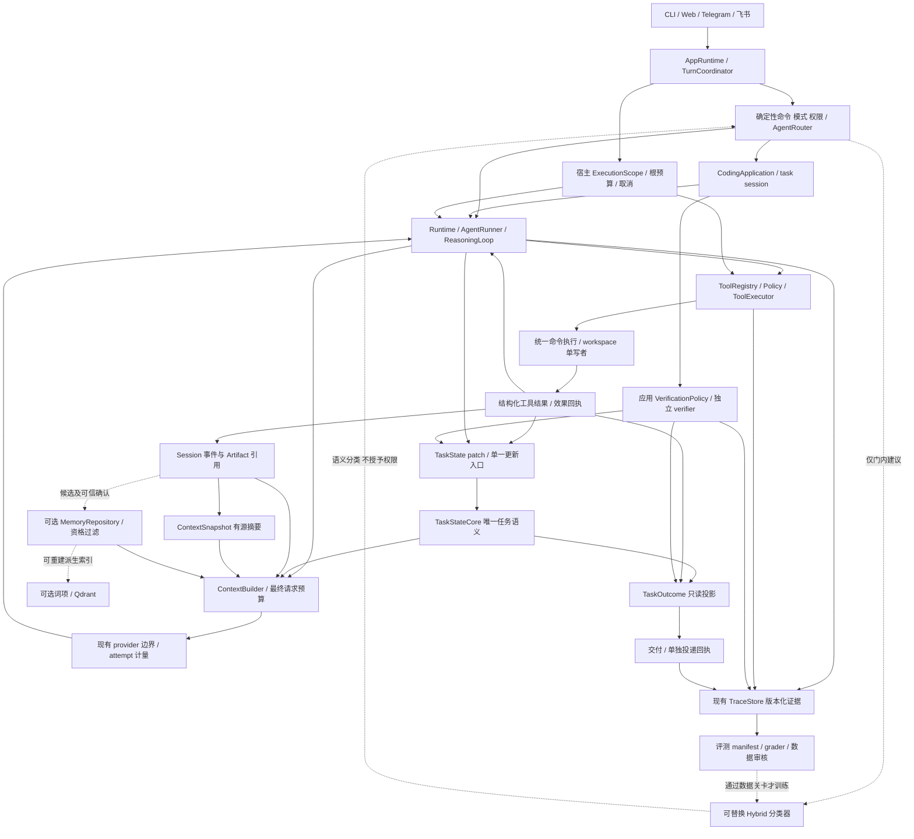
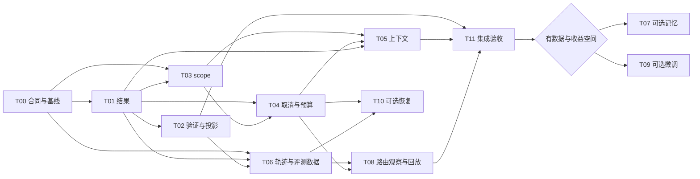

# 07｜TaleClaw 整体设计改进方案与实施裁决

> 日期：2026-09-27（Asia/Shanghai）。本轮只完成报告整合、静态代码审查、官方资料核验和设计；未实施业务改造、安装依赖、运行训练、调用付费模型实验、提交或推送代码。所有工期、收益门槛和实验配额均为建议，所有成绩均待测。

## 1. 总体结论

**推荐继续维护现有单主 Agent 运行时与 Coding 应用，先让执行事实、任务状态和验收结果可信，再改上下文，最后按数据决定是否启用记忆和微调。当前不需要换 Agent 框架，也不需要把多 Agent、向量检索或微调变成默认依赖。**

六份专项报告齐全，源码基线一致，可以形成完整的跨专项设计汇总；这不等于已经完成全仓测试、部署审计或模型效果评估。

最有价值的现有设计有三项：

1. **真实的模型—工具反馈循环和应用边界。** `Runtime.run → AgentRunner.run → ReasoningLoop.run` 已实际执行；Coding 应用负责任务会话、工作区和交付工件，通过 contributor/observer 接入内核。[C01–C03]
2. **已有状态、事件、上下文快照和大结果工件的分工基础。** 不必再造一套任务状态或记忆平台；需要纠正部分投影和证据语义。[C04–C07]
3. **集中式工具策略、可选记忆和现成评测资产。** 工具可见性与执行准入都有实现；记忆主库和向量索引已分离；已有 fixture、verifier、trace 和 matrix，可支持增量验证。[C08–C14]

最限制能力的五个问题如下。“高优先级”表示应先解决的依赖，不代表已有线上事故。

| 排序 | 问题与实码依据 | 属于什么问题 | 总体裁决 |
|---|---|---|---|
| 1 | shell 退出码丢失；正常返回的错误文本可能被标 success；最终回复、任务结束与独立验收混用；Verified 脚本 `evaluate=False` 仍将 completed 计 pass。[C04、C08、C13] | 工程可靠性、评测有效性 | 第一批统一结果与验证证据；在此之前不发布“解决率提升” |
| 2 | 后台命令使用全局 cwd；子任务取消不等于线程退出；Coding 停止后仍进入结论提取；写后缓存可能回放旧值。[C09–C10、C16] | 工程可靠性、作用域 | 默认单工作区单写者，限制未接通 scope 的路径，逐调用取消检查，UNKNOWN 禁止盲重试 |
| 3 | 多代快照只压新事件，旧摘要独有内容未传入；摘要校验是锚点检查；根规则读取可能与实际 workspace 不一致。[C05–C07、C15] | 工程信息管理；语义保真还含模型因素 | 先修来源、连续性和最终预算，不靠更大窗口或向量库掩盖 |
| 4 | 记忆晋升可使用模型自报 verified；共享 owner 不自动包含用户；无向量的空索引路径不走词法降级；Coding 自动读取装配不完整。[C11–C12、C15] | 工程资格治理；真实复用收益缺数据 | 自动晋升先保持关闭；需要记忆时先交付显式保存、纠错、撤销和基础查询 |
| 5 | 主模型失败分布、Hybrid 调用占比、完整费用、真实路由错误、长期记忆净收益没有当前可归因基线。[C13–C14、C17] | 缺数据，不能直接归为模型能力弱 | 先采最小元数据和独立验收；微调仅保留为有条件的窄任务实验 |

目前**不能确定**主模型的代码理解、工具选择、规划或中文路由是否是主要瓶颈。脚本回归通过不能证明真实模型能力；静态契约缺口也不能证明模型已经导致线上事故。先排除能由确定性代码解决的问题，剩余失败才进入模型实验。

## 2. 输入完整性、版本与审查范围

### 2.1 六份报告与内容指纹

以下六份文件已存在并参与整合。专题细节可回看，但本文包含独立理解整体方案所需的主要证据、争议与实施次序。

| 文件 | 行数 | 报告记录的源码 HEAD | 本次读取的 SHA-256 |
|---|---:|---|---|
| [01-architecture.md](01-architecture.md) | 714 | `5bc28e8d…` | `37c6ff0b71bec4599c4acbf5f9dc5985cdcc7194188a1a2f2ba4267e3703be30` |
| [02-context.md](02-context.md) | 847 | 同上 | `b5b5fcbbd31b0a61708870e0d13b305cd2c2b24fa562c79970d66c180cae9743` |
| [03-memory.md](03-memory.md) | 809 | 同上 | `9d530539dddcfabd9555649702244d34828d06189e3034584b5ec27ff7398907` |
| [04-reliability.md](04-reliability.md) | 660 | 同上 | `f4faf0137ecb0a47fcdedf8ab734c5163ac35e8d2898ab719f6d941ab85e7f07` |
| [05-finetuning.md](05-finetuning.md) | 645 | 同上 | `b1ff783158291f1bbec5f2c93a67ade015231c0c0794f2dd95993e2371bf3d55` |
| [06-evaluation.md](06-evaluation.md) | 678 | 同上 | `29f1a6093f6c7aff23e10e2a2ad99a2c073ee66503d8bc6f0657fb11d65981c0` |

共同源码提交为 **`5bc28e8d883a6ab4daf7e8d734ca3a1bcfbe24a2`**，提交时间 `2026-08-18T09:25:54+08:00`，标题 `harden runtime handler and embedding sharing`。当前分支为 `feat/memory-runtime-evolution`。

- 六份报告均记录开始审查时无 tracked 修改，既有 untracked 为 `docs/system-design (2)/`、`os`。本轮开始时另有 `docs/agent-design-review/`，即六份输入报告；`git diff --stat` 与 `git diff --cached --stat` 仍为空。
- 本轮审查对象为该 HEAD 的源码及上述明确记录的工作区状态。未执行、修改或以 `os` 和旧设计副本证明能力；未读真实 `.env`、用户对话正文、私有数据库或模型权重。
- `06` 曾只读盘点 ignored 历史评测产物；它们没有可靠绑定到本 HEAD，因此本汇总**不沿用任何历史产物分数作为当前版本成绩**。
- 已阅读根 `README.md`、`CONTRIBUTING.md`、`pyproject.toml`、`docs/README.md`、当前架构与 TaskState/ContextSnapshot 说明，再沿实现核验。`docs/README.md` 将大量旧报告列为历史材料，不能据其旧入口名称证明当前行为。
- 检查祖先目录、Git 文件列表以及相关源码/文档目录中的 `AGENTS.md`，未发现适用文件；没有为了找规则遍历数据库或运行数据正文。
- `07-master-plan.md` 写入前不存在。本轮只新增本文；六份输入未改动，末次复核以内容指纹和 Git 状态确认。

### 2.2 方法与证据等级

使用 Git 状态、目录/符号搜索、带行号源码阅读及官方网络资料；并行只读复核三个专题组合。默认 shell 沙箱因 `mountinfo path is not absolute` 无法启动，获准后只运行同类低成本检查和指定文档写入，没有借此启动应用。

本文标记规则：

- **事实**：当前代码分支、装配或本次读取的官方资料可支持。
- **推演**：由触发条件和调用链推出的失败场景，本汇总没有实际复现。
- **专项已复现**：仅表示输入报告明确记录了内存桩/函数级复现；本文抽查代码但没有重跑，不扩大为线上或真实 shell 事故。
- **建议**：拟议接口、优先级、工期及门槛，不是已实现功能。
- **待验证假设**：效果、发生频率、实际部署或费用尚无数据。

未运行完整 pytest、harness、服务、数据库或真实模型。已有测试文件只证明设计了哪些断言；不表述为本轮测试通过。网络资料访问日期统一为 **2026-09-27**，固定 commit/tag 与动态文档分列于 §12。

## 3. 实际架构与关键代码证据

### 3.1 当前能力分级

| 能力 | 当前状态 | 能确认的范围与限制 |
|---|---|---|
| CLI/Web/Telegram/飞书到应用执行 | 已经实现 | 入口门面、路由、调用与投递有代码；本轮未连接渠道验证。[C01] |
| 反复调用模型、执行工具、读观察、停止 | 已经实现 | 主 Agent 反馈循环真实存在；输出最后回复不等于目标已验收。[C02、C04] |
| 独立 Coding task session / workspace 绑定 | 已经实现 | 每次 Coding 请求创建 task session；绑定工作区直接改文件，不是文件系统沙箱。[C03、C09] |
| TaskState 合法更新与上下文快照 | 已经实现，语义有缺口 | 共享 core、版本 patch、快照 prepare/activate 有实现；部分完成投影和连续压缩仍须修复。[C04–C07] |
| 工具策略与结果结构 | 部分实现 | 已有 ToolExecutionResult、hooks 和 policy；不需另建同名体系，需纠正实际状态生产与消费。[C08–C10] |
| 命令即时取消、完整任务恢复、文件回滚 | 部分实现／完整保证未发现 | 有 cancel token、会话保存和差异清单；没有任意副作用的事务恢复或通用文件撤销。[C09–C10、C16] |
| 长期语义记忆 | 按开关已有实现，端到端部分实现 | 主库、命令服务、索引、读取均有代码；不能宣称所有 Coding 路径自动注入、用户已能完整管理。[C11–C12、C15] |
| 普通聊天持续自动提炼、全链记忆删除 | 未发现当前完整实现 | 旧生命周期文档及枚举不是生产链；当前撤销与永久清除各副本不是一回事。[03 §3、C11–C12] |
| 真实模型质量与路由评测 | 部分实现 | Coding harness、verifier、matrix 存在；scripted 是预设动作，入口路由质量与可信全费用尚缺。[C13–C14、C17] |
| 本项目 LoRA 训练、校准与部署闭环 | 未发现实现 | 有 Transformers 依赖及真实 Hybrid 分类接点；未发现专用数据版本、训练脚本、adapter 和有效对照成绩。[C14、05 §2] |
| 本文统一接口与分阶段目标 | 只有设计 | §6–§10 全部是待实施方案，不以文档存在宣称完成 |

### 3.2 证据索引

路径相对项目根目录；行号对应本次审查 HEAD。以下是高影响抽查与专项交叉证据，不宣称覆盖全仓。

| 编号 | 文件、关键符号与行号 | 支持的具体结论 |
|---|---|---|
| C01 | [applications/turn_coordinator.py](../../applications/turn_coordinator.py) `run_inbound` L55–93、`_execute` L266–322、`_deliver` L328–346；[applications/bootstrap.py](../../applications/bootstrap.py) `build_runtime` L111–133、282–400 | 固定入口编排与 composition root；CLI/Web/网关属于入口，非各自推理内核 |
| C02 | [runtime/runtime.py](../../runtime/runtime.py) `Runtime.run/_execute` L87–138；[runtime/execution/agent_runner.py](../../runtime/execution/agent_runner.py) `run` L72–102；[runtime/execution/reasoning_loop.py](../../runtime/execution/reasoning_loop.py) `run` L310–459 | 模型、工具和下一步循环；每 run 新控制状态；非单轮聊天包装 |
| C03 | [applications/coding/session.py](../../applications/coding/session.py) `TaskSessionFactory.create` L30–67；[applications/coding/runner.py](../../applications/coding/runner.py) `run_coding_task` L127–164、187–233 | 新 UUID task session、绑定既有 workspace；不能将同 task 追问的函数问题外推到所有父会话路径 |
| C04 | [runtime/task_state/service.py](../../runtime/task_state/service.py) `TaskStateRunObserver.after_run` L33–79、`save_task_state_core` L104–133；[runtime/execution/state.py](../../runtime/execution/state.py) `RunExecutionState` L12–62；[applications/coding/runner.py](../../applications/coding/runner.py) L235–239、271–275 | TaskState 持久语义和 run 控制态已分开；最终答复可触发任务完成，Coding metadata 又独立映射状态 |
| C05 | [applications/coding/context_state.py](../../applications/coding/context_state.py) `build_coding_context_view` L120 起、`_compact_events` L371–405、`_latest_real_user_message/_apply_user_objective_change` L547–604；[runtime/context/snapshots.py](../../runtime/context/snapshots.py) `EventCompactor` L168–249、`_normal_prompt` L465 起 | 压缩输入为新选事件与 task facts；旧摘要没有作为连续输入显式传递；原事件仍留存 |
| C06 | [runtime/context/snapshots.py](../../runtime/context/snapshots.py) `SnapshotValidator.validate` L112–149、`ContextSnapshotManager` L280–381 | 锚点/引用/范围/长度校验和激活后推进边界存在；不验证自然语言含义和事实支持 |
| C07 | [runtime/context/builder.py](../../runtime/context/builder.py) `ContextBuilder`；[runtime/context/budget.py](../../runtime/context/budget.py) `ContextBudgeter.from_env` L60 起；[runtime/execution/reasoning_loop.py](../../runtime/execution/reasoning_loop.py) L576–842；[applications/coding/context_state.py](../../applications/coding/context_state.py) L170–215 | 字符分区、软压缩与主调用 token 硬门控并存；不能推断辅助调用都等价受控 |
| C08 | [tools/handlers.py](../../tools/handlers.py) `run_bash` L2402–2415；[tools/executor.py](../../tools/executor.py) `execute` L144–165；[tools/tool_registry.py](../../tools/tool_registry.py) `execute` L387–419；[models/provider.py](../../models/provider.py) L101–105、191–196、338–368 | returncode 丢失、异常字符串与 success 共存、坏 JSON 变空参数和 incomplete 终端信息缺口 |
| C09 | [tools/hooks.py](../../tools/hooks.py) `ShellSafetyHook/ShellWorkspaceScopeHook` L72–124、`FileWriteScopeHook` L127–153；[tools/handlers.py](../../tools/handlers.py) L2655–2658；[applications/coding/orchestration/background_task.py](../../applications/coding/orchestration/background_task.py) L10–70 | 主工具有检查；BG 走全局 WORKDIR，命令黑名单/cwd 不构成 OS 隔离 |
| C10 | [agents/subagent/parallel.py](../../agents/subagent/parallel.py) L62–107；[agents/subagent/runner.py](../../agents/subagent/runner.py) L320–380；[applications/coding/orchestration/teammate.py](../../applications/coding/orchestration/teammate.py) L235–247、358；[runtime/cancellation.py](../../runtime/cancellation.py) L6–55 | 短期子任务有继承，TEAM 路径不等价；future.cancel 不确认正在运行线程退出；cancel token 已存在 |
| C11 | [applications/coding/conclusions.py](../../applications/coding/conclusions.py) `_parse_candidates` L149–177；[applications/coding/promotion.py](../../applications/coding/promotion.py) `promote` L68–127；[memory/command_service.py](../../memory/command_service.py) L41–149；[tools/handlers.py](../../tools/handlers.py) `run_memorize` L3031–3081 | 候选服务真实存在，但模型 verified 可进入 active；memorize 把工具调用标显式用户偏好，可信确认来源需分开 |
| C12 | [memory/commands.py](../../memory/commands.py) `MemoryContext.allowed_owners` L32–45；[memory/semantic_retrieval.py](../../memory/semantic_retrieval.py) `retrieve` L56–137；[memory/postgres_repository.py](../../memory/postgres_repository.py) L62–168；[memory/vector_runtime.py](../../memory/vector_runtime.py) | 主库为权威、向量 ID/version 回源复核已有；scope 不等于用户联合授权；仅异常触发词法降级；[semantic_index.py](../../memory/semantic_index.py) `NullSemanticMemoryIndex.search` L42–48 返回空列表 |
| C13 | [scripts/run_swebench_verified.py](../../scripts/run_swebench_verified.py) L128–154；[evaluation/harness.py](../../evaluation/harness.py) L50–71、201–239、357–363；[evaluation/verifiers.py](../../evaluation/verifiers.py) L19–118；[evaluation/metrics.py](../../evaluation/metrics.py) L9–49 | Verified 生成 completed 被计 pass；本地 harness 另有真实 verifier，不能说所有评测都只看 completed；直接 Coding 入口不测路由 |
| C14 | [runtime/routing/hybrid_classifier.py](../../runtime/routing/hybrid_classifier.py) `should_use_coding` L11–47；[runtime/routing/agent_router.py](../../runtime/routing/agent_router.py) `route` L33–64；[runtime/routing/execution_plan.py](../../runtime/routing/execution_plan.py) L24–127 | 门内短文本无工具分类，4000 字符前缀、异常 False；0.86/0.58 是常数；命令/模式/权限先行 |
| C15 | [applications/coding/runner.py](../../applications/coding/runner.py) `_build_task_runtime` L342–363；[runtime/context/builder.py](../../runtime/context/builder.py) L88–108；[runtime/context/assets.py](../../runtime/context/assets.py) L21–40；[runtime/context/memory.py](../../runtime/context/memory.py) L14–24 | Coding 新 builder 未传 memory/retrieval service，默认空服务；PromptAssetsService 默认 cwd，没有显式绑定已解析 workspace |
| C16 | [applications/coding/runner.py](../../applications/coding/runner.py) L235–254；[runtime/execution/reasoning_loop.py](../../runtime/execution/reasoning_loop.py) L128–145、997–1195；[tools/hooks.py](../../tools/hooks.py) `ToolLoopGuardHook` L191–208、274–276；[tools/handlers.py](../../tools/handlers.py) L705–725、1812–1817 | 停止后仍提取/晋升；工具批次未逐调用统一取消；hook 缓存与 session 缓存失效不同步 |
| C17 | [runtime/trace/events.py](../../runtime/trace/events.py) `TraceEvent` L7–20；[runtime/trace/trace_store.py](../../runtime/trace/trace_store.py) L57–117、211–240；[models/model_pool.py](../../models/model_pool.py) L145–159、192–195、410–481；[applications/turn_coordinator.py](../../applications/turn_coordinator.py) L370–390 | 已有 trace/span，但缺统一事件版本与完整辅助调用计量；SDK 默认策略、provider 回退和 all-open 路径须统一审计 |
| C18 | [runtime/sessions/session_store.py](../../runtime/sessions/session_store.py) `save_session` L343–430、L675–693；[runtime/trace/workspace.py](../../runtime/trace/workspace.py) L51–173；[runtime/ports.py](../../runtime/ports.py) L13–90；[runtime/extensions.py](../../runtime/extensions.py) L18–36 | 已有持久化/扩展口；进程内锁和数据库保存不等于跨进程 CAS 或 shell 副作用原子恢复；diff 快照不是回滚 |

## 4. 跨报告裁决：保留证据，压缩重复工作

六份报告没有出现“同一源码在一份说已实现、另一份说完全没有”的根本冲突。主要分歧是审查口径、优先级、建议阈值与默认开放程度。

| 争议／容易误读处 | 证据与分歧 | 本汇总最终判断 |
|---|---|---|
| 多种 status 是否都应合成一个 | 01/04/06 强调执行和验证分离；02 强调一个任务状态。C04 表明 run 控制、task 语义本就不同，Coding metadata 仍独立映射 | **一个任务语义写者，多个不同事实维度。** 不合并 run/tool/delivery 生命周期；禁止 UI、摘要、记忆再写主任务进度 |
| “完成”是否一律要求测试 | 01/04 倾向按任务合同；06 要求独立 verifier | 代码编辑按预先约定验收；只读分析可按交付文件/引用验收，聊天不强制测试。completed 只保留生命周期含义，verified 必须有证据 |
| 先评测还是先可靠性 | 各专项均有 P0，直接拼接会产生巨大第一阶段 | 先冻结结果口径、12 个契约例和 manifest；结果协议与 verifier 同批推进。无需先跑昂贵“旧基线”，确定性故障修复不等待模型实验 |
| 上下文“丢失”是否删除了历史 | 02 的两代压缩内存复现指最新模型视图缺少旧摘要独有事实；C05–C06 仍保存原事件 | 写作“活动上下文连续性缺口”，不写“数据库历史丢失”。恢复需要重查证据，不把 artifact ref 当已经读过全文 |
| 状态问句一定覆盖原目标吗 | 02 为函数级复现；01/C03 表明普通 Coding 请求会新建 UUID | 保留同 task 更新/来源判定缺陷，但**撤销常规父会话追问必然覆盖的扩张解读**；未来 resume 接入前必须补语义测试 |
| 主装配有 memory/RAG，是否 Coding 自动继承 | 03 指子运行器缺口；C15 再构造了 ContextBuilder | **部分实现**，不宣称全链贯通。明确 memory 配置矩阵后选择显式 recall 或自动注入，分别做装配测试 |
| 检查点能否安全自动续跑 | 01/04 均区分保存与恢复；C18 无外部效果事务 | 首版只承诺“保留证据、识别未终止和人工核对”，不承诺任意工具自动恢复或仓库回滚 |
| 模型 verified、字符串 passed 能否进入事实库 | 03 的晋升门与 04/06 的验收门不是同一个可信源 | 使用宿主 VerificationReceipt；也只证明对应检查，不证明模型整段自然语言结论。模型只能提候选 |
| 多 Agent 是不是当前核心价值 | 01/04 发现多条 scope/取消路径；06 不预设必须获胜 | 保留扩展口；默认主 Agent 单写。短期委派限实际可控读取；研究角色若仍有通用 bash，不能宣传“只读” |
| 记忆先向量化还是换 SQLite | 03 提 A/B/C 是投入等级，01 保留现有 PG | 沿用 PostgreSQL。先结构化/词项查询；Qdrant 可选；不增第二主库、不把基础路径依赖 embedding |
| 0.6B LoRA 是否已经成为主线 | 05 选题明确，但自认没有频率/成本/错误数据；06 要先数据与验收 | 它是**首个可证伪实验候选**，不是首批业务改造。先规则、线性、提示词、未微调同基座，允许最终不训练或不部署 |
| 各报告 5pp/2pp、15%/20% 门槛不同 | 06 为通用效率示例，05 为路由建议，02/03 也有各自探索门槛 | 不是事实矛盾，**不取平均、不当既定 SLA**。工程契约为硬门，模型指标按产品代价在 dev 后、holdout 前冻结，见 §9 |
| 48 案例与 24 题能否直接当训练集/成绩 | 06 提议 48 逻辑案例；C13 scripted 直接跑 Coding | 24 是旧开发回归；48 是未来分层套件，不是 48 个已测端到端任务，更不是路由训练数据 |
| 外部最新版本是否足够可信 | 03 LangMem 缺固定 SHA、Mem0 固定版许可抓取受限；06 Pro V2 缺可靠 immutable SHA | 不把它们升级为本项目依赖依据。本计划不引入这些依赖；若未来采纳须重新冻结源码、许可和数据版本 |

需要降调的表述还包括：“SDK 完全没重试”（错误）、“所有评测都没有 verifier”（错误）、“有 shell 黑名单就是沙箱”（错误）、“记忆关闭就没有任何辅助模型调用”（C16 不支持）、“公开权重等于完整训练可复现”（不成立）。这些是汇总时防止夸大的裁决，不是声称六份报告都犯了这些错误。

重复问题只实施一次：01 的 ToolResult、04 的 ToolOutcome、06 的 outcome 统一为扩展现有 `ToolExecutionResult`；01 的 ExecutionScope 和 03 的 namespace 共享宿主身份来源；02 的调用预算与 04 的总预算在同一调用边界协调，分别管请求大小和运行消耗；06 的 trace 是所有模块的公共证据出口。

## 5. 对抗性审查：现状和替代方案都要经受反例

本节除注明“专项已复现”外均为**推演，本轮未复现**。验收数字是未来提案。

### A1｜运行结束被包装成验证成功

- **现状证据 → 触发 → 场景 → 影响：** C08 的 `exit 1` 若无输出，会返回 `(no output)` 且 executor 标 success；C04 允许非空最终答复成为完成依据；C13 的 Verified 生成结束会计 pass。推演：错误补丁未跑独立测试，却在展示层呈现成功，并被后续结论提取消费。
- **现有优点：** 已有结构化结果外壳、trace、diff、pending/blocker 和本地 verifier；不必重写执行循环。
- **改进：** handler 保留 exit code；解析/拒绝/工具错误产生统一类型；运行结束和 verification 分离；验证回执绑定命令、验收版本及文件树摘要；官方基准读取官方逐题 resolved。
- **新增成本或风险：** exit 0、`echo passed` 或 `pytest || true` 都不是充分证明；验证器可能被模型改动或漏测新文件。采用受信命令、干净补丁重放、reference/empty/等价解检查，仍承认有限测试覆盖。
- **不值得复杂化的条件：** 分析、文档或聊天按自身交付合同验收，不强制全仓测试、不加第二裁判 Agent。
- **验收：** 非零退出/缺失必要检查不能 verified；测试后再次编辑使回执 stale；grader 异常计 invalid，不能 pass 或从分母静默删除。

### A2｜取消、超时和重试与真实副作用脱节

- **证据链：** C10 的取消 future 不停止运行线程，C16 在批次及收尾有取消缺口，C18 无工具效果账本。推演：子任务追加文件后超时，旧 attempt 未停，新 attempt 又追加；或用户停止后执行同一回复中的下一项写工具。
- **影响：** 重复写、迟到结果、取消后继续调用；发生频率未知。不能把 timeout 当“未发生效果”。
- **现有优点：** cancel token、工具风险元数据、受限恢复 controller 和 trace 已有。
- **改进：** 每次模型/工具 attempt 前共用取消与 deadline；UNKNOWN 有副作用操作禁止整轮自动重放；单写者；受管本地进程组停止并确认退出；取消后跳过可选提取/晋升。首版未停止的旧 worker 保留 lease，不放行新写者。
- **新增成本或风险：** 强杀可中断文件写；账本与 shell 不原子；进程组不是安全沙箱。先记录 `not_started/known/unknown`，不能靠 operation_id 宣称任意工具恰好一次。
- **不值得复杂化的条件：** 短时只读工具不需强持久账本；无跨进程续跑需求时不建自动恢复调度器。
- **验收：** 注入“效果后、记录前”中断，重启核对而不重放；收到取消后不启动新 attempt；受管进程目标 5 秒内退出，未退出显示 stopping/unknown，不伪报 stopped。

### A3｜workspace、身份、根规则与权限不一致

- **证据链：** C09 BG 全局 cwd；C10 TEAM 没有同等父身份继承；C15 根指令默认宿主 cwd；C12 project/application owner 不是用户联合键。推演：为仓库 B 执行任务时读取 A 的规则，后台写 A；两个用户共享 project 标识而获得非预期记忆。
- **现有优点：** 短期子任务继承、文件路径校验和工具准入已有；namespace 比完全无范围好。
- **改进：** 宿主生成不可由模型改写的 ExecutionScope，明确 user/workspace/task/run；根规则、文件、shell、memory 都消费它。默认项目记忆键包含 user；共享需显式授权。未接通的 BG/TEAM 写路径默认不可用。
- **新增成本或风险：** scope 本身是逻辑校验，通用 shell 仍能访问进程权限允许的资源；迁移 owner 可能使旧记忆暂不可见；单写者不能阻止用户外部编辑，受管编辑需 expected hash。
- **不值得复杂化的条件：** 可信本地单人先集中 scope 和单写约束；没有多租户需求不引入分布式权限平台。若承诺执行不可信代码，则任务级文件/网络隔离是开放前置条件，不能延期到事故后。
- **验收：** A/B workspace、不同 user、主工具/BG/子任务矩阵不串范围；根规则来自 B；相同旧 hash 两次写只能一个生效；注入文本不能扩大权限。

### A4｜摘要越来越流畅，但证据与约束越来越弱

- **证据链：** C05 新压缩未传上一摘要；C06 只检查锚点；02 §8 记录连续压缩和否定反转的内存复现。此处采用其**专项已复现**结论，未重新执行；不能扩写为历史被删除。
- **场景与影响：** 第一代唯一保留“不能改测试”；第二代只见新事件，或文本保留原句却另说限制已取消；后续决策缺乏正确约束。模型影响程度待实测。
- **现有优点：** 原事件、artifact、TaskState 和快照激活协议已有，可回查而非从零恢复。
- **改进：** 硬约束来自 TaskState 的有源记录；前代仍有效 claims 加新事件增量合并；摘要只能提候选，不能取消约束或确认为 verified；主请求和辅助请求统一最终预算检查；根目标更新需要真实消息来源与明确意图。
- **新增成本或风险：** 无条件累加前代摘要会持续保留陈旧事实并膨胀；引入完整知识图谱又会增加维护。首版只保目标、约束、待办、未解决失败和关键 refs，显式 supersede，按需重读其他事实。
- **不值得复杂化的条件：** 短任务可不开模型摘要；不必全量自动提取每个事件、不为每条 claim 再调用 LLM judge。
- **验收：** 连续至少三代压缩后保留指定约束、未解决失败和可达 refs；状态问句不改目标；伪 user 的工具/记忆消息无权更新目标；最终请求越界则显式 budget_conflict。

### A5｜自动记忆把一次猜测变成长期事实

- **证据链：** C11 模型 verified 进入晋升；C12 回源检查 item version，但不是代码版本验证；Null index 空结果不触发降级。推演：旧分支的“测试框架是 X”在新分支反复注入，或向量关闭后有效偏好也不可见。
- **现有优点：** repository、evidence、candidate/confirm/revoke、事务 outbox 与回源过滤真实存在。
- **改进：** 模型只提 candidate；用户确认或宿主受信证据决定资格；先显式保存低敏偏好/决策、按 ID 纠错撤销、无向量读取；代码事实能廉价重读就不持久化。保留代码事实时绑定依赖文件与验证版本。
- **新增成本或风险：** 人工审核增加摩擦；过严失效损失召回；旧 active 隔离影响体验。撤销是停止使用，不等于日志、备份、索引副本立即物理删除；需分别给回执。
- **不值得改造的条件：** 用户少有跨会话重复信息、或愿意维护仓库规则文件时，维持 memory 关闭。没有收益不建自动提炼、混合检索或图谱。
- **验收：** 模型任意自填 verified 仍只成为候选；用户 A 私有项目项不对 B 返回；关闭/故障索引仍可检索已确认项；撤销立即不注入，陈旧向量不复活条目；偏好否定变化不模糊合并。

### A6｜评测被任务环境、计分或数据泄漏影响

- **证据链：** C13 生成/验证混用且 harness 不过路由；C17 计量/版本缺口。06 §3 指出 patch 导出、verifier 异常、关键词代理指标的限制。
- **场景与影响：** 漏掉 staged/new 文件的 patch 在干净环境失败；模型改了公开测试后“通过”；下游根本没执行 classifier 却声称路由提升；把缺失 usage 填 0 获得虚假的节费结果。
- **现有优点：** fixture、ScriptedModel、独立命令 verifier、matrix、历史产物结构可复用。
- **改进：** 固定 manifest、逐题 ledger、独立 grader、完整补丁重放、unknown usage；路由另加真实入口 harness；dev/holdout 按仓库/任务家族划分，不把测试答案放进检索、记忆或训练输入。
- **新增成本或风险：** 小测试集方差大；grader 可能拒绝等价解；更严指标会降低旧展示分数。诚实重命名旧字段，保留原始记录与口径版本，不篡改历史。
- **不值得复杂化的条件：** 先 12 个必测逻辑例，不马上跑全量外部榜单或部署观测平台。
- **验收：** empty/bad patch 失败、reference/等价正确解通过；staged/new/deleted/binary 的允许改动可干净重放；infra invalid 单列，planned/started/verified/invalid 可核对；secret sentinel 不进入常规 trace。

### A7｜微调成为没有实际收益的展示组件

- **证据链：** C14 只有门内一次短分类且固定 confidence；05 明确无真实频率/成本/质量数据。推演：微调在同模板分类集高分，但真实入口很少调用；弃权大多回原模型，常驻 GPU 和双调用更贵。
- **现有优点：** 窄接点、无工具、权限在外部、易做对照；适合有限研究。
- **改进：** 先测门内流量，规则/线性/few-shot/同基座短标签基线；只训练存在稳定可学误差的 coding/bot/insufficient 语义分类；门控和权限保持独立，含 fallback 全量计费。
- **新增成本或风险：** 标签歧义、截断、多轮指代与 gate 漏召回可能无法靠微调解决；校准会漂移；服务维护成本可能超过调用节省。
- **不值得训练的条件：** 候选流量过低、便宜规则达标、授权数据不足或现有失败主要是信息缺失/工程错误。
- **验收：** 必须在完整入口与独立结果上有收益证据；同基座同模板对照能归因于训练；真实开关确实调用候选并记录接受/回退；达不到 §9 门槛即保留负结果、不部署。

## 6. 统一目标架构与核心接口

以下均是**建议**。沿现有模块增量演进，不引入第二套 Runtime、TaskManager、记忆主库或事件平台。

### 6.1 架构图



图中的“根预算”“回执”“单写者”“VerificationPolicy”是拟议职责，可先作为同进程的小对象和既有表/事件扩展，不代表微服务。TaskState 和验证接入仍走 `RuntimeExtensions`，不让内核导入 Coding 应用。

### 6.2 谁能写什么

| 事实 | 唯一拥有者／写入口 | 消费者与禁止事项 |
|---|---|---|
| 用户身份、授权 workspace、任务归属 | 应用入口创建的 ExecutionScope | 工具、模型调用、记忆读取使用；模型参数不得提升权限；缺身份外部入口拒绝，可信本地兼容由入口明确赋值 |
| 当前任务目标、约束、pending、blocker、completion basis | 现有 TaskStateCore + validated patch 服务；任务所属执行者串行提交 | Coding context/UI/summary 只读。子任务提交建议，由父任务 owner 应用；不直接写父目标 |
| 每 run 步数、调用预算、取消和 stop reason | RunExecutionState / 根运行预算 | RunState、Coding metadata、UI 为投影，不各自推断新的 task completed |
| 原始请求、工具观察、文件证据 | Session event log / Artifact store | 按来源追加；修正以新事件表达；trace 默认存引用，不复制全量内容 |
| 压缩范围、generation、摘要候选 | ContextSnapshotManager | 只能组织模型视图，不改 task 权威；保留原事件可达性 |
| 工具效果和执行结果 | ToolExecutor/命令 adapter 产生不可变 receipt | status/exit code 来自宿主；日志文本不能反向覆盖 status；ledger 不再维护主任务进度 |
| 独立验证结果 | 应用 verifier 生成 VerificationReceipt | TaskState 只引用；每次变更使相关回执失效。LLM 的总结不是 verifier |
| 跨任务已确认事实 | MemoryCommandService → MemoryRepository | 模型提交 candidate；scope、版本、删除由宿主管理；索引不保存第二事实源 |
| 用户可见结果与投递是否成功 | TaskOutcome 为组合视图；delivery receipt 记录传输事实 | 未送达不触发业务重跑；不把“已送达”当任务正确 |
| 实验判定、指标、训练标签 | evaluation 的 grader、manifest、人工审核流程 | 读取既有事实；不修改 runtime 成功状态以配合分数；历史执行轨迹不是天然 gold |

现有 TaskState patch 的版本检查是重要基础，但不是跨进程数据库 CAS 的证明。首版单进程 owner + workspace lease 足够；若允许多实例写同一 task，必须另加 session revision CAS，不能只沿用内存版本。

### 6.3 最小接口草案

以现有 `ToolExecutionResult`、`RunContext`、TaskState patch、trace 事件为扩展点。以下字段不要求全部新建类或表。

```text
ExecutionScope
  user_id, session_id, task_id?, run_id, parent_run_id?, actor_id
  workspace_id, workspace_root, permissions, policy_version
  cancellation_token, deadline, root_budget_id

ToolExecutionResult (扩展既有类型)
  schema_version, tool_call_id, operation_id?, attempt_id
  status: success | error | denied | timeout | cancelled | unknown
  exit_code?, error_kind?, output_ref?, bounded_preview
  effect_state: not_started | no_effect | applied | partial | unknown
  before_fingerprint?, after_fingerprint?, remote_receipt_ref?

VerificationReceipt
  verification_id, task_id, requirement_ids, verifier_version
  outcome: passed | failed | not_run | not_applicable | invalid | stale
  input_tree_digest, environment_digest, tool_call_ids, evidence_refs
  checked_at, reason, coverage_limitations

TaskOutcome (只读投影，不是第二个任务状态机)
  task_state_ref/version, execution_ref, verification_refs, artifact_refs
  delivery_receipt_ref?, unresolved_items

ContextBuildResult
  messages, tool_schemas, source_refs, snapshot_id, task_state_version
  request_budget, counted_input, reserved_output, reductions, conflicts

MemoryProposal / MemoryQuery
  宿主 scope, 来源引用, candidate 内容, 适用版本/有效期, expected_version
  返回 qualified hits + 拒绝/过期理由；不返回可执行指令

RouteDecision
  semantic_route: coding | bot | insufficient
  accepted, fallback_reason, effective_route, policy_override
  input_view_hash, classifier_version, score_kind, calibrated_score?, usage?
```

`operation_id` 表示宿主识别的同一次意图，不是仅靠参数 hash 去重；两个内容相同但用户分别要求的写入可以是不同操作。自动重试复用 operation_id 并产生新 attempt_id；unknown write 只允许核对。此设计借鉴幂等请求标识的原则，不承诺外部服务支持幂等。[AWS 官方资料](https://aws.amazon.com/builders-library/making-retries-safe-with-idempotent-APIs/)（访问 2026-09-27）。

任务示例：用户要求修复 parser 并运行指定测试。run 收到最终回复而结束，测试返回 exit 1，则 `execution=completed`、`verification=failed`、TaskState 保留未解决项，投影显示“执行已结束，验证失败”。修复后测试通过但又编辑 parser，回执变 stale。分析任务若用户禁止运行测试，则 `not_run` 并说明原因；不能改成 passed。纯解释任务的测试验证可为 `not_applicable`。

### 6.4 两种预算，一个调用边界

**不要把上下文窗口和总费用混为一份 token 数。** 在现有 provider/ModelTaskRunner 接入共同调用上下文：

1. `RequestBudget` 检查最终序列化请求：`input_limit = min(provider_input_limit, window - actual_output_reserve - margin)`；工具 schema 和协议开销只计一次。静态规则/核心目标已超限则显式冲突，不静默裁掉禁止条件。
2. `RunBudget` 管总 deadline、模型/工具 attempt、输出上限、已知 token/费用和子任务配额。summary、reflection、conclusion、hybrid、fallback 都纳入。不可计量时标 unknown；有严格费用上限却无法可靠计量时采用保守预留和调用次数上限，不声称精确费用封顶。
3. SDK 传输重试与业务重试只能有一层明确负责同一失败重试，所有尝试消耗根预算。首版显式配置 SDK 行为并记录有效配置，不默认再叠加更多重试。
4. 上下文按核心约束、未解决失败、近期完整工具事务、当前文件证据、可选记忆排序；低优先信息外置。02 的固定比例只作调参起点，本总案不将六份报告配额机械叠加。

### 6.5 记忆与微调的边界

默认继续单 Agent 完成任务。记忆功能未完成资格/管理闭环时保持关闭；如必须启用，首版仅支持明确偏好与人工确认决策。Coding 自动注入和显式 recall 各有接线测试，不为了让“memory on”看起来有作用就偷偷扩大调用范围。

Hybrid 小模型只能给语义建议。规则路由、显式模式、授权和输入来源由宿主决定；`insufficient` 与服务失败不同。首版回 legacy 并记录原因，不假定 legacy 能补回缺失上下文；真正追问需要独立产品路径，后置实施。

## 7. 统一优先级：每项改动的收益、代价和退出方式

**P0**：在宣称可靠执行或发布效果结论前必须处理；**P1**：核心可信后改善长任务和可维护性；**P2**：有需求/测量收益才做。P0 不等于“所有用户已遭遇严重事故”。未启用的可选能力可以通过保持关闭满足前置条件，不必本期把它全部修完。

人日按熟悉 Python 项目的开发者每天约 6 小时有效工作估算，含针对性测试与审查，不含等待外部授权、生产迁移、GPU 排队和大规模人工标注。下表是完整任务包范围，存在共享测试/接口，不能把各专题原估算再相加。

| 包／级别 | 问题证据、预期收益（未实测） | 估计与依赖 | 新增风险 | 可验证完成标准 | 回滚方法 |
|---|---|---|---|---|---|
| T00／P0 | C04/C13/C17：先冻结任务完成、验证、invalid 与 unknown，建立可比较基线 | 1–2 人日；无前置 | 合同过宽导致范围膨胀 | §6 合同与旧字段映射完成；12 个必测案例有 ID、gold、允许范围、manifest；旧成绩标旧口径 | 保留旧字段和原文件只读，新字段缺失映射 unknown；不删除旧数据 |
| T01／P0 | C08：统一工具结果/参数错误/流结束，避免机器误判 | 3–5 人日；T00 | 旧字符串 handler、插件、hook 兼容 | exit 0/1、空输出、stderr、拒绝、超时、非法 JSON/schema、incomplete 矩阵；坏参数不调用 handler；模型和 trace 同源 | 使用单个兼容 adapter；可回退显示，不能把已知错误重新映成 success |
| T02／P0 | C04/C13：任务投影 + verifier，能区分生成完成与正确交付 | 2–4 人日；T00，可与 T01 按冻结类型并行 | 旧 UI 依赖 completed；测试太弱/太严 | final+failed 不显示 verified；后续编辑回执 stale；官方逐题结果绑定 patch digest；invalid 单列 | 新视图开关回旧外观但保留准确标签；必要时停止发布成功率，保留原始回执 |
| T03／P0 | C09/C10/C15：scope/根规则/单写者，减少串工作区和并行覆盖可能 | 2–4 人日；T00，完整结果接 T01 | 关闭 TEAM/BG 影响少数使用者；锁未释放 | 主工具、BG、子任务、规则文件读取的 A/B 测试；默认未知 scope 不执行；旧 writer 未退不放行 | 停用 BG/TEAM/并行写回单主执行；不回全局 cwd；保留用户已有 diff |
| T04／P0→P1 | C10/C16/C17：逐调用取消、所有 purpose 根预算、写后缓存失效 | 3–5 人日；T01/T03；RequestBudget 接 T05 | 强杀中断写、误预算拒绝、fallback 行为变更 | 取消后不启动新 attempt；unknown 不重放；写后重读新值；所有辅助调用可追踪；all-open 不无界继续尝试 | 禁用自动重试/缓存/可选收尾；保留 deadline、取消和 unknown 硬保护，不退回盲重试 |
| T05／P1，根规则/来源先行 | C05–C07/C15：来源、多代压缩、有界状态投影和最终请求 gate | 3–5 人日；T00；工具事实接 T01，scope 接 T03 | 摘要继承过量、来源迁移、角色兼容 | 三代压缩、否定约束、伪 user、状态问句、长请求及超大工具 schema 例通过；主/辅助都检查最终输入 | 开关回确定性投影、限制长任务或明确 budget_conflict；保留原事件/旧快照，不关最终 gate |
| T06／P1，可按需缩小 | C17/06 §3：元数据 trace、attempt 关联、unknown usage、完整 patch 与逐题 ledger | 2–4 人日；T00；验收接 T01/T02 | 日志泄露、I/O 增量、迁移分析脚本 | 版本/输入摘要/实际模型/父子关联可追踪；secret sentinel 不落常规日志；staged/new/deleted/binary 重放一致；错误不丢行 | metadata_only、降采样可选诊断；旧 trace 只读兼容，不把 missing 填零 |
| T07／启用记忆前 P0，默认可跳过 | C11/C12/C15：可信写入、私有 scope、基础读取与用户管理 | 5–8 人日；T01/T02/T03/T05；如果保持关闭则仅核对装配开关 | 旧条目隔离、删除语义、数据库读取异常 | candidate 不能自证；无向量可读；按 ID 改/撤销；两用户同 project 不串；可选 SQL 故障可控；真条目管理可用 | READ/WRITE/CONTEXT 独立关闭；保留主库和导出；隔离来源不明项，不自动降级授权 |
| T08／P1 数据准备 | C14：结构化 RouteDecision、入口 replay、标签手册和调用元数据 | 2–3 人日；T00/T06，分类器结果与 T04 预算接通 | 原输入与实际可见输入不一致；把恒定 confidence 当概率 | 全入口 gate/权限/模式回放；正确 bot 与解析失败分开；真实分类调用可计量；无工具、无共享 last_result | 开关回 legacy bool adapter；保留精确错误和 usage 事件 |
| T09／P2 | 05/06：授权数据、便宜基线、必要时一次 LoRA 和受控比较 | 4–7 人日研究开发，另加标注/算力；T08 + §9 Go | 小样本过拟合、服务摊销、数据污染 | 同家族隔离、同协议未微调对照、全入口与净成本达到预登记门槛；否则交付不部署报告 | classifier 开关回规则/legacy，卸载 adapter 不动 Agent 主依赖；数据版本保留 |
| T10／P2，真实恢复/索引需求触发 | C18、03 outbox：最小 effect ledger、人工恢复；或索引 lease | 4–7 人日；T01/T03/T04/T06；两个子题按需求选 | 账本仍不保证外部原子性、旧 worker、schema 迁移 | crash 窗口为 unknown、不盲重放；处理中的索引事件可重领且撤销不复活；不要求通用 resume | 停止续跑或索引 worker，回人工核对/无向量查询；保留不可变回执 |
| T11／每次阶段验收 | 01–06：集成、消融、失败分析和诚实展示 | 2–3 人日首轮；依赖选中包完成，不等全部 P2 | 测试泄漏、事后调门槛、只选胜例 | §8/§9 固定协议、差异全审、成本含 unknown、负结果可追踪；README/简历区分完成层级 | 退回上一通过配置；保留实验与失败说明，不改历史分数 |

**立即不改的部分：** Runtime 主循环、AgentSpec、应用与内核分层、现有 PostgreSQL 事实源、集中工具注册/策略、provider 兼容协议、已有评测 fixture 与 trace。也不因单文件长而启动全仓拆包，优先让实际契约正确。

**明确后置：** 通用 DAG/Temporal/LangGraph 迁移、Kafka、向量化轨迹仓库、知识图谱、多个推理模型投票、主 Agent 全参微调/RL、默认并行写、跨进程调度与全自动崩溃续跑。已有 Qdrant 不要求删除，但不能以存在为理由默认启用。既有 PostgreSQL 不应为了“轻量”迁移到第二后端。

## 8. 分阶段路线、工作量与依赖

### 8.1 估算基准

这是有多个入口、应用层、运行时、工具、记忆和评测模块的项目，不是十几个文件的示例。01 的静态统计列出 runtime 81 个 Python 文件约 17,835 行、applications 20 个约 5,835 行、tools 8 个约 6,559 行；本轮子审查按 `test_*.py`/AST 定义统计到 118 个测试文件、653 个测试函数、24 个 Coding fixture。它与 01 的“tests 下全部 Python 文件 127 个”口径不同，**不是版本矛盾，更不是通过率**。

估算假设：一位熟悉该代码库的开发者；单 Linux 部署、少量可信用户、既有 PostgreSQL 可用；不建设跨平台沙箱、多实例调度或新前端框架；测试当前是否稳定未知。若上述假设不成立，在 T00 重估；不能把工期写成承诺。

### 8.2 个人开发者精简路线（推荐）

目标是在约 **12–20 有效人日，约 3–5 个全职工作周**形成可信最小闭环。此范围是下表中的**缩减版**，不是 §7 全部任务包总和；兼职每周 2–3 人日约需 4–10 周。初期保持自动记忆、TEAM/BG 写、并行写和小模型训练关闭。

| 阶段 | 范围与可交付结果 | 缩减工期 | 退出门槛 |
|---|---|---:|---|
| S0 建立基线与最小观测 | T00 + T06 元数据子集：成功口径、manifest、12 必测契约、旧分数标签 | 1–2 日 | 无模型即可发现错误 patch/无效 grader/缺 usage，未运行数据不填分数 |
| S1 主要执行可靠性 | T01/T02/T03/T04 最小项：退出码、错误结果、验证状态、关闭不一致路径、scope、逐调用取消、停止可选收尾、写后禁旧缓存 | 5–8 日 | 已知失败不绿灯，取消不启动新动作，单写范围明确；先不承诺进程崩溃续跑 |
| S2 上下文与必要边界 | T05 + T04 预算子集：origin、目标不被伪消息替换、连续摘要最小事实、最终请求 gate、所有 purpose 计量 | 4–6 日 | 三代压缩及超窗反例通过；有明确预算失败，未做长期记忆复杂化 |
| S3 集成与成果整理 | T11 + T08 元数据/回放子集：修复前后契约差异、真实流量需求记录模板、诚实文档与展示 | 2–4 日 | 所选合同通过、实际入口可追踪、没有把 scripted 当能力；明确下一阶段 Go/No-go |
| 合计 | 只覆盖上述缩减范围 | **12–20 日** | 可停在这里，不因微调报告存在就必须训练 |

S1 首次补丁可先只支持主 shell 与文件工具，关闭不受控分支。通用插件全迁移、完整 UI 管理、长期恢复和高级预算算法不在缩减工期内。若当前连可信测试环境都无法运行，则先修验收环境并延后工期，不能跳过门槛补一张成绩表。

### 8.3 时间更充足的扩展路线

完成 T00–T06、T08、T11 的完整范围约 **20–35 人日（4–7 周）**；它包括精简路线，不是额外再加 20–35 日。该区间与所选完整任务包估算相符，联调复用可能降低总量，失败与迁移可能增加总量，应在 T00 拆分后更新。

之后按需求选择，不默认全做：

1. **必要记忆能力（T07，5–8 日）**：先显式保存/撤销和基础检索；有自动注入需求才接 Coding factory；代码事实失效与索引 lease 按实际选择。可以不启用向量。
2. **路由数据与微调实验（T09，4–7 日开发 + 独立标注/算力）**：先试标与便宜基线，Go 后才训练。100–200 条试标若平均 2–3 分钟，约 3.3–10 小时；800–1500 条初始标注约 27–75 小时，另加家族去重、争议复核和数据清理。这是算术估算，不是已有数据或质量承诺。
3. **确需恢复或保留向量（T10，4–7 日起）**：先人工核对工具账本或 outbox 租约；完整自动恢复、worktree 合并、外部服务幂等接入另估，不塞进本工期。
4. **集成验证与消融**：每新增模块单独完成 T11；真实模型实验的调用/费用预算和训练硬件另定。不能把报告只读授权延伸到下一轮批量付费运行。

### 8.4 可以并行与必须串行的事项



- T00 冻结契约后，工具结果、scope 和评测 manifest 可以并行；T02 早期可用 fake receipt 开发，正式验收等待 T01。
- T05 的来源/根绑定可以先于完整预算开发，最终验收须与 T04 共用调用口径；图中箭头表示完整交付依赖，不禁止独立子项先行。
- 数据标签手册、许可检查、原创试标可以在 S1/S2 并行；实际训练依赖数据、入口回放和基线，不依赖把长期记忆做完。
- 只有未来实验声称“记忆提升”才依赖 T07；路由微调不应被向量工程阻塞，也不应同时改 gate、输入历史和主模型。
- `runner.py`、`reasoning_loop.py`、`handlers.py` 是冲突热点。并行任务先锁接口与单文件负责人，结果协议先落、其他分支适配；不要让多个包同时发明 outcome/schema。每个实现包单独复核 diff，禁止覆盖用户已有改动。

### 8.5 最小评测与结果格式

保留旧 24 题作 `legacy-dev-regression`。首批 12 个必测逻辑例：正常 bugfix、错误 patch、等价正确解、grader 篡改、临时失败恢复、永久超时、写后超时、摘要否定反转、过期记忆、跨 scope、unknown usage、截断 trace。内存/假 provider 的结果只能证明合同；不依赖 memory 的最小版本中，“过期记忆”可用合成 repo 验证拒绝接口，不能声称生产装配已通。

之后按 06 扩为组件 20、工作流 10、端到端 10、可靠性/安全 8，共 48 个逻辑案例；38 个 C/W/R 可先用 stub，另选行为子集用真实模型。各逻辑 ID、来源和 family 明确，不重复计数。同一逻辑题的多次运行记 trial，而非新题。

最小每 trial 记录：`experiment_id/task_family/task_id/trial_id`、代码 SHA/dirty patch 摘要、fixture/prompt/tool/config/environment hash、实际模型、root/child attempt、工具回执、verification、policy 违规、infra 状态、known/unknown usage、耗时、人工修复时间及受控 artifact refs。默认不采完整生产对话；明确授权的调试内容按独立保留期管理。

| 实验 | 代码／数据版本 | 任务家族／trials | verified 通过率及区间 | policy 违规 | infra invalid | 总费用／unknown 占比 | P50/P95 | 人工修复时间 |
|---|---|---|---|---|---|---|---|---|
| 原基线 | `<待填>` | `<待填>` | `<待测>` | `<待测>` | `<待测>` | `<待测>` | `<待测>` | `<待测>` |
| 执行修复 | `<待填>` | `<同集>` | `<待测>` | `<待测>` | `<待测>` | `<待测>` | `<待测>` | `<待测>` |
| +上下文 | `<待填>` | `<同集>` | `<待测>` | `<待测>` | `<待测>` | `<待测>` | `<待测>` | `<待测>` |
| +可选记忆／路由，各自单测 | `<待填>` | `<同集>` | `<待测>` | `<待测>` | `<待测>` | `<待测>` | `<待测>` | `<待测>` |

未运行层写“未执行”，不填 0；invalid 单列并按预登记方法给全部尝试和有效尝试口径。安全/权限硬门不能由加权平均分抵消。首轮人工审全部端到端输出、差异与异常；小团队不需要先建设在线 LLM judge 平台。

## 9. 微调专项的最终裁决

### 9.1 为什么可能需要，为什么现在还不能宣布需要

唯一值得优先保留的候选是替换现有 `HybridModeClassifier` 的**语义模式路由**，而非训练整个 Agent。原因是 C14 有真实调用点，输入短、标签有限、无工具、回退清楚；可以比较是否减少误路由、分类延迟或费用。

但没有证据说明它当前频繁、昂贵或差。若多数用户固定 coding/bot 模式，或者候选 gate 很少命中，小模型几乎无调用；若长内容被预处理为不充分前缀，则增加训练不能还原信息。**T08 观察结果可以否决整个微调方向。**

选择 Qwen3-0.6B 非思考模式 LoRA 仅为实验起点：官方公开权重、Apache-2.0、固定 revision `c1899de289a04d12100db370d81485cdf75e47ca`，模板支持关闭 thinking；这些事实支持许可/接口可行性，不证明本项目中文路由效果。[Qwen 模型卡](https://huggingface.co/Qwen/Qwen3-0.6B)、[固定模板](https://huggingface.co/Qwen/Qwen3-0.6B/blob/c1899de289a04d12100db370d81485cdf75e47ca/tokenizer_config.json)（访问 2026-09-27）。不因 0.6B 可训练就先部署常驻 GPU 服务。

### 9.2 基线必须回答“更简单的方法能否解决”

| 对照 | 能解决什么 | 不能隐瞒的限制／裁决 |
|---|---|---|
| B0 现行 Hybrid 模型 | 保留当前质量/时延/费用参考 | 解析失败与 bot 当前合并，先补观测；不是人工 gold |
| B1 明确规则 + legacy 回退 | 高置信项目操作、明确概念问答 | 否定、引用、变体和指代可能失败；规则达标就采用 |
| B2 字符 n-gram + 线性分类 | 中文短文本便宜、CPU 部署容易 | 需家族隔离和校准，仍可能过拟合词面；是有效候选，不是凑数 |
| B3/B4 现行模型提示改进、few-shot | 常见歧义、输出更短、少量例子 | 改协议造成的改善不归因于微调；prompt 同样需要冻结版本 |
| B5 同一 0.6B 基座、同短标签、未微调 zero-shot 与 few-shot 两组 | 检查已有指令能力、少样例提示与输出协议收益 | 与 LoRA 共用输入、tokenizer、协议及校准预算，各自只在 dev 调参；防止把提示或协议收益归于训练 |
| F1 同基座 LoRA | 学剩余且稳定的语义错误 | 只有胜过最佳便宜基线和 B5 才说明训练有增量价值 |

RouteLLM 的公开 Apache-2.0 实现比较强弱模型偏好；可借阈值/成本曲线，不能把其权重、标签或论文节费比例直接用于 coding/bot 模式选择。[固定 routers.py](https://github.com/lm-sys/RouteLLM/blob/0b64fdafe049e596a3f5657c219329f24af24198/routellm/routers/routers.py)、[固定许可](https://github.com/lm-sys/RouteLLM/blob/0b64fdafe049e596a3f5657c219329f24af24198/LICENSE)（commit 2024-08-10，访问 2026-09-27）。本计划不引入整个 RouteLLM 平台。

### 9.3 先补的数据和评测能力

1. **D0 需求与试标**：100–200 条原创/授权请求，记录真实候选比例、现行分类费用/耗时/异常/错误和标签分歧；这是建议采样量，当前未完成。禁止直接读取或导出私人轨迹作为“现成训练数据”。
2. **标签合同**：`coding` 包含具体项目的只读审查；`bot` 为一般解释/写作或既有专门路径；`insufficient` 表示当前允许输入无法判断。显式命令、pinned mode、用户权限是 policy，不放进语义 gold。
3. **实际输入一致**：保存路由时可见输入及外置/截断标记。C14 前 4000 字符可能已被 `TurnCoordinator` 改写；一期候选可对外置/明显缺指代/预算不足弃权。回 legacy 不等于解决信息缺失，单列未解决率。
4. **数据划分**：按仓库、原始任务、模板来源和多轮 family 分组，再划 train/dev/holdout；不能先随机拆句子再让同一任务变体泄漏。训练约 800–1500 条仅作后续预算起点，是否足够取决于独立家族与误差，测试规模通过 pilot 估方差后冻结。
5. **每条 lineage**：来源授权、脱敏版本、input cutoff、gold 与标注者/争议、工具/策略版本、family/split；未来步骤和最终 grader 原文不能进入决策时的输入。原模型 route、summary verified 或历史 completed 不直接作 gold。
6. **三级验收**：门内离线分类 → 真实 `IntentClassifier/ExecutionPlanner/AgentRouter` 契约回放 → 真实入口配对端到端。现有直接 Coding harness 只复用 fixture/verifier，不冒充第三级。

可判定的 coding/bot 集共同报告二类 macro-F1、双向误路由、coding precision/recall；insufficient 独立报告；三类 F1 只比较同三类协议模型。弃权不得从最终分母删除，需计算回退后的质量、时延和费用；0.86/0.58 不作为概率校准数据。

### 9.4 训练、部署与停止的关卡

| 关卡 | Go 条件 | No-go／停止条件 |
|---|---|---|
| 进入试标 | 有数据授权和明确语义合同，元数据可测 | 无授权、没有有效 Hybrid 流量：止于设计/原创离线研究 |
| 进入一次 LoRA | B1–B5 后仍有稳定可学错误，成本/延迟或质量有足够空间 | 规则/线性已够用；错误主要来自 gate、缺历史/截断；不训练 |
| 离线候选 | 同基座同协议优于未微调，且相对最佳便宜基线无不可接受退步 | 只在同模板获益；dev 连续两轮合理数据/超参修正仍无收益；不扩大模型 |
| 影子接入 | 只观察、不改变实际路由；输入、版本、接受/回退、异常可追踪 | 未真接入入口、只打印模型名；无法记录调用或与主预算重复：不称集成完成 |
| 小范围部署 | 权限/模式合同全通过；配对 E2E 满足预登记质量与净收益门槛；可一键切回 | 新权限违规、严重误操作、全量成本增加、服务成本不合算或证据不足：不部署/回退 |

统一阈值裁决如下，均须在看 holdout 之前登记：

- **硬门**：限定回放集上零权限/显式模式违约、非法输出不执行工具、无新增严重副作用、数据与模型可追踪。零次观察不等于真实总体风险为零。
- **质量优先**：05 的 coding P/R 各下降不超过 1pp、E2E 非劣界不大于 2pp 可作讨论起点；不能将 06 的通用 5pp 容忍自动套给路由，也不能因小样本点估计好看就认定非劣。结合误入 coding 的代价冻结；无法给出足够区间就写“探索性证据不足”。
- **实用收益**：可选择“有可信质量提升”或“质量非劣且每千总请求净费用/路由 P95 约改善 20%”作为目标；后者必须不恶化总任务体验。15%/20% 不是当前 SLA。覆盖率可从 dev 的 60% 起点讨论，但不能靠几乎全弃权通过质量验收。
- **经济计算**：`每期净收益 = 原分类调用成本 - 新分类/回退成本 - 误路由新增下游成本 - 服务摊销 - 维护成本`。若只是路由环节省了 20%，不得写整个 Agent 省 20%；低流量时允许结论为不划算。
- **统计纪律**：先 pilot/dev 估方差，再固定独立 family 的最终样本量；不反复解封测试集调参直到显著。重复试验按 family 聚类比较；少量题不足以证实细微差异。
- **训练方法范围**：首轮 BF16 LoRA 能放下就不引入 QLoRA；需要量化时单独测质量/延迟。先核实实际 tokenizer 的标签 token、loss mask、训练库兼容与一次小批 smoke；训练环境与 Agent 运行依赖分开。LoRA 冻结基座、训练低秩参数的方法依据见 [作者论文](https://arxiv.org/abs/2106.09685)（初稿 2021-06-17，访问 2026-09-27）；其大模型成绩不用于预测本任务。不得把既有 Transformers 依赖说成训练栈已可用。

### 9.5 防止“展示组件”化的交付要求

研究产物按实际关卡交付：试标后保存数据 manifest 和标签分歧；跑过哪些基线就交付哪些结果与未做项；仅训练后要求 adapter/config 和同基座消融，仅实际集成后要求入口开关与调用证据。费用账本保留 unknown，不补造完整费用。失败案例按实际观察展示，包括观察到的模型输给规则、回退及缺信息问题；没有观察到不得编造。不得仅展示 JSON 格式成功；每个停止关卡都要有理由和下一步裁决。

若最终规则胜出，就部署规则或保持 legacy，并把结论写成“完成可复现对照，未观察到微调部署收益”。若只有离线分类完成，就写“离线路由研究”；只有完整入口配对与有限运行数据才可谈 Agent 端到端收益。**训练完成、adapter 文件存在或参数量变小都不是本任务的成功标准。**

## 10. 后续可交给 Codex 的独立实施任务包

以下是未来任务说明，本轮不执行。每包开始时重新读适用 AGENTS、HEAD/status 和目标文件，保留未提交改动；只改列明范围。若需扩大公共接口，先更新 T00 的合同并协调文件负责人，不能另建并行状态体系。运行测试时只用 fake provider、隔离 fixture/专用测试库；模型实验、安装依赖与外部发送另列后续任务授权和预算。

### T00｜冻结结果合同和最小基线

- **目标／范围**：围绕现有 `runtime/execution`、`runtime/task_state`、`evaluation/task_schema.py`、`metrics.py` 定义兼容字段和例子；先落合同测试及 manifest，避免大规模迁移。
- **前置／输入**：本报告 C04/C13/C17、旧数据样例；需要明确分析/编辑/测试任务的验收要求。
- **输出**：类型/枚举兼容表、12 逻辑例定义、旧 completed/pass/unknown 映射、实验版本记录。
- **测试／完成**：fake receipt 可表达失败、未运行、无须验证、验证器异常和 stale；无模型下能解释每种终态。
- **禁止扩展**：不改路由策略、不引入框架、不迁移所有历史数据、不生成虚假历史回执。

### T01｜贯通工具和模型终端结果

- **目标／修改范围**：`tools/executor.py`、`tool_registry.py`、`handlers.py` 的相关 handler、`models/provider.py`、`runtime/tooling`、消费它们的 loop/trace 适配及针对性 tests。
- **前置／输入输出**：T00；输入 ToolCall/进程结果，输出扩展的 ToolExecutionResult；旧字符串仅经一个 adapter 展示。
- **测试方式**：假 handler 的成功/异常/拒绝/非法参数；短本地 fixture 命令 exit 0/1、空/stderr、超时；假流 incomplete、坏 JSON；确认非法输入不调用工具。
- **完成标准**：状态、error_kind、exit_code、输出引用在模型观察与 trace 中一致；关键 shell 的已知失败不被 success 包装。
- **禁止扩展**：不顺带重写所有 handler、不由字符串猜业务成功、不自动执行新的恢复动作。

### T02｜统一任务投影和验证回执

- **目标／范围**：`runtime/task_state/service.py`、Coding `runner.py/state_updates.py`、`runtime/trace` 投影、`evaluation/verifiers.py/harness.py/metrics.py`、Verified 脚本及必要 UI 状态适配。
- **前置／输入输出**：T00/T01；读取 run/工具结果、任务要求和文件树摘要，生成 VerificationReceipt 与 TaskState patch；metadata 只从权威状态派生。
- **测试方式**：final+failed、pending+final、未运行检查、测试后再编辑、合法分析、grader 抛错；官方逐题结果用固定小 JSON 样例导入。
- **完成标准**：不把 generation completed 当 solved；旧记录 verification unknown；回执绑定 patch/verifier/environment；合法测试修改仍被允许且能审查。
- **禁止扩展**：不统一为一个 success 布尔、不加入付费评审 Agent、不要求所有聊天跑测试。

### T03｜收敛执行 scope 和写权限

- **目标／范围**：`applications/bootstrap.py`、Coding `runner/session/context_contributor/orchestration`、`runtime/workspace.py`、`context/assets.py`、subagent、相关工具/hook。
- **前置／输入输出**：T00/T01；宿主 user/workspace/task/run → 同一 ExecutionScope，含指令根和通知归属；单写 lease 由宿主维护。
- **测试方式**：A/B 仓库和用户、主/后台/子任务、消息归属、根 AGENTS 来源；模拟旧 writer 未终止、外部文件版本变化。
- **完成标准**：未接入 scope 路径默认不可写；不会将别的 task 通知排入当前上下文；明确 admin 本地兼容与外部缺身份拒绝规则。
- **禁止扩展**：不建设 worktree 池、多租户平台；不把读角色的通用 bash 当只读保障。

### T04｜取消、预算、缓存和有限恢复

- **目标／范围**：`runtime/cancellation.py`、`execution/reasoning_loop.py/recovery.py`、`models/provider.py/model_pool.py/model_task_runner.py`、subagent parallel/retry、Coding 收尾、工具缓存。
- **前置／输入输出**：T01/T03；输入根 deadline/cancel/attempt budget，输出停止确认、已知/未知消耗和效果状态；与 T05 共用最终请求 gate。
- **测试方式**：fake clock/provider、可取消等待、批次第一工具后取消、旧线程 timeout、all-open、写后读；本地受管进程的终止在隔离 fixture 验证。
- **完成标准**：所有 purpose 使用根计量；未知写不自动重试；受管进程有退出确认，未受管线程诚实显示未停止；写后不回放旧缓存。
- **禁止扩展**：不强杀 Python 线程、不无限重试、不建设跨进程熔断服务或通用 saga。

### T05｜修复上下文来源与连续压缩

- **目标／范围**：`runtime/context/events.py/snapshots.py/builder.py/dynamic_budget.py`、Coding `context_state.py/state_updates.py`、必要调用预算适配。
- **前置／输入输出**：T00/T01/T03；输入原始消息来源、TaskState、上代有效事实和新事件，输出有界 ContextBuildResult；不新建 TaskState。
- **测试方式**：三代压缩、约束反转、状态问句、runtime_retry 伪 user、长用户指令、并行大结果、超大 schemas、摘要模型失败。
- **完成标准**：有限反例集的目标/约束/未解决失败保留；原 refs 可读；摘要不能改目标/verified；所有完整请求在发送前检查，冲突给出块成本。
- **禁止扩展**：不引入全量 claims 图谱、不把 DeterministicEventExtractor 全部字段灌进 prompt、不换大窗口模型冒充修复。

### T06｜可信轨迹与评测导出

- **目标／范围**：`runtime/trace`、coordinator 事件、`evaluation/harness.py/swebench_adapter.py`、`scripts/run_coding_agent_matrix.py`、`scripts/run_swebench_verified.py` 与相关测试。
- **前置／输入输出**：T00/T01/T02；运行事实 → metadata-only 事件、manifest、逐 trial ledger、完整允许 patch、独立 grader 结果。
- **测试方式**：missing usage、实际 fallback model、坏 trace 尾行、verifier 异常、staged/new/deleted/binary 文件、empty/reference/等价 patch、secret sentinel。
- **完成标准**：不中断整套结果收集而丢分母；unknown 不变 0；干净重放含所有允许修改；独立隐藏 grader、锁定留出答案及同源历史补丁不进入 Agent 可读目录、记忆与训练导出；任务合法公开测试允许访问，并核查其完整性。
- **禁止扩展**：不重置真实用户仓库、不全量采私人对话、不安装观测平台、不本轮跑公开榜单。

### T07｜最小可管理记忆（可选）

- **目标／范围**：`memory/commands.py/command_service.py/domain.py/postgres_repository.py/semantic_retrieval.py/dedup.py/conflict_service.py`、Coding promotion、memorize/recall、Web 最小条目管理。
- **前置／输入输出**：T01/T02/T03/T05；输入宿主确认/来源/私有 scope，输出 candidate 或已确认条目、基础搜索、更正/撤销回执；选择是否接 Coding 自动注入。
- **测试方式**：伪 verified、字符串 false、共享 project 双用户、否定/数值去重、disabled/empty/error index、SQL 读取故障、stale vector、expected_version 冲突。
- **完成标准**：普通可选记忆故障 degraded，依赖记忆的任务明确 blocked，授权失败不能降级放行；真实语义条目可管理；撤销和物理清理范围文案准确。
- **禁止扩展**：不自动导入/晋升全部旧 active、不上图谱/新数据库、不默认全历史提炼、不声称所有副本永久删除。

### T08｜路由观测、回放与数据准备接口

- **目标／范围**：`runtime/routing/hybrid_classifier.py/agent_router.py`、coordinator、trace、路由 tests 和入口评测 adapter。
- **前置／输入输出**：T00/T04/T06；实际可见文本/策略状态 → RouteDecision、事件与经过授权的数据导出结构。
- **测试方式**：hybrid/bot/coding、admin/non-admin、命令优先、外置长文本、否定/引用、insufficient、timeout/invalid、classifier 并发调用。
- **完成标准**：保留现有 gate 与权限；classification 与 policy_override 分开；故障不再伪装正常 bot；无共享可变 last_result；三级评测入口明确。
- **禁止扩展**：不改 gate、不加入历史检索、不下载权重、不自动读取真实用户数据。

### T09｜窄路由实验（有条件）

- **目标／范围**：独立研究目录/训练依赖锁、授权数据 manifest、规则/线性/提示词/未微调/LoRA 脚本及候选 adapter；路径在未来任务启动时明确，不侵入业务依赖。
- **前置／输入输出**：T08 + §9 Go；冻结模型/data/tokenizer → 可复现配置、对照表、消融、负结果及部署决定。
- **测试方式**：离线 mask/tokenizer 检查、家族隔离、同协议对照、入口 replay；另获预算后才能做训练和真实模型配对。
- **完成标准**：效果和净成本满足预登记门槛才建议部署；不满足也交付完整不部署结论。
- **禁止扩展**：不主模型全参训练、DPO/RL、多模型委员会、恢复/记忆写策略学习；不为了让分数好看改测试集。

### T10｜有限恢复或索引消费（按需求二选一）

- **目标／范围**：现有 PostgreSQL/session persistence、工具 effect 记录与人工核对入口；或 `memory/index_sync.py/postgres_repository.py` 的 outbox lease。
- **前置／输入输出**：T01/T03/T04/T06，且有长任务恢复或向量保留需求；中断/processing 记录 → unknown 待核对或可重领索引事件。
- **测试方式**：PREPARED 后崩溃、效果后保存前崩溃、owner 丢失、旧 attempt 迟到、索引 claim 后退出、撤销与重建竞态。
- **完成标准**：不重复未知外部效果；旧 writer 不能覆盖新 owner；主记录撤销后重试/重建不复活；能人工查原因。
- **禁止扩展**：不承诺任意 shell exactly-once、不做用户工作区全自动 reset、不建通用分布式工作流。

### T11｜集成验收和展示材料

- **目标／范围**：选中任务包的集成测试、实验 manifest、结果报告及未来 README/演示材料；本轮仅本文，不立即改 README/简历。
- **前置／输入输出**：阶段包完成、冻结候选；事实/验收/指标 → 能复核的结果与采纳决定。
- **测试方式**：先确定性契约，再受预算约束的配对行为集；逐项消融，审阅所有差异、异常与受限副作用；不临时追加测试直到显著。
- **完成标准**：归因可解释、失败可追踪、unknown 可见；列出原始范围与限制；当前/计划/实测三层分开。
- **禁止扩展**：不伪造上线/用户规模、不把功能存在写成质量提升、不把模型自报当成果证据。

## 11. 诚实的项目展示与简历表述

### 11.1 三类能力分开展示

| 展示层 | 当前可写内容 | 证据／不能越过的边界 |
|---|---|---|
| 现有实现 | Python Agent 运行时，主模型工具循环，独立 Coding 任务会话，多入口、工具策略、TaskState/快照、可选记忆 repository 与 trace/评测资产 | C01–C18；强调“代码已实现，本轮未进行真实运行验收”。不写成多租户硬隔离、通用自动恢复或已证明高成功率 |
| 已完成的本轮工作 | 六报告同基线核验、关键代码抽查、外部公开资料比较、统一状态/执行/验证设计、分阶段任务包 | 本文、§2 内容指纹和来源；这是审查与方案产物，不是实现成果 |
| 计划能力 | 结构化 shell 结果、统一 scope/取消/预算、连续摘要、可管理记忆、条件微调实验 | §7–§10；用“计划”“待实现”“待实验”，不能画成生产链已经具备 |
| 经实验验证能力 | 当前此栏为空；后续填写明确数据集、版本、样本量和区间 | 只有 T11 的已执行结果才可填写；历史不明版本、scripted 回归与厂商成绩不能补空 |

### 11.2 架构介绍与技术难点

可用 5–7 分钟介绍四个问题，不以框架名单作为项目亮点：

1. **请求如何变成实际工作？** 展示当前入口 → Coding task session → Runtime loop → tools → observation，说明应用分层和会话隔离的真实范围；指向 C01–C03。
2. **为什么“运行结束”不等于“修好了”？** 用静态代码片段说明退出码缺口及完成投影，再展示拟议回执。实施后才演示 exit 1、独立 verifier、stale receipt 的真实结果。
3. **长任务如何保留约束与证据？** 对照原 TaskState/快照结构和两代摘要缺口；区分专项内存复现与尚未运行的生产路径；完成 T05 后展示固定三代反例与实际压缩结果。
4. **为何少做某些功能？** 解释单写者、记忆关闭、规则先于微调的取舍；给成本/质量/复杂度证据。选择不部署微调可以体现工程判断，但不能包装为节省了尚未发生的费用。

演示仓库使用独立合成 fixture，显示 code SHA、fixture hash、是否 fake model、验证命令与结果。保留一例失败与恢复，展示 unknown 和人工核对，不只播成功路径。现在可以展示代码和设计图；未来实际录屏不得剪接成不存在的完成能力。

### 11.3 实验展示框架

每页/每段结果固定包含：问题假设 → baseline/candidate 唯一变化 → 数据 family 和 split → 主指标/代价/区间 → 失败例与适用范围 → 采纳或停止决定。

建议对照组顺序：原方案 → 只修结果/验证 → +scope/取消 → +上下文 → 按需分别 +memory 或 +router。不能同时换主模型、扩大窗口、开多 Agent、加向量再声称增益来自微调。模型随机性用配对重复和 family 层区间说明；测试环境资源、冷/热缓存和 fallback 配置保持可审计。

微调成果表至少列：`<独立家族 G>/<样本 N>`、`<macro-F1 与区间>`、`<coding P/R>`、`<接受覆盖率/回退率>`、`<完整入口正确率>`、`<E2E verified>`、`<路由与总体 P95>`、`<含服务摊销的费用>`；未做某层写“未执行”。

### 11.4 简历表述模板

以下只提供模板，不认定用户独立完成所有历史代码；使用前按实际贡献替换“负责/参与”，删除不属于本人的部分。`<…>` 必须用可公开核验的真实数据填写，未测不得保留成绩句。

**仅基于本轮已交付审查：**

> 审查 TaleClaw Agent 项目的六份专题报告并核验同一代码基线，追踪执行结果、任务状态、上下文压缩、长期记忆与评测链路，形成统一接口、风险取舍和分阶段实施方案；识别 shell 退出码、生成/验收混用等代码证据，未将静态风险表述为线上事故。

**完成工程改造且验收后可使用：**

> 负责/参与 Python Coding Agent 的执行可靠性改造，贯通工具退出码与验证回执，统一 task/workspace 归属、取消和预算；在 `<代码 SHA>` 的 `<G 个独立任务家族、N 次试验>` 上，独立验证通过率从 `<A%>` 到 `<B%>`，配对差 `<Δ 与区间>`，总 P95 `<数值>`、人工修复耗时 `<数值>`；指标范围限 `<本地开发集/留出集/指定外部子集>`。

**完成微调对照后可使用：**

> 针对 Agent 的 Hybrid 模式路由构建 `<N>` 条授权/原创、按家族隔离的数据，对比规则、线性、few-shot、未微调基座与 Qwen3-0.6B LoRA；在 `<测试版本>` 上获得 `<质量/区间>`，接受覆盖 `<值>`，含回退与托管摊销的费用变化 `<值>`，据 `<完整入口验收>` 决定 `<部署/保留规则/不部署>`。

不得写“服务百万用户”“生产成功率 99%”“微调大幅提升 Agent 能力”“零幻觉/绝不越权”等无数据或超出验证范围的表述。代码行数、测试函数数、模型参数量都不能替代业务效果。

## 12. 关键资料、支持结论与选型边界

### 12.1 本地证据来源

- 六份输入报告及内容指纹见 §2；实现证据 C01–C18 见 §3。汇总只抽查高影响分支，没有重跑专项合成探针。
- 项目说明 [README.md](../../README.md)、[docs/README.md](../README.md)、[当前架构](../architecture/SYSTEM_ARCHITECTURE.md)、[TaskState/ContextSnapshot 契约](../architecture/TASK_STATE_CONTEXT_ARCHITECTURE.md) 用于理解意图；具体能力由代码证实。
- 补丁导出补充证据：[evaluation/swebench_adapter.py](../../evaluation/swebench_adapter.py) `git_diff` L507–515 仅执行 `git diff --binary`，因此 staged/untracked 不完整的场景是静态推演；不是本轮重放失败成绩。
- 可选记忆故障隔离补充证据：[memory/semantic_retrieval.py](../../memory/semantic_retrieval.py) L69–86 只捕获 index.search 异常，repository 读取可继续抛出；[runtime/context/memory.py](../../runtime/context/memory.py) L18–23 → [providers.py](../../runtime/context/providers.py) L107–123 → [builder.py](../../runtime/context/builder.py) L291–298 未隔离该错误。**推演**：启用的可选记忆 SQL 读取失败可阻断上下文构建。关闭时独立运行和启用后故障隔离不是同一保证；T07 增加注入验收，权限错误仍必须拒绝。
- 默认记忆范围来自 [applications/bootstrap.py](../../applications/bootstrap.py) L135–203、251–256 与 [.env.example](../../.env.example) L382–386：WRITE/READ/CONTEXT 默认关闭；本轮没有读部署 `.env`，不会声称当前生产一定开或关。

### 12.2 独立核验的一手网络资料

所有访问日期为 **2026-09-27**。固定 SHA 是“本次采用的版本”，不自动等于最新稳定版；可访问源码/权重与完整产品开放程度分开表述。以下精选资料足以支撑本计划的取舍，不复制六份报告的全部候选名录。

| 编号／资料与版本 | 公开／许可核验 | 支持的具体结论与在本项目的采用方式 |
|---|---|---|
| S01 [AWS：Making retries safe with idempotent APIs](https://aws.amazon.com/builders-library/making-retries-safe-with-idempotent-APIs/)；未据页面确定发布日期，记访问日 | 官方工程文章，不视作开源执行平台 | caller request ID 表达意图，相同参数未必是同次操作，token 与效果原子性有边界。支持 §5 A2/§6 operation_id 和 UNKNOWN 核对；不证明任意 shell exactly-once |
| S02 [Python concurrent.futures](https://docs.python.org/3/library/concurrent.futures.html)；动态官方文档 | 标准库文档；不将访问页面 Python 版本当项目部署版本 | 运行中的 Future 不能靠 cancel 停止。支持 C10 的静态推演及“退出确认”验收，不需引入新框架 |
| S03 [mini-SWE-agent DefaultAgent](https://github.com/SWE-agent/mini-swe-agent/blob/04d809ceab9df28f9adaed044884180159172930/src/minisweagent/agents/default.py)、[固定 MIT LICENSE](https://raw.githubusercontent.com/SWE-agent/mini-swe-agent/04d809ceab9df28f9adaed044884180159172930/LICENSE.md)；`04d809ce…` | 官方公开源码、固定版 MIT，已读取实际 `query/serialize/run` | 单循环、预算与配置/模型统计/退出状态/轨迹分别保存。支持保留本项目单循环、补 manifest；不复制完整 messages 到生产日志，不引用其成绩推断本项目质量 |
| S04 [LangGraph `_retry.py`](https://github.com/langchain-ai/langgraph/blob/644815f9e5bc52ad8f7a5227a456227e9c3e639b/libs/langgraph/langgraph/pregel/_retry.py)、[固定 MIT LICENSE](https://raw.githubusercontent.com/langchain-ai/langgraph/644815f9e5bc52ad8f7a5227a456227e9c3e639b/LICENSE)、[Persistence 文档](https://docs.langchain.com/oss/python/langgraph/persistence)；`644815f9…` | 官方公开代码、固定版 MIT；文档为访问时版本 | thread checkpoint 与跨 thread store 分责，可借持久化边界；不能自动撤销 shell 副作用。本项目已有对应 owner，暂不迁移整个框架；未在汇总逐行复核全部 retry 默认值 |
| S05 [OpenAI Python v2.38.0 常量](https://raw.githubusercontent.com/openai/openai-python/v2.38.0/src/openai/_constants.py)、[重试实现](https://github.com/openai/openai-python/blob/v2.38.0/src/openai/_base_client.py) | 本项目已锁定的公开 SDK 版本；不是新服务选型 | 常量默认 2 次额外重试、HTTPX 总默认 timeout 参数 600 秒/connect 5 秒；它不是端到端任务 deadline。C17 客户端未覆盖相关参数，支持显式配置与根预算；不声称所有部署都使用默认值 |
| S06 [Anthropic：Effective context engineering](https://www.anthropic.com/engineering/effective-context-engineering-for-ai-agents)；2025-09-29 | 官方公开工程披露，不代表其产品内部完整实现公开 | 压缩、结构化笔记和按需上下文是候选策略。支持 §5 A4 的设计方向；本项目配额、连续摘要结构和收益需自己验证，不借其知名度定方案 |
| S07 [Anthropic：Claude Code sandboxing](https://www.anthropic.com/engineering/claude-code-sandboxing)；2025-10-20 | 只采用文章公开披露的机制，不推断闭源产品全部权限/恢复实现 | 文件系统与网络边界需一同考虑。支持区分 cwd/黑名单与隔离；不是推荐直接迁移，也不保证 workspace 内测试不能被改 |
| S08 [Anthropic：Demystifying evals for AI agents](https://www.anthropic.com/engineering/demystifying-evals-for-ai-agents)；2026-01-09 | 官方工程文章，不冒充开源 grader 或内部标准 | task/trial/grader/transcript/outcome 分离，自动验收与人工复核结合。支持 §8 的分层结果；12/48 配额是本项目建议 |
| S09 [SWE-bench grading.py](https://github.com/SWE-bench/SWE-bench/blob/02e7a74ffd0b707aab73d203fe87bdc7c76afc8e/swebench/harness/grading.py)、[固定 MIT LICENSE](https://github.com/SWE-bench/SWE-bench/blob/02e7a74ffd0b707aab73d203fe87bdc7c76afc8e/LICENSE)、[评测指南](https://www.swebench.com/SWE-bench/guides/evaluation/)；`02e7a74f…`，提交 2026-09-02 | 公开、MIT 的 harness；任务代码/数据还需各自许可，不一概视为 MIT 训练语料 | `get_resolution_status/get_eval_report` 用真实测试判定 resolved，生成完成、empty patch 和 infra error 不等价。支持 T02/T06 导入逐题结果、绑定 patch 和运行身份；先少量相关题外部校准，不跑全量作第一阶段门槛 |
| S10 [Qwen3-0.6B 卡片](https://huggingface.co/Qwen/Qwen3-0.6B)、[固定 tokenizer](https://huggingface.co/Qwen/Qwen3-0.6B/blob/c1899de289a04d12100db370d81485cdf75e47ca/tokenizer_config.json)、[模型 API](https://huggingface.co/api/models/Qwen/Qwen3-0.6B)；`c1899de2…`，API lastModified 2025-07-26 | 官方公开权重、非 gated、Apache-2.0；开放权重不等于完整预训练数据/过程已复现 | 非思考模式与小型候选可行；支持 §9 的实验起点，不证明中文模式分类、低延迟或净成本优势 |
| S11 [RouteLLM routers.py](https://github.com/lm-sys/RouteLLM/blob/0b64fdafe049e596a3f5657c219329f24af24198/routellm/routers/routers.py)、[固定许可](https://github.com/lm-sys/RouteLLM/blob/0b64fdafe049e596a3f5657c219329f24af24198/LICENSE)；`0b64fdaf…`，提交 2024-08-10 | 官方公开、未归档、Apache-2.0 | 强弱模型偏好与阈值/成本曲线；不等同本项目 coding/bot，不导入原标签或节费比例，部分路径外部 embedding 成本不能忽略 |
| S12 [LoRA 论文](https://arxiv.org/abs/2106.09685)；初稿 2021-06-17，v2 2021-10-16 | 作者论文；不将论文访问权限替代训练代码、基座和数据许可 | 冻结基座、更新低秩参数是方法依据；不把大模型论文显存/效果数字移作 0.6B 项目预测，具体训练依赖执行前另冻版 |
| S13 [PostgreSQL 官方许可](https://www.postgresql.org/about/licence/) | PostgreSQL License，开源数据库；现有项目已经依赖 | 支持继续复用现有主库的可行性；“不加 SQLite/新主库”是结合 C12/C18 运维边界的本项目判断，不是许可文档证明性能优势 |

**外部方案裁决：** 保留本项目已建边界，借 mini-SWE 的结果/统计分离和 LangGraph 的状态范围划分；借 AWS 的未知效果/幂等意图原则；微调候选用可定位的开放权重；用官方 grader 校验外部题。没有一个来源能够证明 TaleClaw 必须多 Agent、必须向量库、必须微调或换框架。

**未独立复核部分：** 01/02 的 Cline 部分固定 raw 链接在子审查访问时 cache miss；03 的 LangMem 未锁可靠 SHA、Mem0 固定版许可读取有限；06 的 Pro V2 未锁可靠 immutable SHA。本汇总不据此指控资料错误，也不将这些细节列为已独立复核或采纳依赖。未来选用时重新审查即可。闭源系统未公开的内部恢复、权限和一致性机制均未作推断性补全。

## 13. 尚未确认的问题

| 未确认项 | 为什么影响裁决 | 最小补证方式／当前处理 |
|---|---|---|
| 实际部署实例数、用户角色、并行写、未知插件入口 | 决定 scope/CAS/强隔离的真实优先级 | 不读密钥的有效配置摘要与调用入口清单；当前按单实例可信用户估算，不对多租户安全背书 |
| TEAM/BG/长期运行的实际使用与价值 | 决定保留修复还是默认关闭 | 元数据统计与几个真实需求例；缺证据先限写，不启动大重构 |
| 主模型错误分布、长期任务中断和取消延迟 | 决定是否需要模型改进/worker/自动恢复 | T06 元数据、限定 fixture 故障注入与授权样本复核；现无线上故障率 |
| 验证合同和测试稳定性 | 完成状态、工期和评测阈值依赖它 | T00 确认必须检查、允许测试修改与基线；本轮不声称 pytest 已通过 |
| 二次压缩频率、语义丢失率及辅助调用占比 | 决定更复杂 claims/摘要优化的 ROI | T05/T06 记录 generation、块成本、调用目的与证据缺失；不立即换大窗口 |
| 记忆开关、有效条目、复用率、共享成员和旧来源 | 决定 T07 范围及迁移 | 未来授权后只读盘点；先默认关闭/显式小范围，不自动处理旧条目 |
| 可选记忆 SQL 故障是否阻断实际启用路径 | 本轮补充静态链，尚未运行 | 注入 repository 异常，分别验证 optional 与 required memory；不得把降级当授权兜底 |
| Hybrid 流量、误路由、全费用和数据授权 | 微调是否值得进行 | T08 元数据 + D0 试标；未取得前不训练、不部署 |
| GPU/CPU、并发、冷启动、托管费与维护时间 | 0.6B 可能不如 CPU 规则划算 | 实际硬件短跑与完整成本公式，另获实验授权后执行 |
| 外部模型 revision、协议兼容、真实重试和 fallback 授权范围 | 两次实验是否可比、是否超预算 | 固定 provider/config 清单、actual model 和 attempts；未知值明确 null |
| 日志/记忆的保存期限与删除承诺 | metadata、调试原文、索引、备份边界 | 由维护者确定可承担期限与范围，不把 03/06 的示例天数变成既定政策 |
| 小差异统计是否有足够独立 family | 2pp 非劣或微小质量收益可能无法判断 | pilot 估方差、预登记最终规模；证据不足保留基线 |

## 14. 与其他任务的接口和依赖

| 专项 | 本汇总已经裁决的公共接口 | 后续实施责任与禁止重复 |
|---|---|---|
| 01 架构 | 复用 Runtime/Extensions；TaskState 唯一任务写入口；ExecutionScope | 协调 T00/T02/T03，不再建第二 TaskManager；必要恢复另触发 |
| 02 上下文 | TaskState/事件/摘要分责；RequestBudget；origin/refs | T05 消费工具 receipt，不自己解析成功；硬约束和摘要候选不互相覆盖 |
| 03 记忆 | 宿主 scope、MemoryProposal、可信确认/VerificationReceipt | T07 默认私有、基础查询、纠错撤销；向量仅派生，不能接管当前任务状态 |
| 04 可靠性 | 扩展既有 ToolExecutionResult、根预算、effect_state、UNKNOWN | T01/T03/T04；账本只保存效果，恢复不重演未确认副作用 |
| 05 微调 | RouteDecision、实际可见输入、无工具/无授权、baseline/Go | T08/T09；规则/模型同集比较，不改变 gate 与权限来帮训练过关 |
| 06 评测 | manifest、receipt、actual model、usage unknown、trial/invalid | T06/T11；独立 grader，训练与留出隔离；不以 run.completed 代 resolved |
| 产品/UI/网关 | TaskOutcome 只读、verification 与 delivery 分开 | 展示 task/执行/验证/送达各自事实；不由投递重试重新触发业务 |
| 后续汇总/版本维护 | 本报告的版本/指纹、争议日志、阶段门槛 | 新源码或专项更新需复核差异；本文件不自动覆盖后续基线结论 |

接口变更遵循单一负责人原则：T00 维护共享字段；T01 产生工具事实；T02 拥有任务状态投影/验证规则；T04 拥有调用预算；T05 拥有模型视图；T06 拥有导出与指标口径。它们可以是一个开发者分阶段完成的职责，无需创建六个长期维护服务。

## 15. 留给下一轮汇总裁决的争议与建议默认值

本轮已经裁决架构与实施顺序；以下涉及真实产品要求和资源，需要补证后复审，不能用文档假定答案。此列表不阻止先执行明确的最小工程修复，也不构成本轮实施授权。

| 待裁决争议 | 本轮建议默认值 | 改变默认值所需证据 |
|---|---|---|
| 产品是可信个人助手，还是不可信多租户执行服务 | 保留多入口分层，按可信少量用户范围做最小路线 | 明确新增威胁模型/用户承诺后，将 OS/网络/凭据隔离前移；不能只扩大开放范围 |
| 长期 TEAM/BG 是否必须保持可写 | 默认限制，单主写者，短期读取委派可选 | 实际有显著净耗时/质量收益，且作用域、取消、通知归属验收完成 |
| “继续”是新任务还是跨进程同任务 resume | 当前新任务入口语义保留；自动 resume 后置 | 有可量化重做成本，能核对旧 writer 与 unknown 效果，产品支持显式 resume 合同 |
| 记忆是否默认自动保存/注入 | 关闭自动晋升；必要时显式偏好和决策 | 来源、用户管理、删除、有效性、装配和收益均通过；不能以向量命中率单独决定 |
| 旧来源不明 active 项如何处理 | 隔离待确认，保留只读导出 | 用户确认具体来源/范围；不得为提升召回伪造 verified |
| 删除承诺到哪里 | 明确区分撤销未来使用与物理 purge 清单 | 运维能证明主库/索引/工件/备份处理边界及保留时间 |
| 微调是否列为项目必须成果 | 不列为必做；完成便宜基线与 Go/No-go 即有价值 | 需求和净收益空间成立才训练；结果不足时公开负结果，不包装上线 |
| 2pp/20% 等门槛是否合理 | 作为 dev 阶段讨论起点，holdout 前冻结 | 误路由代价、样本量、基线方差和实际服务预算；不对不同任务机械统一 |
| 是否引入新平台/数据库/大规模公开榜单 | 当前不引入 | 小方案已被测量证明不足，收益超过迁移/维护/数据风险，并另有实施预算 |

本次交付核对：六份输入齐全、同一源码基线；本文新增且只属于汇总任务；所有具体改造、测试/训练运行和上线仍待后续任务实施。本文未产生新的模型成绩或线上效果结论。
