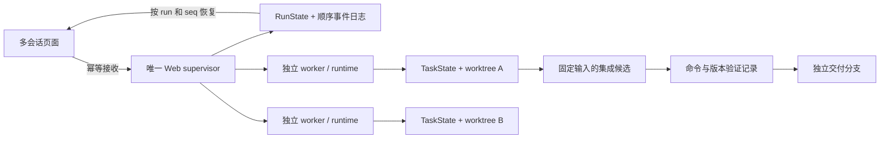

# 多会话执行与 Coding 工作树

当前合同，2026-10-03。对应[实施与验收记录](../workplan/2026-10-03-parallel-coding-implementation.md)；早期[调研](../workplan/2026-10-03-parallel-coding-worktrees-research.md)中的多机调度、自动合入用户主分支等仍是研究方案。

## 状态与执行归属

| 对象 | 唯一事实来源 | 不承担的职责 |
|---|---|---|
| conversation/session | SessionStore 与当前用户 chat ID | 不随浏览器连接决定执行生命周期 |
| 后台 run | supervisor 写入的 `.runs/<run>/run_state.json` 与 `stream.jsonl` | worker trace/report/index 不决定最终取消、退出和隔离状态 |
| Coding task | 现有 TaskState/task session；绑定 `worktree_binding` | 新一轮 run 不自动变成新 task |
| workspace | WorktreeService 所有权记录、Git identity 与 writer lease | 任意路径字符串不授予受管身份 |
| delivery | 固定 source/target/candidate SHA 与一次验证证据 | run 完成不等于测试通过，测试通过不更新用户主分支 |

`web/agent_service.py` 是唯一 Web 执行器；旧入口通过同一接收和事件接口适配。每个工作进程运行独立 `build_runtime()`，避免共享会话缓存、模型池和取消开关。默认同时运行 2 个 worker，最多另排队 32 个；同用户同 session 只接受一个活动 run。进程文件锁防止两个 supervisor 管理同一个 run 根目录。

`request_id` 在同一用户范围内幂等：同 key 和同输入返回原 run，不同输入返回 409。输入先写入私有 request artifact，接收状态和事件持久化后才返回。活动会话重复启动返回 409，容量满返回 429。事件携带服务器生成的 `run_id`、客户端 chat key 和递增 `seq`；内部子 trace 的 run ID 单独保留为 `source_run_id`。

取消先发信号，再确认 worker/已跟踪后代退出；PID 身份包含启动时间并通过 pidfd 发信号。异常退出、清理无法确认、重启时发现未终结状态均不会自动重放请求。相关 session/workspace 隔离，保留证据。这个版本没有自动解除隔离的管理按钮；需人工确认无残留写入者并审查现场，不能通过删除锁文件或租约超时假设退出完成。

## Web 与接口

页面的选中会话只控制视图。运行控制器常驻应用层，以 run 保存连接、游标、输出和状态；草稿、附件和会话消息缓存按 session 隔离。切换会话、切换页面、断网和整页刷新都不发送取消请求。重新加载从服务端查询活动 run 并重放事件；用户点击停止时发送精确 run ID。

同页网络不确定的提交保留原 request ID 供重试；整页刷新不保留尚未确认的客户端 request ID，也不保留未发送的 File 附件，因此不承诺跨刷新恰好一次提交。Runs 诊断页面识别 queued/running/cancelling 并轮询；后台聊天的最终状态以 `/api/chat/runs` 为准。

| 请求 | 合同 |
|---|---|
| `POST /api/chat/runs` | `{session_id, message, request_id, ...}`；202 与 run DTO |
| `GET /api/chat/runs?session_id=…` | 当前用户的执行列表 |
| `GET /api/chat/runs/{id}` | 已授权 run 状态；未知/跨用户统一 404 |
| `GET /api/chat/runs/{id}/events?after=N` | NDJSON；只消费 seq > N，断开不取消 |
| `POST /api/chat/runs/{id}/cancel` | 空对象；仅取消该用户该 run |
| `POST /api/chat` | 同一服务的同步适配；支持 request_id，等待超时返回 202 与原 run_id |
| `POST /api/chat/stream` | 同一服务的持久事件流适配，附件由 worker 解析 |
| `POST /api/chat/stop` | 兼容路由现在要求 run_id；仅传 session_id 返回 400，避免迟到停止取消下一轮 |

新接口的浏览器写入要求同源 `application/json`。身份、角色、run ID 和可信默认设置不能由请求正文伪造。新会话标题从首个问题确定性截取，已有标题保留；不再额外调用模型或启动后台标题写入线程。

## 工作区生命周期

Web 新建 Coding task 默认从授权源仓库的已提交 HEAD 创建独立 worktree，包括 Hybrid 首次路由到 Coding。源目录未提交和未跟踪内容保持原状，不会自动复制；界面明确显示这一点。默认路径必须是 Git checkout 根目录。非 Git 项目可显式选原目录模式。

- `new` 创建新 task/worktree，可传已提交 `base_ref`。任务分支为平台生成的 `taleclaw/wt_*`。
- `continue` 复用 task 及工作区，省略 workspace_mode/base_ref/workspace_root。旧 in_place 任务不会自动迁移。
- `branch` 分叉任务状态；worktree 模式从来源任务当前已提交版本创建新目录，要求先保存来源修改。任务状态中的旧工作树绑定不会错误继承到显式 in_place 分支。
- Python/旧调用未声明隔离模式时仍保持原有兼容行为；Web 的默认值由可信 coordinator metadata 注入，只用于新建任务。

repo ID 依据 canonical common Git directory 和设备/inode 标识生成。同一路径更换 Git 元数据、symlink 别名、工作树分支身份变化都会使绑定失效；不承诺随意移动仓库后自动修复。受管根目录必须在源码仓库之外，且由服务用户私有持有。

元数据创建/删除使用短期每仓库锁，任务执行使用每 worktree 单写锁。不同受管工作树可并行推理与文件编辑；原目录模式采用保守全局 writer 锁，也与受管 writer 协调，覆盖父子路径重叠。

## 命令资源与边界

受管 bash 使用每 worktree 独立的 venv、HOME、缓存和临时目录，移除宿主凭据/数据库环境与 Git 路径覆盖项。venv 含 pip，但不会自动复制宿主项目依赖或安装软件；项目测试前需在该环境完成明确的依赖准备。PORT 是分配提示，不是持有 socket 的保证；Compose 项目名按 worktree 区分。

本服务的受管命令共享本地资源 lease，争用返回 `ResourceBusy/not_started`，可稍后重试。进程退出且输出完成、后代清理确认后才释放；未知效果保留标记并隔离。未实施跨机器分布式调度或每任务容器。

这是协作式隔离，不是 OS 安全沙箱：任意 shell 仍可能访问当前服务账号可读写的路径、忽略端口提示、修改共享 Git refs 或主动清除后代标记。需要运行不可信命令时，应另配容器/虚拟机、文件系统与网络边界。平台 Git 管理操作禁用 hooks、外部 diff/textconv，拒绝 external filters、merge drivers 和 fsmonitor，以免管理操作执行仓库自定义程序。

## 集成、验证与回收

管理员且记录所有者可在任务工作区面板按以下顺序交付：

1. 停止任务，点击“保存任务提交”。仅 stage/commit 受管 task 目录，并建立独立保全 ref。
2. 点击“创建集成候选”。固定任务 source SHA 和目标 branch SHA，在另一个 worktree 合并得到 candidate SHA/tree。冲突现场保留；回到任务工作区合入目标分支并解决，再保存与重新准备。
3. 输入明确验证命令。命令经过现有 shell safety/workspace hooks，在候选私有环境执行；记录命令、超时、实际环境、退出码、effect state、输出及 source/target/candidate SHA。退出 0 且候选源码/HEAD 未改变才通过。
4. 点击“生成交付分支”。Git ref 事务再次校验目标 expected SHA，并创建 `refs/heads/taleclaw/deliveries/dl_*`。目标变化使候选失效；不会更新用户检出的分支、index 或工作目录。

`/api/coding/worktrees` 提供管理员 owner-scoped 列表/详情，`/{id}/checkpoint` 与 `/{id}/remove` 接受空对象。`/api/coding/deliveries` 接收 `{worktree_id,target_ref?}` 或查询列表；`/{id}/verify` 接受 `{command,timeout_seconds?}`（1–300 秒），`/{id}/publish` 接受空对象。客户端不能指定发布到任意 branch。

prepare/verify 在 HTTP 处理进程中执行；连接断开不自动撤销已开始操作。进程被强退后，PID 与启动时间不匹配的 preparing/verifying 记录展示 interrupted，保留现场，不自动重放；这不是交付事务的自动恢复。验证结果对应具体环境和命令，不证明未执行的测试或生产环境行为。

回收只允许 ready、clean 且 HEAD 已由独立 ref 保全或仍在原 base 的工作树，不接受客户端 hash 充当保全证明，不使用 `--force`，保留任务 branch。活动、隔离、冲突、脏工作树均不会自动删除。当前通过管理 API 显式回收，无后台 GC 或一键清空功能。

## 部署配置

`WEB_AGENT_MAX_WORKERS=2`、`WEB_AGENT_MAX_PENDING=32` 控制单机容量；增加 worker 会增加每进程 runtime 的内存/连接开销。仅使用一个 Web supervisor 进程，Linux `/proc`、flock 与进程身份能力为当前依赖。

本地 `MANAGED_WORKTREE_ROOT` 留空时使用工作目录相邻的隐藏目录。Compose 将 `./.runs` 和 `./.worktree_data` 持久挂载，受管根默认在 `/var/lib/taleclaw-worktrees/managed`，避免与 `/app` 重叠。源 Git 仓库也必须以稳定容器路径持久挂载并列入 WORKSPACE_ROOTS；镜像内 `/app` 不含 `.git`，不能直接当作默认 worktree 源。源仓库、`.runs` 和受管目录必须一起备份，不能只复制 checkout 目录而丢掉 common Git metadata。

更新代码后需重启 Web 服务以加载新的 supervisor；前端静态资源已随本次构建更新。现有技能热更新合同见 [Web 使用文档](../../web/README.md#技能设置与热更新)，它不等同于热替换 Python 执行器。
