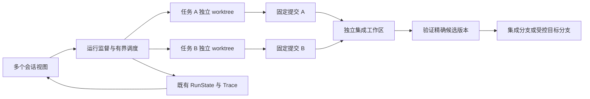

# Coding 多会话并行与 Git worktree 改造调研

调研日期：2026-10-03。本文是针对当前工作区代码的设计提案，**尚未实现多会话调度或 worktree 管理**。三个子 Agent 分别核查执行链、开源实现和隔离边界，并对方案做反向审查；实际实验仅使用自动清理的临时 Git 仓库。

建议采用：**一个可写 Coding task 对应一个受管 worktree，同一 task 的后续对话复用；不同任务有界并行，结果进入独立集成工作区验证。** 同时改造前端流状态与服务端运行生命周期。当前瓶颈包括单活动流、同步执行阻塞事件循环、同一系统用户共用写锁，单独调用 `git worktree add` 无法解决。

需要区分：session 承载交互，run 承载一次执行，task 承载持续的软件任务，worktree 承载可修改的源码。以下“现状”来自源码；“建议”是本项目的设计取舍，不表示参考项目具备全部建议能力。

## 当前代码的能力与缺口

| 层次 | 核查结果 | 判断 |
| --- | --- | --- |
| 会话存储 | 已有多个 session；[useSessions](../../web/frontend/src/hooks/useSessions.ts) 只保留一个 activeId/active | 缺的是后台运行与按会话组织的前端缓存，不是完全没有多会话数据结构 |
| 前端流 | [useChatStream](../../web/frontend/src/hooks/useChatStream.ts) 第 10–19 行只有一组状态和一个 AbortController；再次 send 会 abort 前一个 | 连接、游标和输出应按 run 保存，选中会话只决定展示 |
| 结果归属 | [ChatPage](../../web/frontend/src/pages/ChatPage.tsx) 第 40 行直接更新当前 active；第 213 行 mergeCompletedSession 按消息 seq 合并，没有 session 身份检查 | 若开放 A 运行时切到 B，A 的迟到结果可能污染 B 的当前视图；这是静态路径风险，未冒充浏览器复现 |
| 会话锁 | [server.py](../../web/server.py) 第 428、567 行按用户和 session 分锁 | 适合保留；它不是全局串行的根因 |
| 执行线程 | 请求提交到同一 runtime loop；[turn_coordinator.py](../../applications/turn_coordinator.py) 第 87 行同步调用 _execute，其中模型和工具执行同步 | 多 HTTP 线程不等于多 Agent 并行；路由、预处理也需检查 |
| Coding 写锁 | [workspace_lease.py](../../runtime/workspace_lease.py) 使用固定 coding-writer.lock；[runner.py](../../applications/coding/runner.py) 第 160 行整个 run 持锁，竞争直接报忙 | 不同仓库和 worktree 仍互斥；优点是保守防止父子目录重叠写 |
| 连接生命周期 | [server.py](../../web/server.py) 第 2032、2129–2138 行使用请求内队列，BrokenPipe/ConnectionReset 时取消 session | 难以后台运行与断线恢复 |
| 任务分支 | [TaskSessionFactory.branch](../../applications/coding/session.py) 分叉事件和状态；runner 第 155–158 行要求 continue/branch 保持原 workspace | 当前“分支任务”不是 Git 分支，代码没有隔离 |
| 并行子 Agent | [parallel.py](../../agents/subagent/parallel.py) 第 55 行只接受 explore/plan；子会话继承父 workspace | 已有只读并行，可保留；不能直接把 coding 加入白名单 |
| 工具工作目录 | [workspace.py](../../runtime/workspace.py) 集中解析 session 工作区；[Git 工具](../../tools/handlers.py) 第 1950 行只检查 .git 存在，兼容 linked worktree 的 .git 文件 | 不必再写一套文件、Git 和 Shell 工具 |
| 项目身份 | runner 第 635 行把 git show-toplevel 当 repository ID；[记忆检索](../../memory/episodic_retrieval.py) 用它作为 project fallback | worktree 顶层路径不同，会把同一项目的记忆拆开，需分离 repo 身份与路径 |

现有设计适合个人单任务：同会话有序、Coding 单写、只读探索可并行、工具集中解析路径。改进应把保守约束缩到真正共享的资源上，不能只删锁。取消另有线程安全的直接信号路径，因此不能说事件循环阻塞后“完全无法取消”；发信号和所有写入进程停止则是两件事。[取消实现](../../runtime/cancellation.py)

## Worktree 能解决什么

Linked worktree 的工作文件、HEAD 和 index 各自独立，共享仓库对象与部分 Git 元数据。它隔离正常的目录内编辑，合并仍可能有文本或语义冲突。`git worktree lock` 保护工作树管理信息免于清理，不是文件写入互斥锁。[Git 官方文档](https://git-scm.com/docs/git-worktree)

| 冲突 | Worktree 的作用 | 还需要什么 |
| --- | --- | --- |
| 编辑互相覆盖，暂存区混用 | 独立 checkout/index 可隔离 | 正确的工具绑定和跨目录写入约束 |
| 两边修改同一函数 | 两边可以独立工作 | 冲突解决与重新验证 |
| A 改接口，B 使用旧接口 | 不会自动传播知识或代码 | 依赖版本、接口合同、组合测试 |
| Git refs、配置、管理操作 | 部分状态仍共享 | 平台短锁与精确 ref 更新 |
| 同端口、数据库、可写缓存 | 不提供隔离 | 资源命名空间、配额或容器 |
| 任意 Shell 与后台进程 | 不是操作系统沙箱 | 执行环境与进程生命周期管理 |

不建议第一版改为“每个文件加锁”：软件修改跨文件，formatter、包管理器和任意 Shell 也能写入；只锁编辑工具，既难定义完整事务，又保护不了其他写入路径。

## 开源实现与产品文档

| 对象 | 已核实的机制 | 本项目的借鉴 |
| --- | --- | --- |
| Codex 产品 | worktree 模式、环境准备、本地与工作树 handoff、工作树生命周期管理 | 工作区可见性与恢复流程。这里是产品文档证据，不声称审计过 App 调度器源码。[官方文档](https://learn.chatgpt.com/docs/environments/git-worktrees) |
| Claude Code 产品 | --worktree 独立会话，子 Agent 可配置 isolation: worktree，包含保留与清理规则 | 子任务也应显式绑定基点和工作区，不能推断本项目已有相同 Shell 约束。[Worktrees](https://code.claude.com/docs/en/worktrees)、[Subagents](https://code.claude.com/docs/en/sub-agents) |
| Vibe Kanban 开源实现 | workspace 为仓库创建 worktree/任务分支；同 workspace 的 sessions 共享文件和 Git 状态，切换会话不停止进程 | 最接近多会话产品，但“多个 session”本身不保证多写者隔离。[源码](https://raw.githubusercontent.com/BloopAI/vibe-kanban/main/crates/workspace-manager/src/workspace_manager.rs)、[Sessions 文档](https://www.vibekanban.com/docs/workspaces/sessions) |
| SWE-agent 开源实现 | batch 有界线程池，每实例创建环境对象和输出目录；默认 Docker，实际资源隔离取决于 deployment 配置 | 实例级资源及产物归属；这里是批任务，并非 worktree 交互 UI。[Batch](https://raw.githubusercontent.com/SWE-agent/SWE-agent/main/sweagent/run/run_batch.py)、[环境](https://raw.githubusercontent.com/SWE-agent/SWE-agent/main/sweagent/environment/swe_env.py) |

Vibe Kanban 的创建锁是进程内路径锁，不能直接当多服务实例互斥。Git 实现会拒绝目标已前进的部分直接合并场景，另有 rebase 冲突流程；核查的直接 merge 路径没有统一强制测试门禁。可借鉴其隔离和交互，再补本项目的集成验收合同。[WorktreeManager](https://raw.githubusercontent.com/BloopAI/vibe-kanban/main/crates/worktree-manager/src/worktree_manager.rs)、[GitService](https://raw.githubusercontent.com/BloopAI/vibe-kanban/main/crates/git/src/lib.rs)、[直接合并 API 路由](https://raw.githubusercontent.com/BloopAI/vibe-kanban/main/crates/server/src/routes/workspaces/git.rs)

SWE-agent 曾修复共享 patch hook 在多 worker 下把产物写到错误实例目录的竞争。文件隔离后，共享回调的可变状态仍会串任务；本项目的完成回调、SessionManager、Trace 和产物元数据都需检查。[修复 PR 1366](https://github.com/SWE-agent/SWE-agent/pull/1366)

Anthropic 的 C 编译器工程实验使用共享 bare repository、每个 Agent 独立容器和 clone，以及任务认领与 Git 同步，并非仅用 worktree lock。可借鉴测试反馈和任务认领，不能把工程个案当通用提速证明。[工程博客](https://www.anthropic.com/engineering/building-c-compiler)

源码链接指向可变 main，记录本次访问所见；产品文档也可能更新。未固定 release 的行为不应写成永久兼容合同。

## 论文中的两种路线

**CAID** 的《Effective Strategies for Asynchronous Software Engineering Agents》核查版本为 2026-07-08 的 v2。方法包含依赖图、独立 worktree、自测提交与集中合并，冲突交回原工程师。实验使用 OpenHands 1.11.0；Commit0-Lite 配 4 名工程师，PaperBench Code-Dev 配 2 名；与单 Agent 不是等总成本预算，作者承认成本增加、总体时间未显著下降。它支持明确依赖与集成责任，不能推出多开会话必然更快。[全文](https://arxiv.org/html/2603.21489v2)

**STORM** 的《Multi-agent Collaboration with State Management》核查版本为 2026-05-19 的 v1。它共享目录，写前检查目标文件和已读依赖版本，结合短暂预约与意图注释提前暴露冲突。附录承认 Bash 写可绕过检查，并发命令未协调；文件级检查可能误拒绝独立函数修改。正文与附录对部分评测口径存在不一致，本文不引用其扩展收益数字。[全文及附录 E](https://arxiv.org/html/2605.20563v1)

本项目建议先采用 worktree，再记录源码版本、检测陈旧证据。暂不建设覆盖任意 Shell 副作用的共享目录事务系统。只有写入路径能完整介入、强耦合任务的合并成本经实测过高时，再研究 STORM 类路线。两篇按预印本看待，不将实验分数换算成本项目收益。

## 身份与状态的最小合同

以下是建议，字段名仅用于说明，实施时复用既有类型和存储。

| 对象 | 唯一责任 | 关键数据 |
| --- | --- | --- |
| Repository | 稳定项目身份及授权 | repo_id，common Git directory 校验信息；remote URL 仅是属性 |
| Workspace binding | 可修改源码资源的归属 | worktree_id、规范路径、平台 ownership、分支、创建基点、生命周期 |
| Session | 对话与消息顺序 | session_id、用户、任务引用；切换 UI 不改运行绑定 |
| Coding TaskState | 持续任务语义 | task_id、parent task、需求版本、依赖、workspace 引用 |
| RunState | 一次执行生命周期及所有权 | run_id、session/task、attempt、owner、取消和终态 |
| 验证与集成证据 | 对精确源码版本发生的事实 | 输入提交、候选 SHA、目标旧 SHA、命令、环境、结果、操作身份 |

Workspace 生命周期与 RunState 描述不同对象；不要另增 JobState 和会话 metadata 来竞争解释同一 run。运行结束、验证通过、已集成也不是一个布尔值。`.coding_applications/<task-id>` 继续存任务资料，不兼任源码 checkout。

第一版每个可写 task 一个 worktree，跨多轮 run 复用，同一时刻只有一个 writer。只读 explore/plan 可共享可复现的源码视图，不必每条消息建工作树。通用 Agent 复用多会话调度，无需强制绑定 Git；真正修改仓库时才申请对应工作区。

### 新建继续与分叉

- new：确定源码基点、task ID，先记录创建意图，再创建分支/worktree，核验 Git 身份后发布可运行绑定；路径由服务端生成。
- continue：复用已有 worktree；目录消失进入恢复流程，不退回用户主目录，不自动跟随主分支移动。
- branch：同步完成任务状态与源码分叉，记录明确 fork SHA；修改当前“branch 必须同路径”的合同。继承证据按版本重新判定有效性。
- 交付：固定提交或完整变更快照。继续修改产生新候选，不能覆盖旧候选的“通过”标记。

**当前有大量未提交修改，从 HEAD 建工作树不会包含它们。** 第一版可从明确已提交版本启动，并提示未包含的变化；支持“包含当前修改”时，需独立实现一致性快照，记录 tracked diff 与选定 untracked 文件。不能自动 stash/reset 或批量提交用户目录，也不能顺带复制 .env、依赖和运行数据。源目录持续变化时，核对前后版本，无法得到一致快照则拒绝或重试。

受管源码建议放在用户 checkout 外的服务端专用根，例如 `<managed_root>/<repo_id>/<worktree_id>`，单独注册授权；不要通过放宽任意 workspace_root 授权实现。拒绝路径重叠和符号链接逃逸，核对 common Git directory。repo_id 可由注册时生成稳定 ID 表示；不要使用临时路径或 remote URL 作为唯一身份。已有项目记忆命名空间做显式映射，不模糊合并不同仓库。

## 锁如何拆分

| 保护对象 | 范围与时间 | 规则 |
| --- | --- | --- |
| 会话顺序 | 当前 session 的 turn | 保留同会话有序；第二条排队或遵循明确 steering 协议 |
| 工作区写入 | 同一受管 worktree 的整个写 run，包括模型等待 | 保持推理所观察文件稳定；不同 worktree 不互斥 |
| Git 管理操作 | 同一仓库的创建、回收、相关共享元数据操作 | 短锁，不持锁等待模型或完整测试，不串行所有 git read |
| 目标推进 | 同一 target ref 的校验与最终推进 | 候选可独立验证，推进时重新比较目标版本 |
| 环境资源 | 端口、服务、数据库或可写缓存 | 优先独立分配；有限共享资源用配额或专用锁 |

受管 worktree 身份来自注册和核验，不能对用户传入路径简单取哈希充当锁键。任意外部目录暂保留保守规则，或实现真实重叠检测；父目录、子目录和别名不能各拿不同锁后修改同一棵树。

第一版建议单机唯一 supervisor。本机进程锁保护平台协作者；多实例再引入事务 claim、attempt/generation，拒绝陈旧状态写入。租约过期只能说明失联，**不能阻止旧进程写文件**，必须确认退出或撤销执行环境。平台 advisory lock 也约束不了用户编辑器。

## 后端运行和前端订阅

建议在既有 AgentService 内建立唯一监督入口，使用有并发上限的独立 worker 进程运行同步 Agent；初始可从两个 writer 测量，这是试点值，不是论文最优值。worker 具有独立运行对象，supervisor 负责认领、持久化、事件、取消与回收。

不能只包一层 asyncio.to_thread：SessionManager 可变缓存、loop future、provider/hook、Trace 与插件生命周期均需审计；取消 await 不会停止线程。若线程过渡，先证明共享对象所有权与退出协议。

**复用 RunState，但补持久化合同。** 当前 [TraceStore](../../runtime/trace/trace_store.py) 第 34、146、548 行只有进程内 RLock、固定临时文件名，默认保存元数据，不是跨进程运行队列或完整聊天重放日志。supervisor 应成为同一 run 的唯一持久化写入者，worker 发带 run_id/attempt/event_id 的 IPC 事件；保存输入事件引用和 queued 状态后才确认接收。明确事件提交与 snapshot 重建协议，旧 attempt 不得覆盖新终态。既有 trace 索引保持查询投影，不成为第二个可独立修改的运行权威。

推荐接口形态如下，尚未实现：

| 操作 | 行为 |
| --- | --- |
| POST /api/runs | 持久接收，返回 202/run_id；用户、会话与请求幂等键去重 |
| GET /api/runs/{id} | 查询运行状态及 task/workspace/证据 |
| GET /api/runs/{id}/events?after=cursor | 按 run 授权，顺序游标恢复与去重；可沿用流协议，无需全面换 WebSocket |
| POST /api/runs/{id}/cancel | 幂等取消明确的一次执行；断开订阅不触发取消 |

旧 chat/stream API 迁为同一入口的适配器，不保留第二套执行器。活动状态可恢复；正文继续由既有 session/artifact 承载。若要求未完成输出逐字恢复，应为现有消息片段补 checkpoint，不能默认打开全文敏感 Trace。

前端草稿、附件和乐观消息按 session 保存，连接、输出、cursor 和运行状态按 run 保存。activeSessionId 只决定显示，A 的结果仅更新 A 的缓存；停止绑定 run ID。切换、刷新、断线都不结束后台任务。列表显示排队/运行/停止中/失败，任务区另显示分支、验证与集成结果。

workspace 在新任务时确定，运行绑定不随浏览器全局设置漂移。技能热更新、模型设置应显示生效边界，记录实际使用版本，避免并行结果无法复现。

## 合并验收与依赖任务

以下是建议流程，不是当前已有 merge queue：

1. 写 run 停止且文件一致时，固定任务提交 C 与基点。继续任务产生 C2，也不改变这次集成的输入 C。
2. 记录目标提交 T，在独立集成 worktree 中组合 T 与 C，生成固定候选 M；保存操作身份和输入 SHA 以便恢复。
3. 文本冲突保留为待解决状态，不覆盖目标；无文本冲突仍运行组合测试。
4. 验证绑定 T/C/M、命令、工具链、依赖与环境。测试或 formatter 改了源码，需形成新候选重新验证。
5. 获取目标推进短锁，目标仍等于 T 时才推进精确的 M；目标改变则重建重测。
6. 记录推进结果；Git 成功而记录终态前崩溃时，核对 old/new SHA 和操作身份，不重复 cherry-pick。

Git expected-old 更新支持 ref 比较并交换，但不会同步工作文件或 index。[git-update-ref](https://git-scm.com/docs/git-update-ref) **第一版自动推进只允许平台控制、且未在任何 checkout 中检出的 target ref。** 若目标已被检出，包括平台自己的 worktree，交付测试过的独立集成分支，由明确的接纳流程处理。未来若支持推进受管 checkout，须另订停止全部写入、同步文件/index 和崩溃恢复的合同，仅 target-ref 短锁不够。对用户 checkout，“先检查干净”仍有编辑竞争窗口；不能直接 update-ref 当前分支，更不能自动 reset/stash。

GitHub merge queue 对目标与排队变更的组合执行检查，可借鉴此验证原则，不要求第一版接入 GitHub。[官方说明](https://docs.github.com/en/repositories/configuring-branches-and-merges-in-your-repository/configuring-pull-request-merges/managing-a-merge-queue)

B 依赖 A 时绑定 task_A + commit SHA，不能读取 A 的活动目录。A 更新后显式判断 B 是否重建，不能偷偷刷新 B。第一版显式 depends_on 和接口约定即可；依赖环拒绝或转成集成任务，强耦合改动可顺序执行，不必立即建设自动 DAG 规划器。

## 环境隔离取消与回收

当前 [docker-compose.yml](../../docker-compose.yml) 含固定容器名和主机端口。多 worktree 运行同一份 Compose 不会自然隔离；只改 project name 无法解决固定名称、端口和外部 DB。测试需独立端口、临时目录、数据库/schema 与数据目录。依赖下载缓存可共享，正在安装的可写 .venv/node_modules 不宜相互软链接；worktree 创建不应自动复制账号密钥。

cwd 和路径检查不是操作系统沙箱。[ShellWorkspaceScopeHook](../../tools/hooks.py) 无法约束任意 Python 写入、重定向和 git -C。Git repo 定位环境变量应显式净化，再核对 top-level/git-dir/common-dir，防止 GIT_INDEX_FILE 等指向别处；自动创建还需明确仓库 hook/filter 执行策略。[Git 环境](https://git-scm.com/docs/git)、[hooks](https://git-scm.com/docs/githooks)

取消应是：请求取消 → 停止整个执行进程集合 → 确认后代不再写入 → 保存终态 → 释放所有权。当前 [command.py](../../tools/command.py) 用独立进程组，worker 被杀时 finally 不一定执行；PID 消失或 flock 可获取都不足以证明安全。无法确认后代退出时隔离该 worktree，禁止重入、合并与回收；受 supervisor 管理的容器或系统级进程控制是进一步实现方向。

回收只处理平台登记的工作区。运行中、脏文件、untracked、尚未安全保存的提交、不明进程均应保留。归档、删目录、删分支分别定义；日志、patch 和验证证据放在源码目录外。重启核对持久记录、Git 工作树和进程事实，不明目录待检查，不按过期时间直接强删。

## 与上下文记忆和 KV cache 衔接

共享记忆可保存项目约定，不能让 A 的工作记忆覆盖 B。需求和推理按 task 管理，文件观察和测试证据绑定 repo、源码版本与依赖；分叉继承的是历史材料，不是当前版本正确性保证。

现有 [evidence_validity.py](../../applications/coding/evidence_validity.py) 与 [state_updates.py](../../applications/coding/state_updates.py) 依赖登记的文件观察和显式编辑失效路径，Shell、合并和未观察文件可能超出范围。建议验证绑定实际 candidate tree、命令、工具链及输入；有未提交或相关 untracked 文件时，只记录 HEAD 不够。

上下文布局建议保持规则与工具定义前缀稳定，把 task/worktree 绑定、变更摘要和新事件放到可变后部；执行目录由服务端约束，模型仍获得明确工作区说明。避免逐轮把所有会话状态、临时绝对路径和时间戳改写进 system 前缀。OpenAI 缓存依赖精确前缀匹配，但跨会话命中还依赖有效缓存断点、provider、路由与保留策略；相同文本前缀不一定是可查找的缓存前缀。应按实际模型能力设置共享内容的缓存边界并测量命中，不能承诺 worktree 自然改善 KV cache。[Prompt caching](https://developers.openai.com/api/docs/guides/prompt-caching)

压缩按 task/run 独立推进。向协调者返回提交 SHA、变更摘要、接口、测试证据和未解决项，避免反复拼接所有子会话全文。产物内容去重与来源分开：同 blob 可复用，每次 run/tool call/输入版本的 provenance 必须独立，不能借用第一次去重命中的元数据解释所有后续产物。

## 实施顺序与瘦身边界

| 阶段 | 最小闭环 | 替换的旧机制 |
| --- | --- | --- |
| 一 | 按 run 的后台执行、有界 worker、同会话有序、前端独立状态、明确取消与恢复 | 单 AbortController；断线即取消；请求拥有任务生命周期 |
| 二 | task 绑定 worktree；new/continue/branch 一致；稳定 repo ID；脏源目录合同 | 受管工作区的 OS 用户全局写锁；状态分支混同源码分支；路径充当项目身份 |
| 三 | 固定提交、独立集成验证、版本校验与保守回收 | run 结束被当作已验收；活动分支名代替精确交付版本 |
| 四 | 用真实任务测依赖调度、隔离效果和容量，再扩大并发 | 不预先引入通用分布式平台、共享目录事务或第二套 TaskState/Memory |

一、二可在同一开关下联合交付；隔离和新租约未就绪前不能先删全局锁。开放多 writer 的前置条件还包括独立端口与临时数据、测试数据库权限和命名空间、可写依赖隔离，以及进程退出确认；暂不能隔离的服务测试必须排队。只保留一个执行入口，旧 API 做适配。工作树组件只负责创建、核验、恢复与回收；复用 CodingApplication、上下文引擎和工具，不再堆多个通用 Manager。

主要落点是 AgentService/TurnCoordinator、CodingApplication 生命周期、workspace_lease、RunState/Trace、useChatStream/useSessions/ChatPage。先明确唯一写入者，再决定是否拆类。

## 实施时必须通过的反例

以下是验收要求，**本轮没有对尚未实现的功能运行这些测试**。可用 fake runner、barrier 与临时仓库，不依赖真实模型。

1. 两个 session 同时到达执行 barrier；同 session 第二轮仍有序等待。
2. 不同受管 worktree 可同时写，同工作区互斥；父子目录及别名不能绕锁。
3. A 运行时切 B，A 的输出、完成和错误只属于 A；停止 B 不取消 A。
4. 刷新和断线运行继续；重连不重复消息；重试请求不多建 task/worktree/run。
5. new 的基点正确，continue 路径稳定，branch 文件独立；源目录脏改动不丢失，也不被误称已包含。
6. worker 被杀但延迟写 Shell 未退出时不得重入；旧 attempt 迟到事件不能覆盖新状态。
7. 分支自测都过、组合接口不兼容时集成失败；目标在验证期间变化时旧验证失效。
8. C1 验证期间任务生成 C2，交付不能跟随活动分支误用 C2。
9. 任何 checkout 检出目标时，第一版均不通过 update-ref 自动推进；用户 index 和脏文件不被修改。
10. 创建中断、Git 推进后记录前崩溃、取消与清理中断可恢复；不重复应用 patch、不强删。
11. 端口、DB 和依赖安装互不污染；共享 hook 不串产物。
12. TaskState、RunState、UI 没有同一事实的竞争状态副本；blob 去重不混淆来源。

评估固定模型、任务集和预算，对比单任务与 2/4 并发的最终集成通过率、总模型成本、端到端与排队时间、冲突返工、无效测试、缓存命中和残留进程/目录。不能只报告同时启动多少 Agent。

## 本轮实际验证与变更范围

使用本机 Git 2.43.0，在 /tmp 初始化独立仓库，禁用全局 Git 配置与 hooks，建立 A/B/集成工作树，执行真实编辑、暂存、提交及冲突合并。确认以下行为：

- 新 worktree 不包含源目录脏改动与 untracked；源目录修改完整保留。
- linked .git 是文件，common Git directory 共享；文件和 index 相互独立。
- 同分支重复 checkout 被拒绝；worktree lock 不阻止普通文件写入。
- 两个隔离任务仍可产生真实 merge conflict。
- 直接加载当前 workspace_lease.py，仅将锁目录替换为实验私有目录，确认 A 持锁时独立 B 仍报忙，释放后 B 可进入；未触碰真实锁。
- 临时仓库已清理。

这是 Git 语义和现有 lease 行为验证，不是多会话端到端验收。本轮只新增本报告与文档索引；没有修改业务执行代码、创建用户仓库 worktree、提交代码或启动真实 Agent。既有未提交变更保留。实施前应以届时代码重新核对行号、RunState/Trace 合同和任务分支语义。
